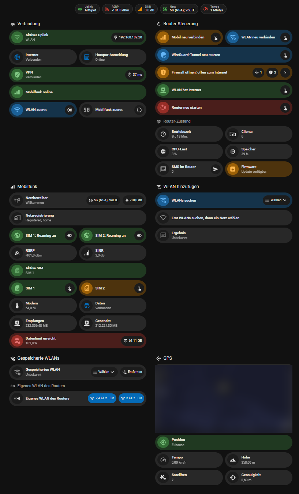
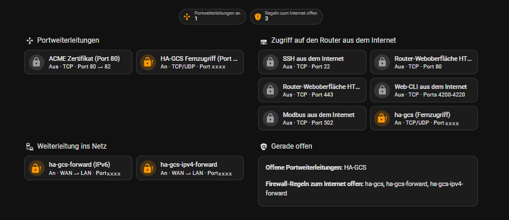
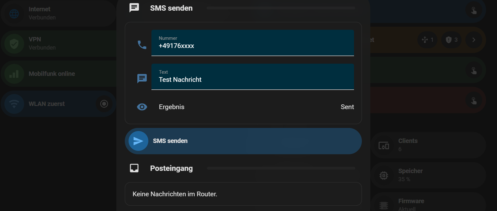
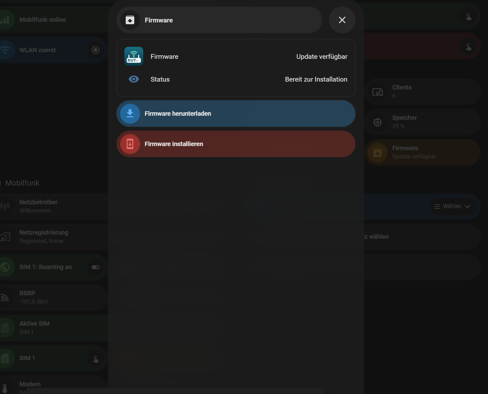

# Teltonika Control

[English](README.md) | **Deutsch**

[](https://github.com/BetaHydri/teltonika-control-ha/actions/workflows/validate.yml)
[](https://hacs.xyz/docs/faq/custom_repositories)
[](LICENSE)

**Steuere deinen Teltonika-Router aus Home Assistant.** Wechsle mit einem Tipp
zwischen WLAN und Mobilfunk, lass dich benachrichtigen, wenn ein
Campingplatz-WLAN eine Anmeldung verlangt, füge WLAN-Netzwerke von einem
Dashboard aus hinzu oder entferne sie, starte einen WireGuard-Tunnel neu, öffne
einen Port nur so lange, wie du ihn brauchst, und behalte dein mobiles
Datenvolumen im Blick. Alles läuft über die lokale REST-API des Routers: keine
Cloud, kein Modbus, kein MQTT und keine Skripte auf dem Router.

Entstanden ist die Integration in einem Wohnmobil. Sie ist überall nützlich, wo
ein Teltonika-Router mit RutOS 7 läuft. Entwickelt wurde sie auf einem RUTC50;
andere RutOS-7-Router nutzen dieselbe API, siehe
[Unterstützte Router](#supported-routers).

[](docs/dashboard.de.md)

Das fertige [Dashboard](docs/dashboard.de.md) (die Karte ist in diesem Bild
unscharf). Es nutzt Bubble Card und Mushroom, nur für das Dashboard.

<a id="why-try-it"></a>

## Darum lohnt sich der Test

- **Uplink mit einem Tipp**: *WLAN zuerst* oder *Mobilfunk zuerst*, mit einem
  automatischen Rückweg auf Mobilfunk, wenn das WLAN kein Internet hat.
- **Campingplatz-WLAN ohne Router-Webseite**: Die Anmeldeseite wird erkannt,
  neue Netzwerke werden vom Dashboard aus gesucht, hinzugefügt und entfernt.
- **Wissen, was offen ist**: Jede Portweiterleitung und jede Firewall-Regel ist
  ein Schalter, und ein [Firewall-Dashboard](docs/firewall-dashboard.de.md)
  zeigt, was gerade zum Internet hin offen ist.
- **Dein Datenvolumen im Griff**: verbrauchte Daten, das Limit deines Vertrags
  in Prozent und eine Warnung von Home Assistant bei dem Prozentwert, den du
  wählst, unabhängig von der SMS-Warnung des Routers.
- **Mobilfunk und VPN auf einen Blick**: Signal, Netzwerktyp, Roaming,
  SIM-Wechsel und ein WireGuard-Tunnel, den du aus einer Automatisierung neu
  starten kannst.
- **Fertige Dashboards**: YAML einfügen, einen Platzhalter ersetzen, fertig.
- **Schonend zu deinem Router**: Es wird nur das eine Feld geschrieben, das
  nötig ist, danach wird es zurückgelesen, und jede Aktion, die eine Verbindung
  unterbricht, muss bestätigt werden.

<a id="quick-start"></a>

## Schnellstart

[](https://my.home-assistant.io/redirect/hacs_repository/?owner=BetaHydri&repository=teltonika-control-ha&category=integration)

1. Füge in HACS `https://github.com/BetaHydri/teltonika-control-ha` als
   **benutzerdefiniertes Repository** hinzu (Typ Integration), installiere
   **Teltonika Control** und starte Home Assistant neu.
2. Gehe zu **Einstellungen, Geräte & Dienste, Integration hinzufügen**, wähle
   **Teltonika Control** und gib Adresse, Benutzer und Passwort des Routers ein.
   Ein eigener Router-Benutzer wird empfohlen, siehe
   [Router-Benutzer und Berechtigungen](#router-user-and-permissions).
3. Optional: Füge das [Beispiel-Dashboard](docs/dashboard.de.md) ein und, wenn
   dein Router Portweiterleitungen oder Verkehrsregeln hat, das
   [Firewall-Dashboard](docs/firewall-dashboard.de.md).

Neu hier? Die [Schritt-für-Schritt-Anleitung](docs/getting-started.de.md)
führt dich vom Router-Benutzer bis zu deiner ersten Dashboard-Karte, und die
[Best Practices](docs/best-practices.de.md) fassen Router-Zugriff,
Firewall-Schalter, Datenlimits und Automatisierungen auf einer Seite zusammen.

Dies ist ein unabhängiges Community-Projekt. Es steht in keiner Verbindung zu
Teltonika Networks und wird von dieser Firma nicht unterstützt. Teltonika, RUT
und RutOS sind Namen ihrer jeweiligen Inhaber und werden hier nur verwendet, um
anzugeben, welche Router unterstützt werden.

<a id="features"></a>

## Funktionen

<a id="major-features"></a>

### Hauptfunktionen

- **Uplink-Steuerung**: Sieh, welcher Uplink den Verkehr trägt, und wechsle mit
  einem Tipp zwischen **WLAN zuerst** und **Mobilfunk zuerst**, mit einem
  automatischen Rückweg auf Mobilfunk, wenn das WLAN kein Internet hat.
- **Hotspot-Anmeldung**: Erkennt die Anmeldeseite eines Campingplatzes oder
  Hotels (auch eine abgelaufene Anmeldung) und wartet, bis du sie bestätigt
  hast, siehe [Hotspots mit Anmeldeseite](#hotspots-with-a-login-page).
- **WLAN-Netzwerke verwalten**: Suche, füge hinzu, verbinde und entferne
  Netzwerke mit Entitäten auf einem Dashboard oder mit Diensten, siehe
  [WLAN-Netzwerke verwalten](#managing-wi-fi-networks).
- **Mobile Daten und SIM**: Modem-Signal und -Status, SIM-Slot, Daten-Roaming
  pro SIM, der Failover-Status des Routers und das Datenvolumen im Vergleich zu
  deinem Vertrag, siehe [Modem](#modem-one-device-per-modem),
  [Mobilfunk-Datenlimit](#mobile-data-limit) und [Failover](#failover).
- **GPS-Tracking**: ein Device Tracker für die Karte sowie Geschwindigkeit,
  Höhe, Satelliten und Genauigkeit, siehe [GPS](#gps).
- **Wer ist im Wohnmobil**: ein Anwesenheits-Tracker für jedes Handy, das du
  auswählst, zuhause, solange es im WLAN des Routers eingebucht ist, für eine
  Person in Home Assistant. Siehe
  [Anwesenheit](#presence-who-is-on-the-wi-fi).
- **Das eigene WLAN des Routers**: ein Schalter für jeden Access Point, der den
  echten Zustand zeigt, auch wenn du ihn in der Router-Weboberfläche änderst.
- **VPN**: ein Sensor **VPN erreichbar** für jeden Site-to-Site-Tunnel sowie
  Status, Schalter und eine Schaltfläche **neu verbinden** für jede
  WireGuard-Instanz und, auf echter Hardware ungetestet, für Tailscale,
  OpenVPN, IPsec und SSTP. Siehe [VPN-Prüfung](#vpn-check),
  [WireGuard-Tunnel](#wireguard-tunnels) und
  [Andere VPN-Typen](#other-vpn-types).
- **Router-Zustand**: Betriebszeit, CPU-Last, Speicherauslastung und die Zahl
  der DHCP-Clients (verbundene Geräte).
- **SMS**: Sende eine SMS vom Dashboard, aus einer Automatisierung oder einem
  Skript, lies den Posteingang und reagiere mit einem Ereignis auf jede neue
  SMS. Siehe [SMS](#sms).
- **Firmware**: eine Update-Entität sowie Schaltflächen, um die Firmware
  herunterzuladen und, wenn du es entscheidest, zu installieren. Siehe
  [Firmware-Update](#firmware-update).
- **Firewall-Steuerung**: ein Schalter für jede Portweiterleitung und jede
  Verkehrsregel und ein eigenes [Firewall-Dashboard](docs/firewall-dashboard.de.md).
  Siehe [Firewall](#firewall).
- **Im Netzwerk gefunden**: Ein Teltonika-Router erscheint unter **Entdeckt**
  und wird über seine MAC-Adressen mit seinen anderen Einträgen in Home
  Assistant verknüpft. Die Einrichtung probiert HTTPS und dann einfaches HTTP.
- **Fertige Dashboards**: siehe [docs/dashboard.de.md](docs/dashboard.de.md)
  und das [Firewall-Dashboard](docs/firewall-dashboard.de.md).

<a id="other-features"></a>

### Weitere Funktionen

- Schaltflächen, um den WLAN-Client neu zu verbinden und den Router neu zu
  starten.
- Eine Internetprüfung, die ein funktionierendes WLAN von einem hinter einer
  Anmeldeseite unterscheidet.
- Die Uhr des Routers als Diagnosesensor, wenn der Router sie meldet.
- Schonende Abfragen für schwache Router: Statusseiten bei jeder Aktualisierung,
  selten ändernde Konfigurationsseiten nur alle paar Minuten, beide Intervalle
  in den Optionen einstellbar. Eine langsame Seite nimmt nie alle Entitäten
  offline.
- Einzelne leere GPS-Messwerte zwischen normalen werden ignoriert.
- Neu anmelden, neu konfigurieren und Optionen in der Benutzeroberfläche.
- Diagnose-Download ohne Passwörter und persönliche Daten, einschließlich der
  Angabe, welche Router-Seiten geantwortet haben und wie sie aufgebaut sind.
- Ausführliches Debug-Logging für den Support, ohne Geheimnisse, siehe
  [Debug-Logging](#debug-logging).
- Englische und deutsche Übersetzungen.

<a id="core-integration-and-teltonika-control"></a>

### Core-Integration und Teltonika Control

Home Assistant bringt eine eigene
[Teltonika-Integration](https://www.home-assistant.io/integrations/teltonika/)
mit (Domain `teltonika`). Sie liest die Modem-Sensoren, wird im Netzwerk
entdeckt und hat keine Steuerelemente. Teltonika Control deckt all das ab
(dieselben Modem-Sensoren, Erkennung über die MAC-Adresse des Routers, HTTPS
und HTTP, erneute Anmeldung) und ergänzt Steuerelemente und die
Wohnmobil-Funktionen: Uplink-Priorität, Hotspot-Anmeldung, WLAN-Verwaltung,
WireGuard, Roaming- und SIM-Steuerung, GPS, Firewall, Datenvolumen, SMS,
Firmware-Informationen und die Dashboards. Du kannst sie also anstelle der
Core-Integration nutzen, ohne etwas zu verlieren.

- Beide lassen sich parallel installieren. Die Domains unterscheiden sich, daher
  kollidieren die Entitäten nicht. Jede fragt den Router für sich ab; bei einem
  schwachen Router nutze nur eine oder erhöhe die Intervalle in den
  [Optionen](#options).
- Wenn du nur die Modem-Signalsensoren brauchst, reicht die Core-Integration.
  Teltonika Control ist ein benutzerdefiniertes HACS-Repository und nicht Teil
  des HACS-Standardspeichers, weil die Core-Integration dieselben Geräte über
  dieselbe API abdeckt.

<a id="supported-routers"></a>

## Unterstützte Router

Entscheidend ist die **RutOS-Version**, nicht der Modellname. Die Integration
prüft das Modell nicht: Die Einrichtung braucht eine Anmeldung und eine Antwort
der Router-Seite `/system/device/status`, sonst nichts. Alles, was sie tut,
läuft über die RutOS-REST-API, und sie liest Modems, WLAN-Radios, Interfaces,
VPN-Instanzen, SIM-Slots, Firewall-Regeln und Failover-Interfaces vom Router,
statt Namen anzunehmen. Jedes Teltonika-Gerät mit RutOS 7 und REST-API sollte
also funktionieren, und die Entitäten richten sich nach der vorhandenen
Hardware.

| Familie | Beispiele | Status |
|---|---|---|
| RUTC | RUTC50 | Auf einem RUTC50 entwickelt und getestet (RutOS 7.24) |
| RUTX | RUTX11, RUTX50, RUTX14 | Gleiche API, noch nicht auf Hardware getestet |
| Andere RutOS-7-Geräte | RUTM (RUTM50, RUTM30), RUT1xx/2xx/9xx (RUT241, RUT951), TRB-Gateways (TRB140, TRB246) | Die veröffentlichte API-Beschreibung von Teltonika (Version 1.17.3 für RutOS 7.25) führt für diese Familien dieselbe API auf. Hier nicht getestet. Die Funktionen für mobile Daten, SIM, GPS, WLAN und WireGuard hängen davon ab, was das Gerät hat. |

Funktionen, die Hardware oder eine RutOS-Funktion brauchen, erscheinen nur, wenn
der Router sie hat, zum Beispiel GPS, eine zweite SIM, WLAN, WireGuard, das
mobile Datenlimit oder Failover. Ein Router ohne eine bestimmte Seite antwortet
darauf mit einem Fehler, und die Integration legt dann diese Entitäten nicht an.
Alles andere funktioniert weiter. Die neueren Seiten (Failover, Datenlimit,
Firewall-Regeln) werden als optional gelesen, und einer älteren RutOS-7-Version
können einige davon fehlen. RutOS 6 (zum Beispiel auf älterer RUT9xx-Firmware)
hat keine REST-API dieser Art und wird nicht unterstützt.

Wenn eine Funktion auf deinem Modell oder deiner RutOS-Version nicht
funktioniert, eröffne bitte ein Issue mit dem [Debug-Log](#debug-logging) und
dem Diagnose-Download. Sie zeigen, welche Seiten dein Router anbietet und wie er
seine Felder benennt, und genau das wird gebraucht, um Unterstützung dafür
hinzuzufügen. Eine Meldung wie „funktioniert auf einem RUTM50“ oder „Seite X
fehlt auf RutOS 7.1x“ hilft genauso wie ein Fehlerbericht, denn die Liste oben
ist nur so gut wie das, was getestet wurde.

<a id="prerequisites"></a>

## Voraussetzungen

Prüfe diese Punkte, bevor du die Integration hinzufügst. Die meisten
Einrichtungsprobleme entstehen auf der Router-Seite: Der Router muss erreichbar
sein, und der Benutzer muss alles tun dürfen, was die Integration tut.

<a id="home-assistant"></a>

### Home Assistant

- Home Assistant 2025.2 oder neuer (entwickelt und getestet mit 2026.10).
- Der Home-Assistant-Host muss den Router über das Netzwerk erreichen, entweder
  im LAN des Routers oder per Routing. Die Integration fragt den Router ab; der
  Router verbindet sich nie mit Home Assistant, und es ist kein Cloud-Konto
  nötig.
- HACS ist optional und nur für die Installation über HACS nötig.

<a id="router"></a>

### Router

- Ein Teltonika-Router mit **RutOS 7** und REST-API (RUTC, RUTX und andere
  RutOS-7-Geräte, siehe [Unterstützte Router](#supported-routers)). Die für
  RUTC50 und RUTX veröffentlichte REST-API-Beschreibung beginnt bei RutOS 7.9,
  und die Integration wurde gegen 7.24 entwickelt. Router mit RutOS 6 werden
  nicht unterstützt.
- Die Router-Weboberfläche muss vom Home-Assistant-Host aus erreichbar sein,
  weil die REST-API von ihr bereitgestellt wird. Sie nutzt standardmäßig HTTPS
  auf Port 443 mit einem selbstsignierten Zertifikat. Wenn Home Assistant nicht
  im LAN des Routers ist, erlaube den Zugriff unter **System, Administration,
  Access Control, General** und in der Firewall.
- Für Uplink-Priorität und Hotspot-Anmeldung muss mindestens ein WLAN-Netzwerk
  als WLAN-Client auf dem Router gespeichert sein. Ohne es ist die
  Prioritätsauswahl nicht verfügbar.

<a id="router-user-and-permissions"></a>

### Router-Benutzer und Berechtigungen

Die Integration meldet sich mit Benutzername und Passwort an und erhält ein
Sitzungs-Token. Das Token gilt so lange wie die Router-Einstellung **API session
timeout** (System, Administration, General; Standard 300 Sekunden) und wird
automatisch erneuert. Alles, was die Integration tut, wird bei jedem Aufruf
gegen die Rechte der Gruppe dieses Benutzers geprüft.

Lege für Home Assistant einen eigenen Benutzer an, statt `admin` zu verwenden:

1. Lege unter **System, Administration, User Settings** eine Gruppe für Home
   Assistant an (oder wähle eine vorhandene) mit den unten aufgeführten Rechten.
2. Lege einen Benutzer in dieser Gruppe an und gib ihm ein starkes, einmaliges
   Passwort.
3. Lass den SSH-Zugriff für diesen Benutzer ausgeschaltet. Die Integration
   braucht ihn nicht.

| Stufe | Rechte | Was funktioniert |
|---|---|---|
| Nur Überwachung | Lesen auf den unten genannten Seiten | Sensoren und Binärsensoren. Schaltflächen, Schalter, Auswahlfelder und Dienste scheitern mit der Fehlermeldung des Routers. |
| Volle Steuerung | Lesen und Schreiben auf den unten genannten Seiten | Alles in diesem Dokument. |
| Administrator | Gruppe `admin` | Funktioniert, gibt Home Assistant aber die volle Kontrolle über den Router. Nicht empfohlen. |

Die Seiten sind die Seiten der Router-Weboberfläche, zu denen die
API-Operationen gehören:

| Verwendet für | Seite der Weboberfläche | Braucht |
|---|---|---|
| Einrichtung, Modell und Firmware | System, Device, Info | Lesen |
| Uplink- und Prioritätsstatus | Network, Interfaces | Lesen |
| Uplink-Priorität, Hotspot-Anmeldemodus | Network, Interfaces | Schreiben |
| WLAN-Client- und Access-Point-Status | Network, Wireless, SSIDs | Lesen |
| Access-Point-Schalter, WLAN neu verbinden, Netzwerke suchen, speichern und entfernen | Network, Wireless, SSIDs | Schreiben |
| Modem-Sensoren | Network, Mobile | Lesen |
| GPS-Position | Services, GPS | Lesen |
| Betriebszeit, CPU-Last, Speicher, Routeruhr | Status, Overview (system usage) | Lesen |
| DHCP-Clients | Status, Network, LAN (DHCP leases) | Lesen |
| WireGuard-Interface-Status und -Zähler | Network, Interfaces | Lesen |
| WireGuard-Schalter und Neuverbinden | Services, VPN, WireGuard | Lesen und Schreiben |
| Tailscale-, OpenVPN-, IPsec-, SSTP-Status, -Schalter und Neuverbinden | Services, VPN, die Seite dieses Typs | Lesen und Schreiben |
| Mobilfunkverbindung neu starten, SIM-Slot | Network, Mobile, Modems | Schreiben |
| Daten-Roaming-Schalter (SIM-Einstellungen) | Network, Mobile, General | Lesen und Schreiben |
| Failover-Status | Network, Failover | Lesen |
| Datenlimit-Verbrauch | Network, Mobile, Data limit | Lesen |
| Heute und diesen Monat verbrauchte Daten | Status, Network, Mobile Traffic | Lesen |
| Portweiterleitungs-Schalter | Network, Firewall, Port forwards | Lesen und Schreiben |
| Verkehrsregel-Schalter | Network, Firewall, Traffic rules | Lesen und Schreiben |
| SMS-Nachrichten (Anzahl und Ereignis bei neuer Nachricht) | Services, Mobile Utilities, SMS Utilities | Lesen |
| SMS senden | Services, Mobile Utilities, SMS Utilities | Schreiben |
| Informationen zum Firmware-Update | System, Firmware | Lesen |
| Firmware herunterladen und installieren | System, Firmware | Schreiben |
| Router neu starten | System, Administration, General | Schreiben |

Die API-Beschreibung von Teltonika nennt nicht für jede Operation den genauen
Berechtigungseintrag. Die Tabelle ordnet Operationen den Seiten der
Weboberfläche zu, wie es die API-Beschreibung tut. Wird eine Aktion abgelehnt,
zeigt Home Assistant die Fehlermeldung des Routers; gib der Gruppe Lese- oder
Schreibrechte auf dieser Seite und versuche es erneut.

Optionale Nur-Lese-Zusätze: Darf der Benutzer eine Seite nicht lesen
(Systemauslastung, DHCP-Leases, die WireGuard-Konfiguration, Failover,
Datenlimits, Portweiterleitungen, Verkehrsregeln, SMS-Nachrichten oder
Firmware-Informationen), antwortet der Router mit einem Fehler, und die
Integration legt diese Entitäten einfach nicht an. Alles andere ist nicht
betroffen. Ein Tunnel, dessen Konfiguration nicht gelesen werden kann, wird
angezeigt (Interface-Status und Zähler), hat aber keinen Schalter und keine
Schaltfläche zum Neuverbinden.

<a id="what-the-integration-changes-on-the-router"></a>

#### Was die Integration auf dem Router ändert

Das zu wissen hilft dir bei der Entscheidung, wie viel du erlauben willst:

- Die Routing-Metrik der WLAN-Client-Interfaces (0 für WLAN zuerst, 10 für
  Mobilfunk zuerst), gefolgt von einem WLAN-Neuverbinden.
- Das Ein/Aus-Flag der eigenen Access Points des Routers.
- Das Ein/Aus-Flag von WireGuard-Instanzen (Schalter und **WireGuard *Name* neu
  verbinden**, was die Instanz aus- und wieder einschaltet).
- Das Ein/Aus-Flag von Tailscale-, OpenVPN-, IPsec- und SSTP-Instanzen
  (Schalter und Neuverbinden, wie bei WireGuard). Es meldet Tailscale nie ab und
  ändert nie Schlüssel, Zertifikate oder Routen.
- Gespeicherte WLAN-Client-Netzwerke (`join_wifi` und `forget_wifi`).
- Neustart der Mobilfunkverbindung, SIM-Slot-Wechsel und Router-Neustart.
- Das Daten-Roaming-Flag jeder SIM („Deny data roaming“, nur dieses Feld).
- Das Ein/Aus-Flag von Portweiterleitungsregeln und von Verkehrsregeln (nur
  dieses Feld; eine eingeschaltete Regel lässt Verkehr aus dem Internet den
  Router oder ein Gerät in deinem Netzwerk erreichen).
- Eine SMS wird nur gesendet, wenn du den Dienst `send_sms` aufrufst oder
  **SMS senden** drückst. Das Lesen der SMS-Nachrichten ändert nichts: Sie
  bleiben auf dem Router.
- Die Firmware: **Firmware herunterladen** lässt den Router das Update
  herunterladen (nichts wird installiert, kein Neustart). **Firmware
  installieren** (aus, bis du es aktivierst) startet die Installation der
  heruntergeladenen Firmware mit beibehaltenen Einstellungen; der Router startet
  neu und ist mehrere Minuten offline.

Es legt nie eine Firewall-Regel an, bearbeitet oder löscht keine, und ändert nie
Passwörter, Benutzer oder andere Firewall-Einstellungen.

<a id="security-notes"></a>

#### Sicherheitshinweise

- Das Passwort wird im Config Entry von Home Assistant gespeichert, wie die
  Zugangsdaten jeder anderen Integration. Diagnose-Downloads schwärzen es.
- RutOS kann eine Adresse nach wiederholten fehlgeschlagenen Anmeldungen
  vorübergehend sperren. Scheitert die Einrichtung nach falschen Passwörtern
  weiter, prüfe **System, Administration, Access Control, Security** und
  entsperre den Home-Assistant-Host.
- Öffne die Router-Weboberfläche nicht nur für Home Assistant zum Internet.
  Erreiche sie über das LAN oder ein VPN.

<a id="installation"></a>

## Installation

**HACS:** Füge das Repository als benutzerdefiniertes Repository hinzu, siehe
Schritt 1 im [Schnellstart](#quick-start). **Manuell:** Kopiere
`custom_components/teltonika_control` in den Ordner `custom_components` deiner
Home-Assistant-Konfiguration und starte neu.

<a id="setup"></a>

## Einrichtung

Die Schritte stehen im [Schnellstart](#quick-start); die
[Schritt-für-Schritt-Anleitung](docs/getting-started.de.md) führt dich vom
Router-Benutzer bis zu deiner ersten Dashboard-Karte. Stelle sicher, dass die
[Voraussetzungen](#prerequisites) erfüllt sind, insbesondere der Router-Benutzer
und seine Berechtigungen. Lass **SSL-Zertifikat prüfen** ausgeschaltet, wenn der
Router sein selbstsigniertes Zertifikat nutzt.

Setze `http://` vor die Adresse, um einfaches HTTP zu verwenden. Ohne diesen
Zusatz probiert die Integration zuerst HTTPS und dann einfaches HTTP, sodass ein
Router, der nur HTTP anbietet, ohne zusätzlichen Schritt funktioniert.

Fragt ein Teltonika-Router in deinem Netzwerk nach einer Adresse, listet Home
Assistant ihn auf der Integrationsseite unter **Entdeckt** auf (erkannt über
seinen MAC-Adressbereich). Wähle **Hinzufügen**, gib die Anmeldedaten deines
Router-Benutzers ein, und du bist fertig. Ein bereits eingerichteter Router wird
nicht erneut angeboten. Ändert sich seine Adresse und antwortet die alte nicht
mehr, wird die neue automatisch übernommen.

Ändern sich Adresse, Benutzer oder Passwort des Routers später, nutze
**Neu konfigurieren** an der Integration. Ein abgelehntes Passwort startet den
Ablauf zur erneuten Anmeldung automatisch.

<a id="what-you-get"></a>

## Was du bekommst

<a id="router-1"></a>

### Router

| Entität | Typ | Hinweise |
|---|---|---|
| Uplink | Sensor | `wifi`, `mobile`, `ethernet` oder `other`: das Interface, das den Verkehr trägt; eines, das der Failover offline meldet, wird übersprungen |
| Uplink-IP-Adresse | Sensor | Diagnose |
| WLAN-Netz, WLAN-Signal, WLAN-Verbindungsgeschwindigkeit, WLAN-Band | Sensoren | Router als WLAN-Client |
| Hotspot-Anmeldung | Sensor | `no_wifi`, `idle`, `waiting`, `login_required`, `online` |
| WLAN verbunden | Binärsensor | Der Router ist ein WLAN-Client, oder ein WLAN-Interface trägt den Uplink |
| Internet | Binärsensor | Ergebnis der Internetprüfung |
| Hotspot-Anmeldung nötig | Binärsensor | Das WLAN ist verbunden, hat aber kein Internet (auch wenn die Anmeldung eines Hotspots abgelaufen ist und der Mobilfunk den Verkehr trägt), siehe [Hotspots mit Anmeldeseite](#hotspots-with-a-login-page) |
| VPN erreichbar | Binärsensor | Nur mit einem Host für die VPN-Prüfung, siehe [VPN-Prüfung](#vpn-check) |
| VPN-Latenz | Sensor | Verbindungszeit zum Host der VPN-Prüfung in ms. Diagnose, nur mit einem Host für die VPN-Prüfung |
| Access Point *Name* | Schalter | Das eigene WLAN des Routers, echter Zustand |
| Uplink-Priorität | Auswahl | WLAN zuerst oder Mobilfunk zuerst |
| WLAN neu verbinden | Schaltfläche | Verbindet alle gespeicherten Netzwerke neu |
| WLANs suchen | Schaltfläche | Sucht mit allen Radios, siehe [WLAN-Netzwerke verwalten](#managing-wi-fi-networks) |
| Gefundene WLANs | Auswahl | Die Netzwerke der letzten Suche, die noch nicht gespeichert sind |
| WLAN-Passwort | Text | Passwort für das nächste Netzwerk; es wird nur eine Maske angezeigt, nie der Text |
| Ausgewähltes WLAN hinzufügen | Schaltfläche | Speichert das gefundene Netzwerk mit dem Passwort |
| Gespeicherte WLANs | Auswahl | Auf dem Router gespeicherte WLAN-Clients und Einträge der Multi-AP-Liste |
| Ausgewähltes WLAN verbinden | Schaltfläche | Lässt den Router das ausgewählte gespeicherte Netzwerk jetzt versuchen (verbindet diesen Client neu; ein Multi-AP-Eintrag wird zuvor an den Anfang der Liste verschoben) |
| Ausgewähltes WLAN entfernen | Schaltfläche | Entfernt das ausgewählte gespeicherte Netzwerk |
| Letzte WLAN-Aktion | Sensor | Zeigt `Scanning for networks ...`, solange eine Suche läuft, danach das Ergebnis der Suche, des Hinzufügens oder Entfernens |
| Routerzeit | Sensor | Die Uhr des Routers. Diagnose, standardmäßig deaktiviert |
| Betriebszeit, CPU-Last, Speicherauslastung | Sensoren | Diagnose. Die Flash-Auslastung ist ebenfalls verfügbar, standardmäßig deaktiviert |
| DHCP-Clients | Sensor | Anzahl der Leases; das Attribut `devices` listet Hostname, IP-Adresse und Interface auf (keine MAC-Adressen) |
| WireGuard *Name* und andere VPN-Instanzen | Binärsensor, Schalter, Schaltfläche, Sensoren | Status, Schalter „aktiviert“, Schaltfläche **neu verbinden** und Verkehrszähler je Instanz, siehe [WireGuard-Tunnel](#wireguard-tunnels) und [Andere VPN-Typen](#other-vpn-types) |
| Router neu starten | Schaltfläche | Füge in deinem Dashboard eine Bestätigung hinzu |
| SMS-Nachrichten, SMS-Nummer, SMS-Text, SMS senden, SMS-Sendeergebnis | Sensoren, Texte, Schaltfläche | Posteingang, SMS schreiben und senden. Nur auf Routern, die die SMS-Seite haben, siehe [SMS](#sms) |
| Firmware | Update | Die installierte Firmware und, wenn der Router eine gefunden hat, die neueste stabile Version. Informiert nur. Nur auf Routern, die Informationen zu Firmware-Updates anbieten |
| Firmware-Status, Firmware herunterladen, Firmware installieren | Sensor, Schaltflächen | Herunterladen und Installation, siehe [Firmware-Update](#firmware-update). **Firmware installieren** ist standardmäßig deaktiviert |
| Failover *Interface* | Sensor | Der Failover-Status eines Uplinks des Routers: `online`, `offline`, `standby`, `starting` oder `notracking`. Attribute: Gesundheits-`score`, `seconds_since_change`, `seconds_online`, `seconds_offline`, `tracking_lost`. Einer je Interface in der Failover-Konfiguration |
| Failover *Interface* online | Binärsensor | An, solange die Failover-Prüfung den Uplink als online meldet |
| Failover Mobilfunk, WLAN, Ethernet online | Binärsensoren | An, solange ein Interface dieser Art online ist. Auf jedem Router gleich benannt, einer je Art, die in der Failover-Konfiguration vorkommt |
| Portweiterleitung *Name* | Schalter | Schaltet eine Portweiterleitungsregel ein oder aus. Attribute: `kind`, `protocol`, `external_port`, `internal_port`. Siehe [Firewall](#firewall) |
| Firewall-Regel *Name* | Schalter | Schaltet eine Verkehrsregel ein oder aus. Attribute: `kind`, `group`, `source_zone`, `destination_zone`, `protocol`, `ports`, `action`. Die eigenen Regeln des Routers (`Allow-...`) werden deaktiviert angelegt. Siehe [Firewall](#firewall) |
| Offene Portweiterleitungen | Sensor | Anzahl der eingeschalteten Portweiterleitungen; das Attribut `rules` listet sie auf |
| Firewall-Regeln zum Internet offen | Sensor | Anzahl der eingeschalteten Verkehrsregeln, die Verkehr von außen hereinlassen; das Attribut `rules` listet sie auf |
| Position | Device Tracker | Nur auf Routern mit GPS, siehe [GPS](#gps) |
| *Gerät* (Router) | Device Tracker | Einer je in den Optionen gewähltem Gerät: zuhause, solange es im WLAN des Routers ist. Siehe [Anwesenheit](#presence-who-is-on-the-wi-fi) |
| GPS-Geschwindigkeit, GPS-Höhe, GPS-Satelliten, GPS-Genauigkeit | Sensoren | Nur auf Routern mit GPS. GPS-Kurs und GPS-Fix-Status sind standardmäßig deaktiviert |

<a id="modem-one-device-per-modem"></a>

### Modem (ein Gerät pro Modem)

Netzbetreiber, Netzwerktyp, Band, RSRP, RSRQ, SINR, Temperatur,
Datenverbindung, SIM-Status, Aktive SIM, empfangene und gesendete Daten
(standardmäßig deaktiviert), ein Sensor **Mobile Daten verbunden**, eine
Schaltfläche **Mobilfunk neu verbinden** und, bei Dual-SIM-Modems, eine Auswahl
**SIM-Slot**. RSSI und Signalqualität sind standardmäßig deaktiviert.

**Empfangene Daten** und **Gesendete Daten** (standardmäßig deaktiviert) sind
die Gesamtwerte des Modems seit Beginn aus Sicht des Routers (sie stammen aus
`rxbytes` und `txbytes` des Modemstatus), kein monatliches Volumen. Für das
Volumen eines Tages oder Monats nutze
[Datenverbrauch heute und im Monat](#mobile-data-limit); für einen eigenen
Monatszähler nutze sie als Quelle eines Utility-Meter-Helfers, siehe
[Schritt 11 der Anleitung](docs/getting-started.de.md#step-11-optional-helpers-for-a-monthly-data-counter).
Der Router meldet einen solchen Zähler hin und wieder für eine einzelne Messung
als 0; der Sensor ignoriert das, bis der niedrigere Wert drei Messungen lang
geblieben ist, sodass es in den Langzeitstatistiken nicht als Zurücksetzen
zählt.

**Netzregistrierung** zeigt den Text des Routers, zum Beispiel
`Registered, home`. Der Binärsensor **Roaming** ist an, solange dieser Text
Roaming nennt, sodass du dich warnen lassen kannst, wenn das Modem dein
Heimnetz verlässt. Beide stammen aus dem Modemstatus, den die Integration
ohnehin liest.

Der Binärsensor **Keine SIM im aktiven Slot** ist an, solange der Router für den
aktiven Slot den SIM-Status `Not inserted` meldet. Ohne SIM werden die
Signalsensoren unbekannt, und das Modem hat keinen Dienst; nutze ihn also, um
den Grund zu sehen. Wenn du den **SIM-Slot** mit der Integration wechselst,
beobachtet sie das Modem bis zu 90 Sekunden lang; enthält der neue Slot keine
SIM, wechselt sie zurück zum vorherigen Slot und meldet einen Fehler. Ist auch
der alte Slot leer (zum Beispiel wenn du nur WLAN oder Ethernet nutzt), wird
nichts zurückgewechselt. Ein Router mit einem SIM-Slot hat keine Auswahl
**SIM-Slot**; der Sensor zeigt trotzdem einen leeren Slot. Ein Slot, den du am
Router selbst wechselst, wird nicht zurückgewechselt, sondern nur vom Sensor
angezeigt.

Die Schalter **Daten-Roaming SIM 1 erlauben** und **SIM 2** zeigen und ändern
die Router-Einstellung **Network, Mobile, General, SIM configuration, Deny data
roaming** jeder SIM. An bedeutet, dass Roaming erlaubt ist (das Gegenteil von
„Deny data roaming“ des Routers). Es wird nur dieses eine Feld geschrieben,
nie die PIN oder der APN, und die Integration liest die Einstellung zurück und
meldet einen Fehler, wenn der Router sie nicht übernommen hat. Das Umschalten
kann dazu führen, dass sich das Modem neu registriert. Innerhalb der EU ist
Roaming meist ohne Aufpreis („Roam like at home“); außerhalb der EU kann es
teuer sein, verbiete es dort also. Das Beispiel-Dashboard fragt nach einer
Bestätigung, bevor es Roaming erlaubt. Die Schalter brauchen das Recht, die
Mobilfunk-Einstellungen zu ändern (siehe die Berechtigungen), und erscheinen nur,
wenn der Router die Seite mit den SIM-Einstellungen beantwortet.

<a id="mobile-data-limit"></a>

### Mobilfunk-Datenlimit

Wenn du am Router für ein Mobilfunk-Interface ein **Data limit** festlegst
(Network, Mobile, Data limit), zählt der Router die verbrauchten Daten und
schaltet die mobilen Daten ab, wenn das Limit erreicht ist. Die Integration
zeigt diesen Zähler an, du brauchst also keinen Helfer und kein eigenes Zählen.
Für jedes Interface mit aktiviertem Limit (benannt nach seinem SIM-Slot, zum
Beispiel **SIM 1**) legt sie an:

| Entität | Typ | Hinweise |
|---|---|---|
| Datenverbrauch *SIM 1* | Sensor | Verbrauchte Daten des aktuellen Zeitraums, in GB |
| Datenlimit *SIM 1* | Sensor | Das am Router gesetzte Limit. Diagnose |
| Datenlimit genutzt *SIM 1* | Sensor | Verbrauchter Anteil des Limits in Prozent |
| Datenlimit Zurücksetzen *SIM 1* | Sensor | Wann der Router den Zähler auf null setzt. Diagnose |
| Datenlimit erreicht *SIM 1* | Binärsensor | An, wenn die verbrauchten Daten das Limit erreichen |

Nutze den Binärsensor oder einen numerischen Status-Trigger auf dem
Prozent-Sensor (zum Beispiel über 80) für deine Benachrichtigungen. Der Router
legt das Limit und den Rücksetztag fest, die Integration liest sie nur. Es
erscheinen keine Entitäten, solange am Router kein Limit aktiviert ist oder der
Benutzer die Seite nicht lesen darf.

Der Router nimmt das Limit in MB entgegen, zählt sie aber als 1024 × 1024 Byte,
während Home Assistant Gigabyte zu 1.000.000.000 Byte anzeigt. Ein Limit von
60000 MB erscheint daher im Sensor **Datenlimit** als 62,9 GB, und der
Prozentwert ist derselbe wie am Router. Vergleiche mit der Weboberfläche des
Routers den Prozentwert, nicht die Gigabyte.

**Wenn das Limit erreicht ist, schaltet der Router die mobilen Daten ab**, es
sei denn, du schaltest in den Limit-Einstellungen **Enable rate limit** ein,
wodurch die Verbindung stattdessen gedrosselt wird. Setze das Limit bei einem
Router, den du über seine mobilen Daten erreichst, zum Beispiel in einem
Wohnmobil, über deinen Tarif oder nutze die Drosselung, sonst sperrst du dich
selbst aus.

**Mobilfunk-Datenvolumen.** Viele Anbieter kappen die Verbindung nicht, wenn das
Monatsvolumen aufgebraucht ist, sondern drosseln sie. Dann ist die Abschaltung
durch den Router schlimmer als das, was der Anbieter tut, und das Limit am
Router ist nur als Zähler nützlich. Stelle **Mobilfunk-Datenvolumen (GB)** in
den Optionen der Integration auf das Volumen deines Vertrags ein (ein Vertrag
mit 60000 MB sind 60 GB). Der Prozentwert, der Sensor **Datenlimit**, der Sensor
**Datenlimit erreicht** und die Dashboard-Pills beziehen sich dann auf deinen
Tarif statt auf das Limit des Routers. Der Router braucht weiter ein
aktiviertes Datenlimit, weil er mitzählt: Setze es hoch, zum Beispiel auf
100000 MB, damit er die mobilen Daten nie abschaltet, und stelle seine
SMS-Warnung auf das Volumen ein, bei dem du gewarnt werden willst. Lass die
Option leer, um das Limit des Routers zu verwenden. Der Tarif rechnet wie die
Anbieter mit 1 GB = 1000 MB, das Limit des Routers mit 1 MB = 1.048.576 Byte;
die beiden unterscheiden sich also um etwa 5 Prozent, wenn du dieselbe Zahl
einträgst. Die Option gilt für jedes Mobilfunk-Interface, das am Router ein
Limit hat; bei zwei SIMs mit verschiedenen Tarifen lass sie leer.

**Warnungen von Home Assistant, unabhängig vom Router.** Ist der Tarif gesetzt,
ist der Prozentwert der Anteil deines Vertrags, sodass du dich an jedem
beliebigen Punkt warnen lassen kannst, zum Beispiel bei 80 und 95 Prozent, ohne
die SMS-Warnung des Routers und ohne Helfer. Siehe die
[fertige Automatisierung](docs/automation-examples.de.md#mobile-data-volume-warning).

**Datenverbrauch heute und im Monat.** Unabhängig vom Limit liefern die
Verkehrsstatistiken des Routers (Status, Network, Mobile Traffic) zwei weitere
Sensoren:

| Entität | Typ | Hinweise |
|---|---|---|
| Datenverbrauch heute | Sensor | Empfangene plus gesendete Daten des Tages. Attribute `received_mb`, `sent_mb` |
| Datenverbrauch Monat | Sensor | Empfangene plus gesendete Daten des Monats. Attribute `received_mb`, `sent_mb` |

Heute beginnt um Mitternacht der Zeitzone des Routers, der Sensor fällt dann auf
null zurück, und Home Assistant beginnt in seinen Statistiken einen neuen
Zeitraum. Der Monat folgt dem eigenen Zeitraum des Routers, der nicht immer am
Ersten des Monats beginnt. Die Sensoren erscheinen, wenn der Router die Seiten
`data_usage` beantwortet.

<a id="failover"></a>

### Failover

Der Router prüft seine Uplinks mit seiner Failover-Funktion (Network,
Failover) und führt für jeden einen Status. Die Integration zeigt ihn für jedes
Interface, das in der Failover-Konfiguration aktiviert ist: ein Sensor
**Failover *Interface*** mit dem eigenen Text des Routers und ein Binärsensor
**Failover *Interface* online**.

Was jedes Interface ist, kommt vom Router: Seine Failover-Konfiguration sagt
`mobile`, `wireless` oder `wired` und gibt dem Interface seinen Namen. Die
Entitäten heißen also „Mobile (mob1s1a1)“ oder „Wi-Fi (wifi4)“, ohne dass du
etwas einstellen musst.

Für Automatisierungen und Dashboards, die auf jedem Router funktionieren sollen,
gibt es je vorhandener Art einen Binärsensor: **Failover Mobilfunk online**,
**Failover WLAN online** und **Failover Ethernet online**. Jeder ist an, solange
ein Interface dieser Art online ist, und listet sie in seinen Attributen auf.
Nutze diese statt der Entitäten je Interface. Der Status kann einer Änderung bis
zu zwei Minuten hinterherhinken, weil die Seite wie die DHCP-Clients gelesen
wird. Ein guter Auslöser für eine Benachrichtigung ist, dass **Failover
Mobilfunk online** für ein paar Minuten ausgeht.

Der Router entscheidet „online“, indem er seine Prüfadressen durch das
Interface anpingt. Ein Interface, das funktioniert, aber nicht genutzt wird,
wird als `standby` gemeldet (der Router hält es als Reserve bereit); die
Integration zählt es als online. Ein WLAN-Netzwerk, das auf diese Pings nicht
antwortet (manche Hotspots tun das nicht), zeigt `offline`, obwohl es verbunden
ist, und der Router schickt den Verkehr dann über den Mobilfunk. Der Sensor
**Uplink** folgt dem: Er zeigt das Interface, das den Verkehr wirklich trägt,
und sein Attribut `failover_skipped` nennt das übergangene WLAN. Sind alle
Interfaces offline, entscheidet die Priorität des Routers. Eine langsame
Verbindung bei verbundenem WLAN kann also bedeuten, dass du im Mobilfunk bist;
prüfe den Sensor **Uplink** und lege unter Network, Failover eine Prüfadresse
fest, die der Hotspot beantwortet (zum Beispiel sein Gateway). **Failover WLAN
online** ist das Prüfergebnis des Routers, kein Beweis dafür, dass das WLAN kein
Internet hat. Nutze **WLAN verbunden** und **Internet** für den Zustand des
WLANs selbst.

<a id="firewall"></a>

### Firewall

Die Firewall des Routers hat Portweiterleitungen und Verkehrsregeln. Die
Integration macht jede Regel zu einem Schalter, sodass du einen Port nur so
lange öffnen kannst, wie du ihn brauchst, vom Dashboard, einem Skript oder einer
Automatisierung aus. Sie schreibt nur das Ein/Aus-Flag einer Regel, liest es
zurück und zeigt einen Fehler, wenn der Router es nicht übernommen hat. Sie
legt nie eine Regel an, bearbeitet oder löscht keine.

**Portweiterleitungen** (Network, Firewall, Port forwards) werden zu den
Schaltern **Portweiterleitung *Name*** (der Regelname oder seine ID, wenn sie
keinen hat), mit Protokoll und Ports als Attributen.

**Verkehrsregeln** (Network, Firewall, Traffic rules) werden zu den Schaltern
**Firewall-Regel *Name***. Die Integration sortiert sie mit dem Attribut
`group`:

| `group` | Regel | Angelegt |
|---|---|---|
| `access` | Lässt das Internet den Router selbst erreichen, etwa `Enable_SSH_WAN`, `Enable_HTTP_WAN`, `Enable_HTTPS_WAN`, `Enable_CLI_WAN`, `Enable_MODBUSD_WAN` und Regeln, die du selbst angelegt hast | Aktiviert |
| `forward` | Lässt das Internet Geräte hinter dem Router erreichen | Aktiviert |
| `system` | Die eigenen Regeln des Routers, benannt `Allow-...` (DHCP, Ping, WireGuard, IPsec) | **Deaktiviert** |
| `other` | Regeln, die Verkehr blockieren oder nur innerhalb deines Netzwerks gelten | Aktiviert |

Die eigenen Regeln des Routers werden deaktiviert angelegt, weil das
versehentliche Ausschalten einer Regel eine Verbindung kappen kann. Aktiviere
die, die du willst, unter **Einstellungen, Geräte & Dienste, Teltonika Control,
Entitäten**.

Zwei Zähler, **Offene Portweiterleitungen** und **Firewall-Regeln zum Internet
offen**, sagen dir, wie viel offen ist, und listen die Namen im Attribut
`rules` auf. Nutze sie für eine Warnung, wenn etwas offen bleibt, siehe das
[Automatisierungsbeispiel](docs/firewall-dashboard.de.md#automation-warn-when-a-port-stays-open).

Eine eingeschaltete Regel lässt Verkehr aus dem Internet den Router oder ein
Gerät in deinem Netzwerk erreichen. Lass Regeln aus, die du nicht brauchst, und
setze diese Schalter nicht auf ein Dashboard, das Gäste nutzen können. **Die
Regel, die deinen eigenen Fernzugriff trägt, steht ebenfalls in der Liste. Sie
auszuschalten sperrt dich aus, bis du den Router auf anderem Weg erreichen
kannst.**

Ein eigenes [Firewall-Dashboard](docs/firewall-dashboard.de.md) zeigt die Regeln
deines Routers für sich, getrennt vom Haupt-Dashboard, das nur eine Pill
**Open firewall** hat, die darauf verlinkt.

[](docs/firewall-dashboard.de.md)

Das Firewall-Dashboard (sensible Portnummern sind in diesem Bild verborgen).
Siehe [docs/firewall-dashboard.de.md](docs/firewall-dashboard.de.md).

<a id="gps"></a>

## GPS

Router mit GPS-Empfänger melden ihre Position über die REST-API. Die Integration
liest sie bei jeder Aktualisierung und legt, nur auf Routern, die die
GPS-Anfrage beantworten, an:

- **Position**, ein Device Tracker, der den Router auf der Home-Assistant-Karte
  zeigt, mit der Genauigkeit in Metern. Ohne Fix behält er die letzte Position,
  die einen hatte (auch über einen Neustart von Home Assistant hinweg); seine
  Attribute `fix` und `last_fix` sagen, ob die Position aktuell ist und wann der
  letzte Fix war.
- **GPS-Empfang**, ein Binärsensor, der an ist, solange der Empfänger einen Fix
  hat, mit den genutzten Satelliten und dem Zeitpunkt des letzten Fix als
  Attributen. Nutze ihn für eine Benachrichtigung, wenn die Position nicht mehr
  aktuell ist.
- **GPS-Geschwindigkeit** (km/h), **GPS-Höhe** (m), **GPS-Satelliten** und
  **GPS-Genauigkeit**.
- **GPS-Kurs** und **GPS-Fix-Status**, standardmäßig deaktiviert.

Geschwindigkeit, Höhe und Genauigkeit werden gerundet, damit ein geparktes
Wohnmobil oder Boot nicht bei jeder Aktualisierung GPS-Rauschen in den Verlauf
schreibt. Der Empfänger eines RUTC50 meldet hin und wieder einen einzelnen
leeren Messwert (0 Satelliten, Genauigkeit 500 m) zwischen normalen mit 5 bis 9
Satelliten. Bis zu drei solche Messwerte in Folge werden ignoriert, und die
letzten guten Werte bleiben, sodass Sensoren und Zonen-Automatisierungen nicht
springen; ein längerer Verlust des Fix zeigt sich als 0 Satelliten und
**GPS-Empfang**, der ausgeht. Solange der Router keinen Fix hat, meldet er
Nullen: Geschwindigkeit, Höhe und Genauigkeit sind dann `unknown`,
**GPS-Satelliten** zeigt 0, und die Position bleibt bei der zuletzt bekannten.
Ein Router, der seit der Einrichtung der Integration nie einen Fix hatte, hat
keine Position. Bleibt das Signal aus, sieht der Empfänger keine Satelliten: Er
braucht freie Sicht zum Himmel, eine angeschlossene GPS-Antenne, und GPS muss im
Router eingeschaltet sein.

Darf der Benutzer der Integration die GPS-Daten nicht lesen, erscheinen die
GPS-Entitäten nicht. Gib ihm Lesezugriff auf die GPS-Seite, siehe die
[Berechtigungen](#router-user-and-permissions).

<a id="presence-who-is-on-the-wi-fi"></a>

## Anwesenheit: wer ist im WLAN

Ein Handy, das mit dem eigenen WLAN des Routers verbunden ist, ist im
Wohnmobil. Das ist zuverlässiger als GPS: Es funktioniert ohne Position, ohne
Mobilfunknetz und ohne dass der Akkusparmodus des Handys entscheidet, wann es
meldet.

Der Router weiß, welche Geräte mit seinen Access Points verbunden sind. Wähle die
Geräte, die du möchtest, in den Optionen aus (**Geräte für die Anwesenheit**).
Für jedes legt die Integration einen Device Tracker an, benannt nach dem Gerät,
zum Beispiel `laptop (router)`. Er ist `home`, solange das Gerät mit dem WLAN des
Routers verbunden ist, und `not_home`, wenn nicht.

Um ihn für Personen zu nutzen, öffne **Einstellungen**, **Personen**, wähle die
Person und füge den Tracker unter **Geräte verfolgen** hinzu. Home Assistant
kombiniert die Tracker einer Person: Ein Tracker, der von einem Router kommt,
hat Vorrang vor dem GPS des Handys, sodass die Person `home` ist, sobald das
Handy im WLAN ist. In einem Home Assistant, der im Wohnmobil läuft, bedeutet
`home` im Wohnmobil.

1. Verbinde das Handy mit dem WLAN des Routers.
2. Öffne die Optionen der Integration (**Einstellungen**, **Geräte & Dienste**,
   **Teltonika Control**, **Konfigurieren**). **Geräte für die Anwesenheit**
   listet die Geräte, die der Router mit Namen und MAC-Adresse kennt. Ein `●`
   markiert die, die gerade im WLAN sind. Wähle die Handys. Eine MAC-Adresse
   kann auch eingetippt werden.
3. Füge jeden neuen Tracker einer Person hinzu.

Gut zu wissen:

- **Anwesenheit: Minuten bis „weg“** (Standard 1) ist die Zeit, die ein Gerät im
  WLAN fehlen darf, bevor es als weg gilt. Handys im Standby verschwinden kurz
  aus dem WLAN, sehr kurze Werte können den Tracker daher flattern lassen. Setze
  0 für keine Verzögerung.
- **Anwesenheit: Sekunden Stille bis „weg“** (Standard 0, aus) ist für Handys,
  die gehen, ohne sich abzumelden. Der Router behält so ein Handy in seiner
  Liste, bis sein Limit für die Inaktivität der Station abläuft, oft 5 Minuten,
  sodass der Tracker so lange `home` bleibt. Mit einem Wert hier gilt ein Gerät,
  das länger nichts gesendet hat, sofort als weg (die Verzögerung oben gilt
  weiter). Ein Handy im Standby kann lange still sein, selbst wenn es im
  Wohnmobil ist, geh also nicht unter 120 Sekunden. Beobachte das Attribut
  `inactive_seconds` des Trackers, um zu sehen, wie still deine Handys werden;
  die Debug-Zeile `Presence: ... idle_seconds=[...]` zeigt dasselbe. Der andere
  Weg ist der Router selbst: Verringere **Station inactivity limit**
  (`max_inactivity`) des Access Points in der Weboberfläche des Routers.
- Eine Person, die nur wegen eines Router-Trackers `home` ist, hat die
  Koordinaten der Zone Zuhause, nicht die des Handys. Automatisierungen, die den
  Abstand von einer Person zum Fahrzeug messen, sehen dann die alte Position.
  Nutze in solchen Automatisierungen die Router-Tracker direkt, siehe
  [Alarm per SMS](docs/automation-examples.de.md#with-the-presence-trackers).
- Handys nutzen je Netzwerk eine private WLAN-Adresse (zufällige MAC). Sie bleibt
  für das WLAN des Routers gleich, ändert sich aber, wenn das Handy das Netzwerk
  vergisst oder die Einstellung umgeschaltet wird. Wähle das Gerät dann erneut
  aus. Die private Adresse für dieses Netzwerk auszuschalten vermeidet das.
- Nur Geräte an den eigenen Access Points des Routers zählen. Ein Handy im
  Mobilfunk oder in einem Campingplatz-WLAN ist weg, und ein Gerät am Kabel wird
  nicht gefunden.
- Der Tracker ist nicht verfügbar, solange der Router den WLAN-Status nicht
  beantwortet hat.
- Die MAC-Adressen werden nicht in das Debug-Log geschrieben, und die Diagnose
  verbirgt sie. Die Tracker zeigen sie als Attribute, wie Home Assistant es bei
  jedem Router-Tracker tut.
- Die Anwesenheit stammt aus dem WLAN-Status, den die Integration bei jeder
  Aktualisierung liest, sie verursacht also keine zusätzliche Last auf dem
  Router.

Attribute eines Trackers: `ip`, `host_name` und `mac` (aus der Lease-Liste des
Routers), `wifi_network`, `wifi_band`, `signal` (dBm) und `inactive_seconds`
während der Verbindung. `inactive_seconds` ist die Zeit, seit der der Router
nichts mehr vom Gerät gehört hat, der Wert, mit dem **Anwesenheit: Sekunden
Stille bis „weg“** verglichen wird; beobachte ihn, um diesen Wert zu wählen.
`signal` und `inactive_seconds` werden nicht im Verlauf gespeichert. Ein
Tracker, den du aus den Optionen nimmst, wird aus Home Assistant entfernt.

<a id="hotspots-with-a-login-page"></a>

## Hotspots mit Anmeldeseite

Manche kostenlosen WLAN-Netzwerke brauchen einen Klick auf einer Startseite. Der
Router kann das nicht selbst tun, aber die Anmeldung gilt danach für den
gesamten Router, weil der Hotspot nur den Router sieht.

1. Rufe den Dienst `teltonika_control.portal_mode` auf (oder drücke deine
   Dashboard-Schaltfläche dafür). WLAN bekommt Priorität, und die Integration
   wartet.
2. Öffne auf einem mit dem Router verbundenen Handy `http://neverssl.com` und
   akzeptiere die Hotspot-Seite.
3. Sobald die Internetprüfung besteht, bleibt der Router im WLAN, und das
   Ereignis `teltonika_control_portal_result` wird mit `success: true`
   ausgelöst. Ohne Internet nach der Wartezeit geht der Router zurück auf
   Mobilfunk, und das Ereignis hat `success: false`.

Der Sensor **Hotspot-Anmeldung** zeigt `login_required`, solange das WLAN
verbunden ist, aber kein Internet hat. Er erkennt das auf zwei Wegen: Das WLAN
ist der Uplink und die Internetprüfung schlägt fehl, oder der Failover des
Routers meldet jedes WLAN-Interface als offline. Der zweite Weg erfasst einen
Hotspot, dessen Anmeldung abläuft (viele erneuern sie alle 24 Stunden): Der
Router schickt den Verkehr dann über den Mobilfunk, die Internetprüfung von Home
Assistant besteht weiterhin, aber die Failover-Prüfung durch das WLAN
schlägt fehl. Ein Hotspot, der die Failover-Pings nie beantwortet, zeigt
dauerhaft `login_required`; siehe [Failover](#failover) für die Prüfadresse.

Um eine Benachrichtigung zu bekommen, wenn eine Anmeldung nötig ist oder das
WLAN verloren geht, nutze die
[fertigen Automatisierungen](docs/automation-examples.de.md#hotspot-needs-a-login).

<a id="managing-wi-fi-networks"></a>

## WLAN-Netzwerke verwalten

Alles, was zum Hinzufügen eines Netzwerks nötig ist, ist eine Entität des
Router-Geräts, ein Dashboard braucht also keine Helfer oder Skripte:

1. **WLANs suchen** (Schaltfläche) sucht mit allen Radios. Die Suche dauert ein
   paar Sekunden; **Letzte WLAN-Aktion** zeigt sofort `Scanning for networks ...`
   und danach das Ergebnis. Drückst du die Schaltfläche erneut, während eine
   Suche läuft, passiert nichts.
2. **Gefundene WLANs** (Auswahl) listet jedes Netzwerk einmal pro Band mit seinem
   besten Signal, zum Beispiel `Camp5 [5 GHz · secured · -60 dBm]`. Netzwerke,
   die im selben Band bereits gespeichert sind, werden ausgeblendet.
3. **WLAN-Passwort** (Text) nimmt das Passwort entgegen. Ein gesichertes
   Netzwerk braucht eines mit mindestens 8 Zeichen; lass es für ein offenes
   Netzwerk leer. Es wird nur im Arbeitsspeicher gehalten, und der Status zeigt
   immer `********`, sodass es nie in den Verlauf gelangt.
4. **Ausgewähltes WLAN hinzufügen** (Schaltfläche) speichert es. Ohne Passwort
   für ein gesichertes Netzwerk zeigt Home Assistant „Enter the Wi-Fi password
   (at least 8 characters) first“. Mobilfunk bleibt bevorzugt.
5. **Letzte WLAN-Aktion** (Sensor) zeigt, was gerade passiert, und das Ergebnis,
   zum Beispiel `Scanning for networks ...`, `Saved Camp5` oder
   `Scan failed: ...`.

Um dich von Hand mit einem gespeicherten Netzwerk zu verbinden, zum Beispiel
nach der Ankunft auf einem Campingplatz, wähle es unter **Gespeicherte WLANs**
und drücke **Ausgewähltes WLAN verbinden**. Ein WLAN-Client wird neu verbunden.
Ein Eintrag der Multi-AP-Liste wird an den Anfang der Liste verschoben (der
Router probiert die Liste nach Priorität, niedrigste Nummer zuerst), und das
Multi-AP-Radio verbindet neu, sodass der Router nicht zuerst jedes andere
gespeicherte Netzwerk probiert. Die übrigen Einträge behalten darunter ihre
Reihenfolge. Nutze dann den Portal-Modus, um die Anmeldeseite des Hotspots zu
bestätigen, siehe [Hotspots mit Anmeldeseite](#hotspots-with-a-login-page).

Um ein Netzwerk zu entfernen, wähle es unter **Gespeicherte WLANs** und drücke
**Ausgewähltes WLAN entfernen**. Die Liste enthält die WLAN-Client-Netzwerke und
die Einträge der Multi-AP-Liste. Siehe [Multi-AP-Radios](#multi-ap-radios) für
die Regeln, die der Router vorgibt.

Die Entitäten erscheinen auf Routern mit WLAN-Radios. Die Dienste unten tun
dasselbe für Automatisierungen und Skripte.

<a id="vpn-check"></a>

## VPN-Prüfung

Router tragen oft einen Site-to-Site-Tunnel, zum Beispiel WireGuard von einem
Wohnmobil zum Router zuhause. Die RutOS-Weboberfläche zeigt keinen Live-Status
des Tunnels, daher prüft die Integration den Tunnel von außen: Sie verbindet
sich mit einem Gerät hinter dem Tunnel.

1. Gehe zu **Einstellungen**, **Geräte & Dienste**, **Teltonika Control**,
   **Konfigurieren**.
2. Gib den **Host für den VPN-Test** ein: einen DNS-Namen, eine IPv4-Adresse
   oder eine IPv6-Adresse eines Geräts am anderen Ende, zum Beispiel den
   Heimrouter `192.168.178.1`. Ein Port kann folgen, zum Beispiel
   `192.168.178.1:443` oder `[fd00::1]:443`.
3. Stelle den **Port für den VPN-Test** ein (Standard 443) und speichere.

Du bekommst den Binärsensor **VPN erreichbar** und den Sensor **VPN-Latenz**. In
jedem Aktualisierungsintervall öffnet Home Assistant eine TCP-Verbindung zu Host
und Port. Der Tunnel gilt als aktiv, wenn die Verbindung klappt **oder
abgelehnt wird**, weil eine Ablehnung bedeutet, dass das Gerät durch den Tunnel
geantwortet hat. Ein Timeout, ein nicht auflösbarer Name oder „no route“ zählen
als unten. Lass den Host leer, um die Prüfung auszuschalten.

Gute Ziele sind ein Gerät, das am anderen Ende immer an ist, idealerweise eines
mit offenem Web-Port. Nutze eine Adresse im Subnetz des Tunnels, nicht die
öffentliche Adresse des entfernten Routers.

Nutze **nicht** den WireGuard-Endpunkt der Gegenstelle (den öffentlichen Namen
oder die Adresse und den UDP-Port aus den Peer-Einstellungen, zum Beispiel einen
MyFRITZ-Namen mit Port `52377`). WireGuard spricht nur UDP und beantwortet nie
eine TCP-Verbindung, die Prüfung würde also immer „unten“ sagen, und sie würde
ohnehin nicht durch den Tunnel gehen. Nutze stattdessen die LAN-Adresse des
entfernten Routers, zum Beispiel `192.168.178.1` mit Port `80` bei einer
FRITZ!Box.

Hinweise:

- Die Prüfung läuft auf dem Home-Assistant-Host, wie die Internetprüfung. Sie
  ist nur sinnvoll, wenn Home Assistant das entfernte Netzwerk über diesen
  Router erreicht.
- Sie testet den ganzen Weg, nicht nur den WireGuard-Handshake: den Tunnel, die
  Routen und die entfernte Firewall. Eine zu weite oder fehlende Route zeigt sich
  als „nicht erreichbar“.
- Eine Firewall, die den Port stillschweigend verwirft, sieht genauso aus wie ein
  toter Tunnel. Wähle einen Port, den das Gerät beantwortet oder ablehnt.

Um gewarnt zu werden, wenn der Tunnel fünf Minuten lang unten ist, während der
Router online ist, nutze die
[fertige Automatisierung](docs/automation-examples.de.md#vpn-to-home-is-down).

<a id="wireguard-tunnels"></a>

## WireGuard-Tunnel

Die Integration liest die WireGuard-Instanzen des Routers (**Services, VPN,
WireGuard**) und legt für jede Entitäten an, benannt nach der Instanz, zum
Beispiel `RUTC2AVM`:

| Entität | Was sie dir sagt |
|---|---|
| WireGuard *Name* (Binärsensor) | Das Tunnel-Interface ist auf dem Router aktiv. Es beweist nicht, dass die Gegenstelle antwortet, nutze dafür die [VPN-Prüfung](#vpn-check). |
| WireGuard *Name* aktiviert (Schalter) | Die Instanz ist in der Router-Konfiguration eingeschaltet. Ausschalten entfernt das Interface. |
| WireGuard *Name* neu verbinden (Schaltfläche) | Schaltet die Instanz aus, wartet ein paar Sekunden und schaltet sie wieder ein. Das erneuert die Verbindung, zum Beispiel nachdem sich der Uplink geändert hat. |
| WireGuard *Name* empfangen, gesendet (Sensoren) | Verkehrszähler des Tunnel-Interfaces. Diagnose. |

**Neu verbinden** funktioniert bei eingeschalteten Instanzen. Ist der Tunnel
ausgeschaltet, lehnt die Schaltfläche ab und sagt dir, den Schalter zu nutzen.
Schlägt das Wiedereinschalten fehl, sagt das die Fehlermeldung, und der Tunnel
bleibt aus, bis du ihn einschaltest.

Die RutOS-REST-API bietet keinen WireGuard-Peer-Status, die Integration kann
also den Zeitpunkt des letzten Handshakes nicht anzeigen. Das Probe-Tool
antwortet bei den Status-Endpunkten mit `501`. Kombiniere stattdessen den
Interface-Status mit der VPN-Prüfung.

Um den Tunnel automatisch neu zu starten, wenn die VPN-Prüfung weiter
fehlschlägt, nutze die
[fertige Automatisierung](docs/automation-examples.de.md#restart-the-wireguard-tunnel).

<a id="other-vpn-types"></a>

## Andere VPN-Typen

Hat der Router Tailscale-, OpenVPN-, IPsec- oder SSTP-Instanzen (**Services,
VPN**), bekommt jede Instanz dieselben drei Entitäten wie ein WireGuard-Tunnel,
benannt nach dem VPN-Typ, gefolgt vom Instanznamen, wenn der Typ mehrere
Instanzen hat, zum Beispiel `Tailscale` oder `OpenVPN office`:

- *VPN* **verbunden** (Binärsensor): Der Statustext des Routers sagt, dass die
  Instanz verbunden ist. Der Text selbst (zum Beispiel `Running`) und Zähler wie
  Betriebszeit, Verkehr oder Tailscale-Peers sind Attribute.
- *VPN* **aktiviert** (Schalter): Ausschalten trennt die Verbindung, Einschalten
  verbindet.
- *VPN* **neu verbinden** (Schaltfläche): schaltet die Instanz aus und ein,
  abgelehnt, solange die Instanz ausgeschaltet ist.

Diese Typen sind **noch nicht auf echter Hardware erprobt**. Sie folgen der
veröffentlichten API-Beschreibung von Teltonika (1.17.3). Die Formulierung des
Status unterscheidet sich je Typ, daher liest die Integration die Wörter
(„Running“, „Connected“, „Established“ sind aktiv; „Stopped“, „Disconnected“,
„NeedsLogin“ sind unten). Ein Text, den sie nicht kennt, lässt den Sensor
`unknown`. Passiert das auf deinem Router, aktiviere das
[Debug-Logging](#debug-logging) oder führe das Probe-Tool aus und eröffne ein
Issue mit dem Statustext, dann wird die Formulierung ergänzt.

Nicht enthalten: Tailscale-**Abmelden** (es verwirft die Anmeldung, du müsstest
dich also neu authentifizieren), L2TP und PPTP (der Router teilt sie in Client-
und Server-Seiten), ZeroTier und GRE (die API-Beschreibung hat keinen Status
dafür). Die Tailscale-Anmelde-URL, Adressen und Schlüssel werden nie angezeigt.

<a id="sms"></a>

## SMS

Hat der Router eine SMS-Seite, legt die Integration den Sensor
**SMS-Nachrichten** an (wie viele Nachrichten der Router hält), die Entitäten
zum Senden einer SMS vom Dashboard und den Dienst `send_sms`.

**Senden vom Dashboard.** Im [Beispiel-Dashboard](docs/dashboard.de.md) öffnet
die Pill **SMS** dieses Pop-up (die Nummer ist im Bild verborgen):

[](docs/dashboard.de.md)

Vier Entitäten arbeiten zusammen, wie die Felder der WLAN-Verwaltung:

| Entität | Was sie tut |
|---|---|
| SMS-Nummer (Text) | Die Telefonnummer in Ziffern, mit vorangestelltem `+` für die Landesvorwahl. Leerzeichen und Bindestriche werden entfernt. Sie bleibt für die nächste Nachricht erhalten |
| SMS-Text (Text) | Der Text, bis zu 255 Zeichen. Er wird nach erfolgreichem Senden geleert, damit derselbe Text nicht zweimal gesendet wird |
| SMS senden (Schaltfläche) | Sendet den eingegebenen Text. Füge in deinem Dashboard eine Bestätigung hinzu: Das Senden kostet, was eine SMS auf der SIM kostet |
| SMS-Sendeergebnis (Sensor) | `Sent`, `Sent (2 parts)` oder `Not sent: ...` mit dem Grund, zum Beispiel eine fehlende Nummer |

Die Felder leben nur im Arbeitsspeicher: Nach einem Neustart von Home Assistant
sind sie leer. Ihre Zustände werden wie die jeder anderen Entität aufgezeichnet;
wenn du keine Nummern und Texte im Verlauf willst, schließe `text.*_sms_number`
und `text.*_sms_text` im
[Recorder](https://www.home-assistant.io/integrations/recorder/#exclude) aus.
Eine eigene Seite mit denselben Feldern ist
[dashboards/teltonika-sms.yaml](dashboards/teltonika-sms.yaml); füge sie in den
**Raw-Konfigurationseditor** eines neuen Dashboards ein und ersetze `my_router`.
Bei einem Router mit zwei Modems kann das Dashboard keines auswählen: Die
Schaltfläche lehnt ab und sagt, welche Modems online sind. Nutze dort den Dienst
mit `modem`.

**Senden aus einer Automatisierung, einem Skript oder den
Entwicklerwerkzeugen.** Der Dienst `teltonika_control.send_sms` nimmt den Router
als Ziel (jede Entität des Routers) und die Felder `number` und `message`, mit
der Nummer wie oben geschrieben. Bei einem Modem nutzt der Router es; bei zwei
nenne in `modem` das Modem, mit dem gesendet werden soll (zum Beispiel
`2-1.1`). Die Antwort sagt, wie viele SMS der Text gebraucht hat (`sms_used`; ein
langer Text wird als mehrere gesendet). Weder die Nummer noch der Text werden
ins Log geschrieben. Du kannst es ausprobieren, ohne etwas zu schreiben:
**Entwicklerwerkzeuge, Aktionen**, wähle `Teltonika Control: SMS senden`, wähle
eine Entität des Routers als Ziel und fülle die beiden Felder aus.

```yaml
action: teltonika_control.send_sms
target:
  entity_id: sensor.my_router_sms_messages
data:
  number: "+491701234567"
  message: "Das Wohnmobil steht, Datenvolumen bei 95 Prozent."
```

Fertige Automatisierungen: [eine SMS mit festem Text von einer
Dashboard-Schaltfläche senden](docs/automation-examples.de.md#send-an-sms-from-a-button),
[die eingegebene SMS aus einem
Skript senden](docs/automation-examples.de.md#send-the-typed-sms-from-a-script),
[die Position als Google-Maps-Link](docs/automation-examples.de.md#send-the-position-by-sms),
[ein Alarm, wenn sich das Wohnmobil bewegt und niemand dabei ist](docs/automation-examples.de.md#alarm-by-sms-when-the-camper-moves),
[ein täglicher Status](docs/automation-examples.de.md#daily-status-by-sms),
[eine SMS, wenn das Datenvolumen knapp wird](docs/automation-examples.de.md#send-an-sms-when-the-data-volume-runs-low)
und [Befehle per SMS](docs/automation-examples.de.md#commands-by-sms).

**Empfangen.** Der Router behält eingehende Nachrichten. Jede neue löst das
Ereignis `teltonika_control_sms_received` mit den Feldern `sender`, `message`,
`date`, `modem`, `status` und `router` (die Seriennummer) aus. Nutze es als
Automatisierungs-Auslöser, zum Beispiel um die SMS deines Anbieters als
Benachrichtigung weiterzuleiten, siehe die
[Automatisierungsbeispiele](docs/automation-examples.de.md#forward-a-new-sms).
Nachrichten, die schon auf dem Router waren, als Home Assistant startete, werden
nicht gemeldet. Der Router wird alle zwei Minuten gefragt, eine SMS kann also bis
zu so lange brauchen, bis sie erscheint. Die Integration löscht nie
Nachrichten; das macht der Router selbst, wenn sein Speicher voll ist.

**SMS Utilities des Routers.** Der Router kann SMS-Befehle bereits selbst
beantworten: **Services, Mobile Utilities, SMS Utilities** hat Regeln, bei denen
ein Text wie `status`, `iostatus`, `reboot`, `mobileon` oder `mobileoff` den
Router etwas tun lässt und er mit dem Ergebnis antwortet, geschützt durch das
Admin-Passwort des Geräts. Das funktioniert ohne Home Assistant, nutze es also
für das, was der Router kennt. Diese Integration ergänzt, was der Router nicht
kann: SMS, die von Home Assistant geschrieben werden (Alarme, Statusmeldungen,
ein Positionslink) mit Daten jeder Entität, und die Reaktion einer
Automatisierung auf eine empfangene Nachricht. Eine Nachricht, die auf eine Regel
passt, wird vom Router behandelt und kann daher im Posteingang fehlen, den diese
Integration anzeigt. Ob gewöhnliche Texte auf jedem Router und bei jeder
Speichereinstellung (**Services, Mobile Utilities, Messages, Storage**) im
Posteingang ankommen, ist noch nicht bestätigt.

**Den Posteingang lesen.** Der Sensor **SMS-Nachrichten** listet die neuesten 10
Nachrichten, die neueste zuerst, in seinem Attribut `messages` (jeweils mit
`sender`, `date`, `status` und `message`). Das Beispiel-Dashboard zeigt sie im
**Inbox** des SMS-Pop-ups mit einer Markdown-Karte; jede Markdown-Karte oder
jedes Template kann das Attribut lesen:

```yaml
type: markdown
content: |-
  
  **{{ m.sender }}** · {{ m.date }}

  {{ m.message }}

  ---
  
```

Das Attribut ist vom Recorder ausgenommen, sodass die Texte nicht in der
Verlaufsdatenbank landen (und nicht in den Langzeitstatistiken). Sie stehen wie
jedes Attribut im Live-Status von Home Assistant: Jeder, der die Entität sehen
darf, sieht die Nachrichten. Teile keine Screenshots dieser Karte und sei
vorsichtig mit Nachrichten, die Codes enthalten. Ereignisse werden ebenfalls
nicht aufgezeichnet. Absender und Text werden so angezeigt, wie der Router sie
meldet, und das Format von `date` ist das des Routers.

<a id="firmware-update"></a>

## Firmware-Update

Die Entität **Firmware** (Update) sagt dir, wann der Router auf seinem
Update-Server eine neuere stabile Firmware gefunden hat. Sie installiert nichts
und hat absichtlich keine Schaltfläche „Installieren“, damit niemand versehentlich
aus der Update-Liste von Home Assistant einen Router-Neustart auslöst. Zwei
Schaltflächen erledigen die Arbeit, in zwei Schritten. Im
[Beispiel-Dashboard](docs/dashboard.de.md) öffnet die Pill **Firmware** sie als
Pop-up:

[](docs/dashboard.de.md)

| Entität | Was sie tut |
|---|---|
| Firmware herunterladen (Schaltfläche) | Der Router lädt die Firmware von seinem Update-Server herunter. Es wird nichts installiert, und der Router startet nicht neu. Nur verfügbar, solange eine neuere Firmware existiert |
| Firmware-Status (Sensor) | Wie weit das Update ist: `up_to_date`, `update_available`, `downloading` (das Attribut `percent` zeigt den Fortschritt, bei jeder Aktualisierung gelesen, solange ein Download läuft), `ready`, `installing` oder `failed`. Er zeigt auch `installed_version` und `latest_version` |
| Firmware installieren (Schaltfläche) | Installiert die heruntergeladene Firmware und **behält die Einstellungen**. Nur verfügbar, wenn ein vollständiger Download auf dem Router wartet. **Standardmäßig deaktiviert**: Aktiviere sie unter **Einstellungen, Geräte & Dienste, Entitäten** |

**Was beim Installieren passiert:** Der Router schreibt die Firmware und startet
neu. Er ist mehrere Minuten offline: kein Internet, kein VPN, kein WLAN, kein
GPS, und die Integration zeigt ihre Entitäten als nicht verfügbar an, bis er
zurück ist. Tu das nur mit stabiler Stromversorgung und einer Verbindung, die du
in den nächsten zehn Minuten nicht brauchst, und idealerweise mit jemandem am
Router. Ein Stromausfall während der Installation kann den Router unbrauchbar
machen. Setze in deinem Dashboard eine Bestätigung vor die Schaltfläche (das
Beispiel-Dashboard tut das).

**Hinweise.** Die Fortschrittsseite des Routers sagt nicht, welche Version er
hält, und zeigt weiter das Ergebnis eines alten Downloads. Der Status zeigt
deshalb in den ersten Sekunden nach dem Drücken von **Firmware herunterladen**
`downloading`. Er sagt außerdem weiter „succeeded“ für eine Datei, die der
Router inzwischen gelöscht hat, zum Beispiel weil er nach dem Download neu
gestartet ist. Bevor der Status `ready` sagt, fragt die Integration deshalb den
Router einmal, ob die Datei noch da ist (dieselbe Prüfung, die die
Weboberfläche des Routers nach einem Download ausführt, es wird nichts
installiert). Ist sie weg, bleibt der Status `update_available`: Lade erneut
herunter. Eine fehlgeschlagene Installation mit „Firmware file not found“ tut
dasselbe. Gibt der Router keine klare Antwort, bleibt der Status, wie er ist,
und die Prüfung wird später wiederholt. Hat der Update-Server für deinen Router
keine stabile Version (er meldet die Version `newest`), fragt der Download
stattdessen nach der neuesten Version; der Standard des Routers würde nichts
herunterladen. Die Installation ist vom Autor nicht auf echter Hardware erprobt:
Mach es zuerst an einem Router, den du erreichen kannst. Schlägt etwas fehl,
zeigt Home Assistant die Meldung des Routers. Um nur zuzusehen, lass
**Firmware installieren** deaktiviert und installiere in der Weboberfläche des
Routers.

Eine Automatisierung kann zum Beispiel nachts **Firmware herunterladen**
drücken und dir eine Benachrichtigung senden, wenn
`sensor.my_router_firmware_status` `ready` meldet, siehe die
[Automatisierungsbeispiele](docs/automation-examples.de.md#download-new-firmware-at-night).

<a id="services"></a>

## Dienste

| Dienst | Zweck |
|---|---|
| `portal_mode` | WLAN bevorzugen und auf die Hotspot-Anmeldung warten |
| `set_priority` | WLAN oder Mobilfunk zuerst, optional zurückgesetzt, wenn kein Internet da ist |
| `scan_wifi` | Gibt Netzwerke in der Nähe zurück (Antwortdaten) |
| `join_wifi` | Speichert ein Netzwerk als WLAN-Client oder, bei einem Multi-AP-Radio, in der Multi-AP-Liste; Mobilfunk bleibt bevorzugt |
| `forget_wifi` | Entfernt ein gespeichertes Client-Netzwerk (`station_id`) oder einen Eintrag der Multi-AP-Liste (`ssid`) |
| `send_sms` | Sendet eine SMS über ein Modem des Routers (Antwortdaten: wie viele SMS-Teile sie belegt hat), siehe [SMS](#sms) |

Jeder Dienst nimmt den Router als Dienstziel: Wähle eine beliebige Entität des
Routers, auch eine Modem-Entität. Ein Router-Gerät als Ziel und `device_id` in
den Dienstdaten funktionieren weiterhin.

<a id="multi-ap-radios"></a>

### Multi-AP-Radios

Auf manchen Routern läuft das 5-GHz-Radio als Multi AP (beim RUTC50 ist das so).
Der Router akzeptiert dort keinen normalen WLAN-Client, deshalb fügt `join_wifi`
für dieses Radio das Netzwerk der Multi-AP-Liste hinzu oder ändert sein
Passwort, wenn die SSID bereits aufgeführt ist. Welches Radio das Multi-AP-Radio
ist, wird vom Router gelesen, sodass das umgekehrte Layout (Multi AP auf 2,4 GHz,
ein normaler Client auf 5 GHz) genauso funktioniert. Ein Router hat eine
Multi-AP-Liste, getrennt von den gespeicherten WLAN-Client-Netzwerken;
**Gespeicherte WLANs** zeigt beide, mit dem Band beschriftet, zum Beispiel
`Home (5 GHz, Multi AP)`. Der Router erlaubt pro Radio nur einen Client oder ein
Multi AP; `join_wifi` sagt dir, wenn ein Radio belegt ist. `forget_wifi`
entfernt Multi-AP-Einträge per `ssid`. Der letzte Eintrag der Liste kann nicht
entfernt werden: Eine leere Liste lässt den Router-Dienst alle paar Sekunden neu
starten. Entferne ihn in der Weboberfläche des Routers, wenn du wirklich eine
leere Liste willst.

Wird ein Client-Netzwerk entfernt, wird auch sein Netzwerk-Interface entfernt,
es sei denn, es ist eines der Standard-Interfaces des Routers (`lan`, `wan*`,
`mob*`, `vpn*`).

<a id="automation-examples"></a>

## Automatisierungsbeispiele

Sofort einfügbare Automatisierungen sind auf einer Seite gesammelt:
[Automatisierungsbeispiele](docs/automation-examples.de.md). Sie deckt
Benachrichtigungen, VPN- und WireGuard-Wiederherstellung, den Rückweg auf
Mobilfunk, SMS, Firmware und die Wohnmobil-Zone zuhause ab. Dienste nehmen jede
Entität des Routers als Ziel.

<a id="options"></a>

## Optionen

- **Aktualisierungsintervall (Sekunden)**: wie oft der Status des Routers
  abgefragt wird (Uplink, WLAN-Signal, Modem, GPS, Last): 10 bis 600 Sekunden,
  Standard 30.
- **Konfigurationsintervall (Sekunden)**: wie oft Seiten, die sich selten
  ändern (WLAN-Konfiguration, Radios, WireGuard-Instanzen), erneut gelesen
  werden: 30 bis 3600 Sekunden, Standard 300. Aktionen der Integration lesen sie
  sofort neu. Die DHCP-Client-Liste wird höchstens alle zwei Minuten gelesen.
- **URL für den Internettest**: muss bei funktionierendem Internet HTTP 204
  liefern. Leer lassen, um die Prüfung auszuschalten.
- **Host für den VPN-Test** und **Port für den VPN-Test**: optional, siehe
  [VPN-Prüfung](#vpn-check).
- **Mobilfunk-Datenvolumen (GB)**: optional, das Volumen deines
  Mobilfunkvertrags pro Monat. Siehe [Mobilfunk-Datenlimit](#mobile-data-limit).
- **Geräte für die Anwesenheit**, **Anwesenheit: Minuten bis „weg“** und
  **Anwesenheit: Sekunden Stille bis „weg“**: optional, die Geräte, die als
  zuhause gemeldet werden, solange sie im WLAN sind. Siehe
  [Anwesenheit](#presence-who-is-on-the-wi-fi).

Die Integration liest die Seiten nacheinander und hält die Last auf dem Router
niedrig, weil ein RUTC50 eine schwache CPU hat. Fühlt sich der Router trotzdem
langsam an, erhöhe beide Intervalle; der Sensor **CPU-Last** des Router-Geräts
zeigt die Wirkung. Ein Wert, der gemessen wird, während die Integration
abfragt, ist höher als die eigene Anzeige des Routers im Ruhezustand.

Die Internetprüfung läuft auf dem Home-Assistant-Host. Sie ist nur sinnvoll,
wenn Home Assistant das Internet über diesen Router erreicht.

<a id="debug-logging"></a>

## Debug-Logging

Wenn eine Funktion auf deinem Routermodell nicht funktioniert, zeigt das
Debug-Log, warum. Schalte es in Home Assistant unter **Einstellungen**, **Geräte
& Dienste**, **Teltonika Control**, Menü (drei Punkte), **Debug-Protokollierung
aktivieren** ein. Reproduziere das Problem und wähle dann im selben Menü
**Debug-Protokollierung deaktivieren**, um die Datei herunterzuladen. Schritt
für Schritt: [Einstieg-Anleitung](docs/getting-started.de.md#turn-on-debug-logging).

Was das Log enthält:

- **Einen Router-Bericht** beim ersten Update: Modell, Firmware und welche
  Seiten des Routers geantwortet haben, fehlen oder langsam sind, dazu Zahlen
  dessen, was gefunden wurde (Modems, Radios, SIM-Einstellungen, Tunnel und so
  weiter).
- **Eine Zeile pro Anfrage**: Methode, Pfad, HTTP-Status und Dauer, und bei
  Änderungen nur die Namen der gesendeten Felder. Die Struktur jeder Antwort
  (Schlüsselnamen und Werttypen) wird einmal pro Seite geschrieben.
- **Eine Zusammenfassungszeile pro Update**: Uplink, Priorität, WLAN,
  Internetprüfung und Modems.
- **Aktionen**: was umgeschaltet oder gedrückt wurde, und die Fehlermeldung des
  Routers, falls er abgelehnt hat.

Beispiel:

```text
Router report: model=RUTC50 firmware=RUTC_R_00.07.24.8. Pages: {'interface_config': 'ok', ..., 'gps': 'missing (HTTP 404: Not found)', ...}
GET /sim_cards/config -> HTTP 200 in 187 ms
Answer structure of /sim_cards/config: {"list":2,"first":{"deny_roaming":"0","id":"str(9)","modem":"str(5)", ...}}
PUT /sim_cards/config/cfg_sim2 -> HTTP 200 in 311 ms sending fields ['deny_roaming']
Update: uplink=wifi metric=0 wifi_first=True wifi=2.4 GHz -66.0 dBm internet=True portal=online modems_online=1 vpn_reachable=True
```

Nützliche Hinweise beim Lesen:

- `HTTP 404` oder `501` für eine Seite: Dieses Modell oder diese Firmware hat
  die Seite nicht, daher werden die passenden Entitäten nicht angelegt.
- `HTTP 403`: Der Router-Benutzer darf diese Seite nicht lesen oder ändern,
  siehe die [Berechtigungen](#router-user-and-permissions).
- `failed after ... ms: TimeoutError`: Der Router hat nicht rechtzeitig
  geantwortet.
- Ein Feld, das du erwartest, fehlt in einer Zeile `Answer structure`: Der
  Router benennt es anders. Bitte nimm diese Zeile in dein Issue auf.

Was das Log nie enthält: dein Passwort, Sitzungs-Token, PIN, IMSI, IMEI, ICCID,
Seriennummern, WLAN-Namen und -Passwörter, IP- und MAC-Adressen,
GPS-Koordinaten und die Router-Adresse. Werte werden nur für Zahlen, Booleans
und eine kurze Liste harmloser Statustexte angezeigt. Fehlermeldungen von Home
Assistant selbst (zum Beispiel „Cannot reach ...“) können die Router-Adresse
enthalten; sieh die Datei durch, bevor du sie postest. Der
[Diagnose-Download](docs/getting-started.de.md#download-diagnostics) hat
denselben Seitenstatus und dieselben Antwortstrukturen.

<a id="known-limitations"></a>

## Bekannte Einschränkungen

- Die WLAN-Sensoren beschreiben die Verbindung, die den Uplink trägt. Ist der
  Router zweimal mit demselben Netzwerk verbunden (zum Beispiel als
  2,4-GHz-Client und als 5-GHz-Multi-AP-Eintrag), wird die angezeigt, die der
  aktive Uplink ist.
- Der GPS-Kurs steht im Stand auf 0, und seine Werte während der Fahrt sind noch
  nicht bestätigt. Der Fix-Status zeigt den eigenen Code des Routers
  unverändert; seine anderen Werte werden nicht zugeordnet. Bleibt eine Entität
  leer, obwohl der Router einen Fix hat, eröffne ein Issue mit der Diagnose.
- Die Uhr des Routers stammt aus dem Systemauslastungs-Status des Routers, mit
  dem `Date`-Header seiner Antworten als Rückfall. Ohne beides erscheint der
  Sensor **Routerzeit** nicht.
- Das Wechseln der SIM unterbricht die mobilen Daten für etwa eine Minute. Hat
  der neue Slot keine SIM, wechselt die Integration von selbst zum vorherigen
  Slot zurück, es sei denn, dieser Slot ist ebenfalls leer; ein Slot mit SIM
  wird nie zurückgewechselt.
- Wenn du den Access Point ausschaltest, über den du verbunden bist, wirst du
  getrennt.
- Antwortet eine Seite des Routers (zum Beispiel der WLAN-Status) nicht
  rechtzeitig, zeigen ihre Entitäten die zuletzt bekannten Werte, und die Seite
  wird nach zwei Minuten erneut abgefragt. Erst wenn die Interface-Liste selbst
  nicht antwortet, werden alle Entitäten nicht verfügbar. Ohne WLAN-Status
  stammen Name und Band des WLAN-Netzwerks aus der Router-Konfiguration; Signal
  und Verbindungsgeschwindigkeit bleiben unbekannt.
- Die VPN-Prüfung ist ein Erreichbarkeitstest vom Home-Assistant-Host aus, kein
  Auslesen des Tunnels. Sie sagt nichts, wenn Home Assistant das entfernte
  Netzwerk auf einem anderen Weg erreicht. Der Router bietet keine
  WireGuard-Handshake-Zeit, die Entitäten haben also keine. Tailscale, OpenVPN,
  IPsec und SSTP sind durch [Andere VPN-Typen](#other-vpn-types) abgedeckt, auf
  echter Hardware nicht erprobt; L2TP, PPTP, ZeroTier und GRE sind nicht
  aufgeführt, nutze dafür die VPN-Prüfung.
- Die Entität **Firmware** erscheint nur, wenn der Router Update-Informationen
  von seinem Update-Server (FOTA) hat, wofür Internetzugang und der im Router
  eingeschaltete Update-Dienst nötig sind. Die Versionen werden anhand ihrer
  Nummern verglichen; benennt der Router sie so, dass sie nicht vergleichbar
  sind, sagt die Entität „aktuell“, statt zu raten.
- Feldnamen in den Antworten zu Modem, WLAN und Interfaces unterscheiden sich
  leicht zwischen RutOS-Versionen. Eröffne ein Issue mit dem Diagnose-Download,
  wenn eine Entität leer bleibt.

<a id="development"></a>

## Entwicklung

Die Tests brauchen Linux, macOS oder WSL, weil Home Assistant selbst nicht
nativ unter Windows läuft.

```bash
python3 -m venv .venv
.venv/bin/python -m pip install -r requirements_test.txt
.venv/bin/python -m pytest
.venv/bin/ruff check .
```

Eine optionale Nur-Lese-Prüfung gegen einen echten Router liegt in
`tools/live_smoke_test.py`. Sie liest Adresse und Anmeldung aus den
Umgebungsvariablen `TELTONIKA_HOST`, `TELTONIKA_USER` und `TELTONIKA_PASSWORD`
und gibt die Feldnamen aus, die der Router zurückgibt.
`tools/probe_endpoints.py` prüft, welche weiteren REST-Endpunkte dein Router
anbietet. Es ist eigenständig (nur `pip install aiohttp`, kein Home Assistant),
nutzt dieselben Umgebungsvariablen und zeigt nur Schlüsselnamen und Typen, keine
Geheimnisse.

Das Icon und das Logo in `custom_components/teltonika_control/brand` werden von
`tools/make_brand_images.py` gezeichnet (braucht Pillow). Home Assistant 2026.3
und neuer zeigen sie auf der Integrationsseite; ältere Versionen holen
Markenbilder stattdessen aus einem zentralen Repository und zeigen einen
Platzhalter.

<a id="see-also"></a>

## Siehe auch

- [Schritt-für-Schritt-Anleitung](docs/getting-started.de.md)
- [Best Practices](docs/best-practices.de.md)
- [Automatisierungsbeispiele](docs/automation-examples.de.md)
- [Dashboard für Teltonika Control](docs/dashboard.de.md)
- [Teltonika-API-Dokumentation](https://developers.teltonika-networks.com/)
- [Änderungsprotokoll](CHANGELOG.de.md)
