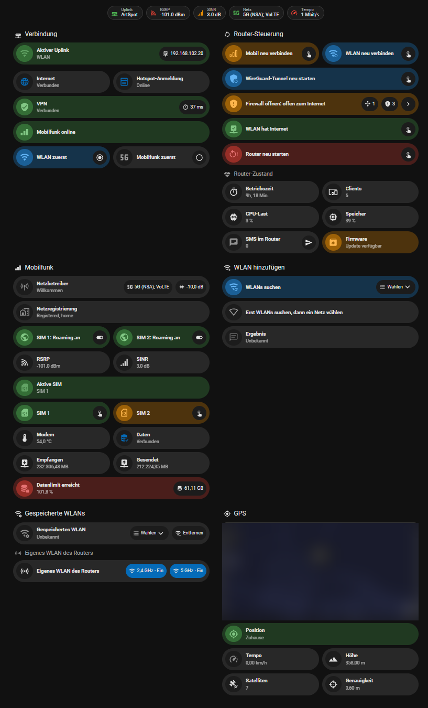

# Teltonika Control

[](https://github.com/BetaHydri/teltonika-control-ha/actions/workflows/validate.yml)
[](https://hacs.xyz/docs/faq/custom_repositories)
[](LICENSE)

Native Home Assistant integration for Teltonika RUTC and RUTX routers.
It talks to the local RutOS REST API, so no Modbus, MQTT, router scripts or
helper entities are needed, and no cloud account.

It grew out of a camper setup: switch between Wi-Fi and mobile data, get told
when a hotspot needs a login, and restart things without opening the router
web page.

[](docs/dashboard.md)

The ready-made [sample dashboard](docs/dashboard.md) (map blurred in this
picture). It uses Bubble Card and Mushroom, for the dashboard only.

This is an independent community project. It is not affiliated with or
endorsed by Teltonika Networks. Teltonika, RUT and RutOS are names of their
respective owners and are used here only to say which routers are supported.

## Relationship to the Home Assistant Teltonika integration

Home Assistant ships its own
[Teltonika integration](https://www.home-assistant.io/integrations/teltonika/)
(domain `teltonika`, library `teltasync`). It reads the cellular modem sensors
(signal values, modem temperature, operator, connection type) and has no
controls. Teltonika Control uses the same local RutOS REST API, but adds
control and the camper features on top: uplink priority, hotspot login
handling, Wi-Fi management, WireGuard, roaming and SIM control, GPS, router
health, and a ready-made dashboard.

- Both can be installed side by side. They use different domains, so entities
  and devices do not collide. Each one polls the router on its own; on a weak
  router, use only one of them or raise the intervals in the
  [options](#options).
- If you only need the modem signal sensors, the core integration is enough.
- Teltonika Control is a custom repository and is not part of the HACS default
  store, because the core integration covers the same devices through the
  same API. Installation and updates work as described in
  [Installation](#installation).

## Features

### Major features

- **Uplink control**: see which uplink carries your traffic (Wi-Fi, mobile
  data or Ethernet) and switch between **Wi-Fi first** and **Mobile first**
  with one tap. Optionally the router goes back to mobile data on its own
  when the Wi-Fi has no internet.
- **Hotspot login handling**: a sensor tells you when a campsite or hotel
  Wi-Fi shows a login page. One service prefers the Wi-Fi, waits until you
  confirmed the page, and falls back to mobile data if nothing happens.
  A result event drives your notifications.
- **Wi-Fi network management**: scan for networks, pick one, enter the
  password and add it, or remove a saved one, all with entities you can put on
  a dashboard. Routers whose 5 GHz radio runs as Multi AP, such as the RUTC50,
  are handled correctly. The same is available as services for automations.
- **Mobile data monitoring**: operator, network type, band, RSRP, RSRQ, SINR,
  modem temperature, SIM state, network registration ("Registered, home" or
  roaming) and the data counters for each modem.
- **SIM and modem control**: switch the SIM slot of dual SIM modems,
  re-establish the mobile connection and allow or deny data roaming per SIM.
- **GPS tracking**: for routers with GPS, a device tracker for the map plus
  speed, altitude, satellites and accuracy.
- **The router's own Wi-Fi**: a switch for each access point that shows the
  real state, also when you change it in the router web interface.
- **VPN check**: enter a host behind your site-to-site tunnel (a DNS name or an
  IPv4 or IPv6 address, for example the router at home) and get a
  **VPN reachable** sensor with the latency. It works with any VPN type,
  such as WireGuard, OpenVPN or IPsec. See [VPN check](#vpn-check).
- **WireGuard control**: for every WireGuard instance on the router, an
  interface state, traffic counters, a switch and a **Reconnect WireGuard**
  button that restarts the tunnel, for example from an automation. See
  [WireGuard tunnels](#wireguard-tunnels).
- **Router health**: uptime, CPU load, memory usage and the number of DHCP
  clients (connected devices).
- **Failover state, data limit and port forwards**: the router's failover
  state per uplink, the usage of the router's mobile data limit with a
  "limit reached" sensor, and a switch for each port forwarding rule. See
  [Mobile data limit](#mobile-data-limit), [Failover](#failover) and
  [Port forwards](#port-forwards).
- **Ready-made dashboard**: a complete dashboard with coloured pills, two
  columns and badges. It needs the Bubble Card and Mushroom frontend cards,
  for this dashboard only. See
  [docs/dashboard.md](docs/dashboard.md).

### Other features

- Buttons to reconnect the Wi-Fi client and to reboot the router.
- An internet check that tells a working Wi-Fi from one behind a login page.
- The router's clock as a diagnostic sensor, when the router reports it.
- Gentle polling for weak routers: status pages on every update, rarely
  changing configuration pages only every few minutes, both intervals
  adjustable in the options. One slow page never takes all entities offline.
- Single empty GPS readings between normal ones are ignored.
- Re-authentication, reconfiguration and options in the user interface.
- Diagnostics download with passwords and personal data removed, including
  which router pages answered and how they are structured.
- Detailed debug logging for support, without secrets, see
  [Debug logging](#debug-logging).
- English and German translations.

### Planned

Ideas that are not implemented yet: own data usage limits and monthly counters
for routers without a data limit (until then, set a data limit on the router,
see [Mobile data limit](#mobile-data-limit), or use a Utility Meter helper, see
the
[step-by-step guide](docs/getting-started.md#step-11-optional-helpers-for-a-monthly-data-counter)),
system temperature of the router,
SMS notifications, the WireGuard handshake time (the router offers no status
endpoint for it, see [WireGuard tunnels](#wireguard-tunnels)) and setting the
Home Assistant home zone from the router's GPS (see the
[automation example](#move-the-home-zone-with-the-camper)).

## Supported routers

| Family | Examples | Status |
|---|---|---|
| RUTC | RUTC50 | Developed against a RUTC50 (RutOS 7.24) |
| RUTX | RUTX11, RUTX50, RUTX14 | Same API, not yet tested on hardware |

If a feature does not work on your model, please open an issue with the
[debug log](#debug-logging) and the diagnostics download. They show which
pages your router offers and how it names its fields, which is what is needed
to add support for it.

RUTC and RUTX use the same RutOS API (the published API description for both
families is identical). Modems, Wi-Fi radios and interfaces are read from the
router, not hard-coded, so differences such as which radio is 2.4 or 5 GHz do
not matter.

## Prerequisites

Check these before you add the integration. Most setup problems come from
the router side: the router must be reachable and the user must be allowed
to do what the integration does.

### Home Assistant

- Home Assistant 2025.2 or newer (developed and tested with 2026.10).
- The Home Assistant host must reach the router over the network, either on
  the router's LAN or routed to it. The integration polls the router; the
  router never connects to Home Assistant, and no cloud account is needed.
- HACS is optional and only needed for the HACS installation.

### Router

- A Teltonika RUTC or RUTX router running **RutOS 7**. The REST API
  description published for RUTC50 and RUTX starts at RutOS 7.9, and the
  integration was developed against 7.24. Routers on RutOS 6 are not
  supported.
- The router web interface must be reachable from the Home Assistant host,
  because the REST API is served by it. It uses HTTPS on port 443 by
  default, with a self-signed certificate. If Home Assistant is not on the
  router's LAN, allow the access under **System, Administration, Access
  Control, General** and in the firewall.
- Optional hardware decides which entities appear: a modem with a SIM for the
  mobile entities, a second SIM slot for the SIM select, and Wi-Fi for the
  Wi-Fi entities.
- For uplink priority and hotspot handling, at least one Wi-Fi network must
  be saved on the router as a Wi-Fi client. Without it the priority select
  is unavailable.

### Router User and Permissions

The integration signs in with a user name and password and receives a
session token. The token lasts as long as the router setting **API session
timeout** (System, Administration, General; default 300 seconds) and is
renewed automatically. Everything the integration does is checked against
the rights of that user's group, on every call.

Create a dedicated user for Home Assistant instead of using `admin`:

1. Under **System, Administration, User Settings** create a group for Home
   Assistant (or pick an existing one) with the rights listed below.
2. Create a user in that group and give it a strong, unique password.
3. Leave SSH access off for this user. The integration does not need it.

| Level | Rights | What works |
|---|---|---|
| Monitoring only | Read on the pages below | Sensors and binary sensors. Buttons, switches, selects and services fail with the router's error message. |
| Full control | Read and write on the pages below | Everything in this document. |
| Administrator | `admin` group | Works, but gives Home Assistant full control of the router. Not recommended. |

The pages are the router web interface pages that the API operations belong
to:

| Used for | Web interface page | Needs |
|---|---|---|
| Setup, model and firmware | System, Device, Info | Read |
| Uplink and priority state | Network, Interfaces | Read |
| Uplink priority, hotspot login mode | Network, Interfaces | Write |
| Wi-Fi client and access point state | Network, Wireless, SSIDs | Read |
| Access point switches, reconnect Wi-Fi, scan, save and remove networks | Network, Wireless, SSIDs | Write |
| Modem sensors | Network, Mobile | Read |
| GPS position | Services, GPS | Read |
| Uptime, CPU load, memory, router clock | Status, Overview (system usage) | Read |
| DHCP clients | Status, Network, LAN (DHCP leases) | Read |
| WireGuard interface state and counters | Network, Interfaces | Read |
| WireGuard switch and reconnect | Services, VPN, WireGuard | Read and write |
| Restart mobile connection, SIM slot | Network, Mobile, Modems | Write |
| Data roaming switches (SIM settings) | Network, Mobile, General | Read and write |
| Failover state | Network, Failover | Read |
| Data limit usage | Network, Mobile, Data limit | Read |
| Port forward switches | Network, Firewall, Port forwards | Read and write |
| Reboot router | System, Administration, General | Write |

Teltonika's API description does not list the exact permission entry for each
operation. The table maps operations to web interface pages as the API
description does. If an action is refused, Home Assistant shows the router's
error message; grant read or write on that page to the group and try again.

Read-only extras are optional. If the user may not read the system usage, the
DHCP leases, the WireGuard configuration, the failover state, the data limits
or the port forwards, the router answers with an error
and the integration simply does not create those entities. Nothing else is
affected. A tunnel whose configuration cannot be read is shown (interface
state and counters) but gets no switch and no reconnect button.

#### What the Integration Changes on the Router

Knowing this helps you decide how much to allow:

- Routing metric of the Wi-Fi client interfaces (0 for Wi-Fi first, 10 for
  mobile first), followed by a Wi-Fi reconnect.
- The on/off flag of the router's own access points.
- The on/off flag of WireGuard instances (switch and **Reconnect WireGuard**,
  which switches the instance off and on again).
- Saved Wi-Fi client networks (`join_wifi` and `forget_wifi`).
- Restart of the mobile connection, SIM slot switch and router reboot.
- The data roaming flag of each SIM ("Deny data roaming", only this field).
- The on/off flag of port forwarding rules (only this field; a rule that is
  on lets traffic from the internet reach a device in your network).

It never changes passwords, users, other firewall settings or firmware.

#### Security Notes

- The password is stored in the Home Assistant config entry, like the
  credentials of any other integration. Diagnostics downloads redact it.
- RutOS can temporarily block an address after repeated failed logins. If
  setup keeps failing after wrong passwords, check **System, Administration,
  Access Control, Security** and unblock the Home Assistant host.
- Do not open the router web interface to the internet just for Home
  Assistant. Reach it over the LAN or a VPN.

## Installation

### HACS (custom repository)

1. In HACS, open the menu and choose **Custom repositories**.
2. Add `https://github.com/BetaHydri/teltonika-control-ha` as type
   **Integration**.
3. Install **Teltonika Control** and restart Home Assistant.

### Manual

Copy `custom_components/teltonika_control` into the `custom_components`
folder of your Home Assistant configuration and restart.

## Setup

New to this? The [step-by-step guide](docs/getting-started.md) walks you from
the router user to your first dashboard card. The short version:

1. Make sure the [prerequisites](#prerequisites) are met, in particular the
   router user and its permissions.
2. In Home Assistant, go to **Settings, Devices & services, Add
   integration** and choose **Teltonika Control**.
3. Enter the router address, user and password. Leave **Verify SSL
   certificate** off if the router uses its self-signed certificate.

Use `http://` in front of the address to talk plain HTTP.

If the router address, user or password changes later, use **Reconfigure**
on the integration. A rejected password starts the re-authentication flow
automatically.

## What You Get

### Router

| Entity | Type | Notes |
|---|---|---|
| Uplink | sensor | `wifi`, `mobile`, `ethernet` or `other` |
| Uplink IP address | sensor | Diagnostic |
| Wi-Fi network, signal, link speed, band | sensors | Router as Wi-Fi client |
| Hotspot login | sensor | `no_wifi`, `idle`, `waiting`, `login_required`, `online` |
| Wi-Fi connected | binary sensor | Router is a Wi-Fi client, or a Wi-Fi interface carries the uplink |
| Internet | binary sensor | Result of the internet check |
| Hotspot login required | binary sensor | Wi-Fi is up but has no internet |
| VPN reachable | binary sensor | Only with a VPN check host, see [VPN check](#vpn-check) |
| VPN latency | sensor | Connect time to the VPN check host in ms. Diagnostic, only with a VPN check host |
| Access point *name* | switch | The router's own Wi-Fi, real state |
| Uplink priority | select | Wi-Fi first or mobile first |
| Reconnect Wi-Fi | button | Reconnects all saved networks |
| Scan for Wi-Fi networks | button | Scans with all radios, see [Managing Wi-Fi networks](#managing-wi-fi-networks) |
| Found networks | select | The networks of the last scan that are not saved yet |
| Wi-Fi password | text | Password for the next network; only a mask is shown, never the text |
| Add selected network | button | Saves the found network with the password |
| Saved networks | select | Wi-Fi clients and Multi AP list entries saved on the router |
| Remove selected network | button | Removes the selected saved network |
| Last Wi-Fi action | sensor | Result of the last scan, add or remove |
| Router time | sensor | The router's clock. Diagnostic, disabled by default |
| Uptime, CPU load, Memory usage | sensors | Diagnostic. Flash usage is also available, disabled by default |
| DHCP clients | sensor | Number of leases; the attribute `devices` lists host name, IP address and interface (no MAC addresses) |
| WireGuard *name* | binary sensor | The tunnel interface is up. One per WireGuard instance, see [WireGuard tunnels](#wireguard-tunnels) |
| WireGuard *name* enabled | switch | Turns the instance on or off. Needs the right to change the WireGuard configuration |
| Reconnect WireGuard *name* | button | Switches the instance off and on |
| WireGuard *name* received, sent | sensors | Traffic counters of the tunnel interface. Diagnostic |
| Reboot router | button | Add a confirmation in your dashboard |
| Failover *interface* | sensor | The router's failover state of an uplink: `online`, `offline`, `standby`, `starting` or `notracking`. Attributes: health `score`, `seconds_since_change`, `seconds_online`, `seconds_offline`, `tracking_lost`. One per interface in the failover configuration |
| Failover *interface* online | binary sensor | On while the failover check says the uplink is online |
| Failover mobile, Wi-Fi, Ethernet online | binary sensors | On while any interface of that kind is online. Same name on every router, one per kind that exists in the failover configuration |
| Port forward *name* | switch | Turns a port forwarding rule on or off. Attributes: `protocol`, `external_port`, `internal_port`. See [Port forwards](#port-forwards) |
| Position | device tracker | Only on routers with GPS, see [GPS](#gps) |
| GPS speed, altitude, satellites, accuracy | sensors | Only on routers with GPS. Heading and fix status are disabled by default |

### Modem (one device per modem)

Operator, network type, band, RSRP, RSRQ, SINR, temperature, data connection,
SIM state, active SIM, data received and sent, a connected sensor, a
**Restart mobile connection** button and, on dual SIM modems, a **SIM slot**
select. RSSI and signal quality are disabled by default.

**Network registration** shows the text of the router, for example
`Registered, home`. The binary sensor **Roaming** is on while that text says
roaming, so you can warn yourself when the modem leaves your home network.
Both come from the modem status the integration already reads.

The switches **Allow data roaming SIM 1** and **SIM 2** show and change the
router setting **Network, Mobile, General, SIM configuration, Deny data
roaming** of each SIM. On means roaming is allowed (the opposite of the
router's "Deny data roaming"). Only this one field is written, never the PIN or
the APN, and the integration reads the setting back and reports an error if the
router did not apply it. Switching it can make the modem register again.
Inside the EU roaming is usually free of extra charge ("roam like at home");
outside the EU it can be expensive, so deny it there. The sample dashboard asks
for confirmation before it allows roaming. The switches need the right to
change the mobile settings (see the permissions) and appear only if the router
answers the SIM settings page.

### Mobile data limit

If you set a **Data limit** for a mobile interface on the router (Network,
Mobile, Data limit), the router counts the used data and switches the mobile
data off when the limit is reached. The integration shows that counter, so you
need no helper and no own counting. For each interface with an enabled limit
(named after its SIM slot, for example **SIM 1**) it creates:

| Entity | Type | Notes |
|---|---|---|
| Data used *SIM 1* | sensor | Used data of the current period, shown in GB |
| Data limit *SIM 1* | sensor | The limit set on the router. Diagnostic |
| Data limit used *SIM 1* | sensor | Used part of the limit in percent |
| Data limit reset *SIM 1* | sensor | When the router sets the counter back to zero. Diagnostic |
| Data limit reached *SIM 1* | binary sensor | On when the used data reaches the limit |

Use the binary sensor or a numeric state trigger on the percent sensor (for
example above 80) for your notifications. The router sets the limit and the
reset day, the integration only reads them. No entities appear while no limit
is enabled on the router or the user may not read the page.

### Failover

The router checks its uplinks with its failover function (Network, Failover)
and keeps a state for each one. The integration shows it for every interface
that is enabled in the failover configuration: a sensor **Failover
*interface*** with the router's own text and a binary sensor **Failover
*interface* online**.

What each interface is comes from the router: its failover configuration says
`mobile`, `wireless` or `wired`, and gives the interface its name. So the
entities are called "Mobile (mob1s1a1)" or "Wi-Fi (wifi4)" without any setting
from you. A RUTC50 lists its Wi-Fi networks as `wan2` and `wan3` there; the
integration reads the real names from the configuration.

For automations and dashboards that should work on any router, there is one
binary sensor per kind that is present: **Failover mobile online**, **Failover
Wi-Fi online** and **Failover Ethernet online**. Each is on while any interface
of that kind is online and lists them in its attributes. Use these instead of
the per-interface entities. The state can lag behind a change by up to two
minutes, because the page is read like the DHCP clients. A good trigger for a
notification is **Failover mobile online** turning off for a few minutes.

The router decides "online" by pinging its check addresses through the
interface. A Wi-Fi network that does not answer these pings (some hotspots do
not) shows `offline` even though it carries traffic. So **Failover Wi-Fi
online** is the router's check result, not proof that the Wi-Fi has no
internet. Use **Wi-Fi connected**, the uplink sensors and **Internet** for the
actual Wi-Fi state.

### Port forwards

Each port forwarding rule of the router (Network, Firewall, Port forwards)
becomes a switch **Port forward *name*** (the rule name, or its ID when it has
none). Use it to open a rule only when you need it, for example for remote
access while you are on site. Only the on/off flag of the rule is written, the
integration reads it back and reports an error if the router did not apply it.
A rule that is on lets traffic from the internet reach a device in your
network, so keep rules off that you do not need and do not put these switches
on a dashboard that guests can use.

A rule that comes from the `wan` zone also catches traffic that arrives
through other interfaces in that zone, for example a VPN tunnel, if its
interface belongs to the `wan` zone (Network, Firewall, General settings shows
the zones). A rule for port 80 or 443 that points to another device or port can
then make the router's own web interface unreachable through the VPN while the
rule is on. Switch such a rule on only while you need it, and use the
router's LAN address or another port for the web interface in that time.

## GPS

Routers with a GPS receiver report their position through the REST API. The
integration reads it with every update and creates, only on routers that
answer the GPS request:

- **Position**, a device tracker that shows the router on the Home Assistant
  map, with the accuracy in meters.
- **GPS speed** (km/h), **GPS altitude** (m), **GPS satellites** and
  **GPS accuracy**.
- **GPS heading** and **GPS fix status**, disabled by default.

Speed, altitude and accuracy are rounded, so a parked camper or boat does not
write GPS noise into the history on every update. The receiver of a RUTC50
now and then reports a single empty reading (0 satellites, accuracy 500 m)
between normal ones of 5 to 9 satellites. Up to three such readings in a row
are ignored and the last good values stay, so sensors and zone automations do
not jump; a longer loss of the fix shows up as 0 satellites. While the router
has no fix (it reports zeros), the entities are `unknown` and the position is
not
trusted. The router needs a clear view of the sky and a connected GPS
antenna, and GPS must be switched on in the router.

If the user of the integration may not read the GPS data, the GPS entities do
not appear. Give it read access to the GPS page, see the
[permissions](#router-user-and-permissions).

## Hotspots With a Login Page

Some free Wi-Fi networks need a click on a landing page. The router cannot do
that itself, but the login is valid for the whole router afterwards because
the hotspot only sees the router.

1. Call the service `teltonika_control.portal_mode` (or press your dashboard
   button for it). Wi-Fi gets priority and the integration waits.
2. On a phone connected to the router, open `http://neverssl.com` and accept
   the hotspot page.
3. As soon as the internet check passes, the router stays on Wi-Fi and the
   event `teltonika_control_portal_result` fires with `success: true`.
   Without internet after the wait time, the router goes back to mobile data
   and the event has `success: false`.

The **Hotspot login** sensor shows `login_required` while Wi-Fi is the uplink
but has no internet.

### Notification example

```yaml
automation:
  - alias: "Router: hotspot needs login"
    triggers:
      - trigger: state
        entity_id: binary_sensor.my_router_hotspot_login_required
        to: "on"
        for: "00:03:00"
    actions:
      - action: notify.mobile_app_my_phone
        data:
          title: Hotspot login needed
          message: Open http://neverssl.com and accept the page.
```

Adjust the entity IDs to your router. The same pattern works for
`binary_sensor.*_wifi_connected` going to `off` for "Wi-Fi lost".

## Managing Wi-Fi networks

Everything needed to add a network is an entity of the router device, so a
dashboard needs no helpers or scripts:

1. **Scan for Wi-Fi networks** (button) scans with all radios.
2. **Found networks** (select) lists each network once per band with its best
   signal, for example `Camp5 [5 GHz · secured · -60 dBm]`. Networks that are
   already saved in the same band are hidden.
3. **Wi-Fi password** (text) takes the password. A secured network needs one
   of at least 8 characters; leave it empty for an open network. It is kept in
   memory only and the state always shows `********`, so it never reaches the
   history.
4. **Add selected network** (button) saves it. Without a password for a
   secured network, Home Assistant shows "Enter the Wi-Fi password (at least 8
   characters) first". Mobile data stays preferred.
5. **Last Wi-Fi action** (sensor) shows the result, for example
   `Saved Camp5` or `Scan failed: ...`.

To remove a network, choose it in **Saved networks** and press **Remove
selected network**. The list holds the Wi-Fi client networks and the entries of
the Multi AP list. See [Multi AP radios](#multi-ap-radios) for the rules the
router sets.

The entities appear on routers with Wi-Fi radios. The services below do the
same for automations and scripts.

## VPN check

Routers often carry a site-to-site tunnel, for example WireGuard from a camper
to the router at home. The RutOS web interface shows no live tunnel status, so
the integration checks the tunnel from the outside: it connects to a device
behind the tunnel.

1. Go to **Settings**, **Devices & services**, **Teltonika Control**,
   **Configure**.
2. Enter the **VPN check host**: a DNS name, an IPv4 address or an IPv6
   address of a device at the other end, for example the home router
   `192.168.178.1`. A port can follow, for example `192.168.178.1:443` or
   `[fd00::1]:443`.
3. Set the **VPN check port** (default 443) and save.

You get the binary sensor **VPN reachable** and the sensor **VPN latency**.
Every update interval, Home Assistant opens a TCP connection to host and port.
The tunnel counts as up when the connection works **or is refused**, because a
refusal means the device answered through the tunnel. A timeout, an
unresolvable name or "no route" count as down. Leave the host empty to turn the
check off.

Good targets are a device that is always on at the other end, ideally one with
an open web port. Use an address inside the tunnel's subnet, not the public
address of the remote router.

Do **not** use the WireGuard endpoint of the peer (the public name or address
and the UDP port from the peer settings, for example a MyFRITZ name with port
`52377`). WireGuard speaks UDP only and never answers a TCP connection, so
the check would always say "down", and it would not go through the tunnel
anyway. Use the LAN address of the remote router instead, for example
`192.168.178.1` with port `80` for a FRITZ!Box.

Notes:

- The check runs on the Home Assistant host, like the internet check. It is
  only meaningful if Home Assistant reaches the remote network through this
  router.
- It tests the whole path, not only the WireGuard handshake: the tunnel, the
  routes and the remote firewall. A route that is too wide or missing shows up
  as "unreachable".
- A firewall that silently drops the port looks the same as a dead tunnel. Pick
  a port that the device answers or rejects.

Example: warn when the tunnel is down for five minutes while the router is
online.

```yaml
automation:
  - alias: "Router: VPN to home is down"
    triggers:
      - trigger: state
        entity_id: binary_sensor.my_router_vpn_reachable
        to: "off"
        for: "00:05:00"
    conditions:
      - condition: state
        entity_id: binary_sensor.my_router_internet
        state: "on"
    actions:
      - action: notify.notify
        data:
          message: "The VPN tunnel to home is down although the router is online."
```

## WireGuard tunnels

The integration reads the WireGuard instances of the router (**Services,
VPN, WireGuard**) and creates entities for each one, named after the instance,
for example `RUTC2AVM`:

| Entity | What it tells you |
|---|---|
| WireGuard *name* (binary sensor) | The tunnel interface is up on the router. It does not prove that the other end answers, use the [VPN check](#vpn-check) for that. |
| WireGuard *name* enabled (switch) | The instance is switched on in the router configuration. Turning it off removes the interface. |
| Reconnect WireGuard *name* (button) | Switches the instance off, waits a few seconds and switches it on again. This renews the connection, for example after the uplink changed. |
| WireGuard *name* received, sent (sensors) | Traffic counters of the tunnel interface. Diagnostic. |

**Reconnect** works on instances that are switched on. If the tunnel is
switched off, the button refuses and tells you to use the switch. If switching
it back on fails, the error message says so and the tunnel stays off until you
switch it on.

The RutOS REST API offers no WireGuard peer status, so the integration cannot
show the time of the last handshake. The probe tool answers `501` for the
status endpoints. Combine the interface state with the VPN check instead.

Example: restart the tunnel when the VPN check has been failing for five
minutes while the router has internet.

```yaml
automation:
  - alias: "Router: restart the WireGuard tunnel to home"
    triggers:
      - trigger: state
        entity_id: binary_sensor.my_router_vpn_reachable
        to: "off"
        for: "00:05:00"
    conditions:
      - condition: state
        entity_id: binary_sensor.my_router_internet
        state: "on"
      - condition: state
        entity_id: switch.my_router_wireguard_homebase_enabled
        state: "on"
    actions:
      - action: button.press
        target:
          entity_id: button.my_router_reconnect_wireguard_homebase
      - delay: "00:02:00"
```

The delay keeps the automation from restarting the tunnel again right away,
because the default mode `single` ignores new triggers while it runs.

## Services

| Service | Purpose |
|---|---|
| `portal_mode` | Prefer Wi-Fi and wait for the hotspot login |
| `set_priority` | Wi-Fi or mobile first, optionally rolled back without internet |
| `scan_wifi` | Return nearby networks (response data) |
| `join_wifi` | Save a network as Wi-Fi client, or into the Multi AP list on a Multi AP radio; mobile stays preferred |
| `forget_wifi` | Remove a saved client network (`station_id`) or a Multi AP list entry (`ssid`) |

Each service takes the router as a service target: choose any entity of the
router, including a modem entity. A router device as target and `device_id`
in the service data still work.

### Multi AP radios

On some routers the 5 GHz radio runs as Multi AP (the RUTC50 does). The router
does not accept a normal Wi-Fi client there, so `join_wifi` for that radio adds
the network to the Multi AP list, or changes its password if the SSID is
already listed. Which radio is the Multi AP radio is read from the router, so
the opposite layout (Multi AP on 2.4 GHz, a normal client on 5 GHz) works the
same way. A router has one Multi AP list, separate from the saved Wi-Fi client
networks; **Saved networks** shows both, labelled with the band, for example
`Home (5 GHz, Multi AP)`. The router allows only one client or one Multi AP per radio;
`join_wifi` tells you when a radio is taken. `forget_wifi` removes Multi AP
entries by `ssid`. The last entry of the list cannot be removed: an empty list
makes the router service restart every few seconds. Remove it in the router
web interface if you really want an empty list.

When a client network is removed, its network interface is removed too, unless
it is one of the router's default interfaces (`lan`, `wan*`, `mob*`, `vpn*`).

## Automation examples

Adjust the entity IDs to your router. Services take any entity of the router
as target.

### Back to mobile data when the Wi-Fi has no internet

```yaml
automation:
  - alias: "Router: mobile first when the Wi-Fi is dead"
    triggers:
      - trigger: state
        entity_id: binary_sensor.my_router_internet
        to: "off"
        for: "00:02:00"
    conditions:
      - condition: state
        entity_id: sensor.my_router_uplink
        state: wifi
    actions:
      - action: teltonika_control.set_priority
        target:
          entity_id: sensor.my_router_uplink
        data:
          wifi_first: false
          verify: false
```

### Move the home zone with the camper

When the router has been standing still for ten minutes, the Home Assistant
home location follows its GPS position.

```yaml
automation:
  - alias: "Camper: home zone follows the router when parked"
    triggers:
      - trigger: numeric_state
        entity_id: sensor.my_router_gps_speed
        below: 1
        for: "00:10:00"
    conditions:
      - condition: template
        value_template: >-
          {{ state_attr('device_tracker.my_router_position', 'latitude') is number }}
    actions:
      - action: homeassistant.set_location
        data:
          latitude: "{{ state_attr('device_tracker.my_router_position', 'latitude') }}"
          longitude: "{{ state_attr('device_tracker.my_router_position', 'longitude') }}"
```

## Options

- **Update interval**: how often the status of the router is polled (uplink,
  Wi-Fi signal, modem, GPS, load): 10 to 600 seconds, default 30.
- **Configuration interval**: how often pages that rarely change (Wi-Fi
  configuration, radios, WireGuard instances) are read again: 30 to 3600
  seconds, default 300. Actions of the integration read them again at once.
  The DHCP client list is read at most every two minutes.
- **Internet check URL**: must answer HTTP 204 when the internet works.
  Leave empty to turn the check off.
- **VPN check host** and **VPN check port**: optional, see
  [VPN check](#vpn-check).

The integration reads the pages one after the other and keeps the load on the
router low, because a RUTC50 has a weak CPU. If the router still feels slow,
raise both intervals; the **CPU load** sensor of the router device shows the
effect. A value measured while the integration polls is higher than the
router's own display at rest.

The internet check runs on the Home Assistant host. It is only meaningful if
Home Assistant reaches the internet through this router.

## Debug logging

If a feature does not work on your router model, the debug log shows why.
Turn it on in Home Assistant under **Settings**, **Devices & services**,
**Teltonika Control**, menu (three dots), **Enable debug logging**. Reproduce
the problem, then choose **Disable debug logging** in the same menu to
download the file. Step by step: [getting started guide](docs/getting-started.md#turn-on-debug-logging).

What the log contains:

- **A router report** on the first update: model, firmware and which pages of
  the router answered, are missing or are slow, plus counts of what was
  found (modems, radios, SIM settings, tunnels and so on).
- **One line per request**: method, path, HTTP status and duration, and for
  changes only the names of the fields that were sent. The structure of each
  answer (key names and value types) is written once per page.
- **One summary line per update**: uplink, priority, Wi-Fi, internet check and
  modems.
- **Actions**: what was switched or pressed, and the router's error message
  if it refused.

Example:

```text
Router report: model=RUTC50 firmware=RUTC_R_00.07.24.8. Pages: {'interface_config': 'ok', ..., 'gps': 'missing (HTTP 404: Not found)', ...}
GET /sim_cards/config -> HTTP 200 in 187 ms
Answer structure of /sim_cards/config: {"list":2,"first":{"deny_roaming":"0","id":"str(9)","modem":"str(5)", ...}}
PUT /sim_cards/config/cfg_sim2 -> HTTP 200 in 311 ms sending fields ['deny_roaming']
Update: uplink=wifi metric=0 wifi_first=True wifi=2.4 GHz -66.0 dBm internet=True portal=online modems_online=1 vpn_reachable=True
```

Useful hints when reading it:

- `HTTP 404` or `501` for a page: this model or firmware does not have that
  page, so the matching entities are not created.
- `HTTP 403`: the router user may not read or change that page, see the
  [permissions](#router-user-and-permissions).
- `failed after ... ms: TimeoutError`: the router did not answer in time.
- A field you expect is missing in an `Answer structure` line: the router
  names it differently. Please include that line in your issue.

What the log never contains: your password, session tokens, PIN, IMSI, IMEI,
ICCID, serial numbers, Wi-Fi names and passwords, IP and MAC addresses, GPS
coordinates and the router address. Values are shown only for numbers,
booleans and a short list of harmless state texts. Error messages of Home
Assistant itself (for example "Cannot reach ...") can contain the router
address; look through the file before you post it. The
[diagnostics download](docs/getting-started.md#download-diagnostics) has the
same page status and answer structures.

## Known Limitations

- The Wi-Fi sensors describe the connection that carries the uplink. If the
  router is connected to the same network twice (for example as 2.4 GHz client
  and as 5 GHz Multi AP entry), the one that is the active uplink is shown.
- The GPS field names are taken from the router API as used by other
  projects. Position, speed, altitude, satellites and accuracy are confirmed
  on a RUTC50. The heading field exists and reads 0 when parked; its values
  while driving are not confirmed yet. The fix status
  shows the router's own code unchanged (`1` with 9 satellites on a RUTC50);
  its other values are not mapped. If an entity stays empty although the
  router has a fix, open an issue with the diagnostics.
- The router clock comes from the system usage status of the router, with the
  `Date` header of its answers as fallback. Without either, the **Router
  time** sensor does not appear.
- Changing the SIM drops mobile data for about a minute and is not rolled
  back automatically.
- The roaming switches write one field of the SIM settings. Denying and
  allowing roaming were both checked on a RUTC50: the router showed the new
  "Deny data roaming" value each time. The integration reads the setting back
  and reports an error if the router did not apply it.
- Switching off the access point you are connected through disconnects you.
- If one page of the router (for example the Wi-Fi status) does not answer in
  time, its entities show the last known values and the page is asked again
  after two minutes. Only when the interface list itself does not answer, all
  entities become unavailable. Without a Wi-Fi status, the name and band of
  the Wi-Fi network come from the router configuration; signal and link speed
  stay unknown.
- The VPN check is a reachability test from the Home Assistant host, not a
  read-out of the tunnel. It says nothing when Home Assistant reaches the
  remote network another way. The WireGuard handshake time is not available,
  because the router offers no status endpoint for it.
- The WireGuard entities cover WireGuard only. OpenVPN, IPsec and other
  tunnels are not listed yet; use the VPN check for them.
- Field names in the modem, Wi-Fi and interface answers differ slightly
  between RutOS releases. Open an issue with the diagnostics download if an
  entity stays empty.

## Development

The tests need Linux, macOS or WSL, because Home Assistant itself does not run
on native Windows.

```bash
python3 -m venv .venv
.venv/bin/python -m pip install -r requirements_test.txt
.venv/bin/python -m pytest
.venv/bin/ruff check .
```

An optional read-only check against a real router lives in
`tools/live_smoke_test.py`. It reads the address and login from the
environment variables `TELTONIKA_HOST`, `TELTONIKA_USER` and
`TELTONIKA_PASSWORD`, and prints the field names the router returns.
`tools/probe_endpoints.py` checks which further REST endpoints your router
offers. It is standalone (only `pip install aiohttp`, no Home Assistant), uses
the same environment variables and shows only key names and types, no
secrets.

The icon and logo in `custom_components/teltonika_control/brand` are drawn by
`tools/make_brand_images.py` (needs Pillow). Home Assistant 2026.3 and newer
show them on the integration page; older versions fetch brand images from a
central repository instead and show a placeholder.

## See Also

- [Step-by-step guide](docs/getting-started.md)
- [Dashboard for Teltonika Control](docs/dashboard.md)
- [Teltonika API documentation](https://developers.teltonika-networks.com/)
- [Changelog](CHANGELOG.md)
