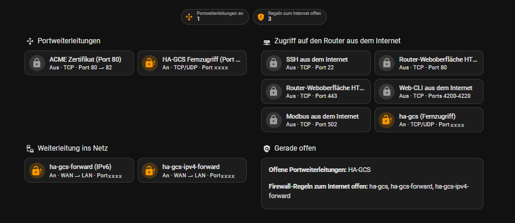
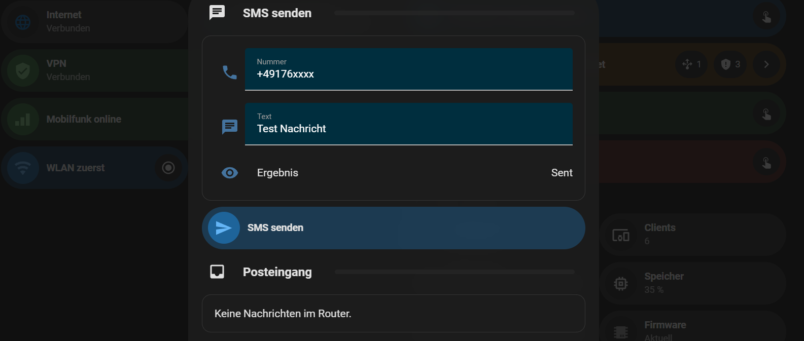
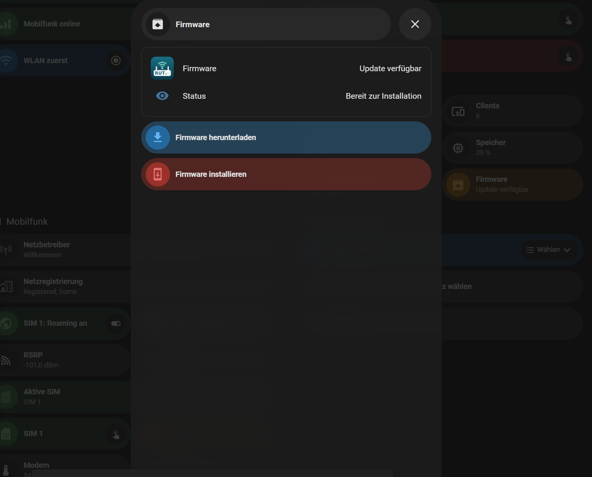

# Teltonika Control

[](https://github.com/BetaHydri/teltonika-control-ha/actions/workflows/validate.yml)
[](https://hacs.xyz/docs/faq/custom_repositories)
[](LICENSE)

**Control your Teltonika router from Home Assistant.** Switch between Wi-Fi and
mobile data with one tap, get told when a campsite Wi-Fi wants a login, add and
remove Wi-Fi networks from a dashboard, restart a WireGuard tunnel, open a port
only while you need it, and keep an eye on your mobile data volume. Everything
runs through the router's local REST API: no cloud, no Modbus, no MQTT and no
scripts on the router.

It grew out of a camper and is useful wherever a Teltonika router runs
RutOS 7. Developed on a RUTC50; other RutOS 7 routers use the same API, see
[Supported routers](#supported-routers).

[](docs/dashboard.md)

The ready-made [dashboard](docs/dashboard.md) (map blurred in this picture). It
uses Bubble Card and Mushroom, for the dashboard only.

## Why try it

- **One tap uplink**: *Wi-Fi first* or *Mobile first*, with an automatic way back
  to mobile data when the Wi-Fi has no internet.
- **Campsite Wi-Fi without the router web page**: the login page is detected,
  new networks are scanned, added and removed from the dashboard.
- **Know what is open**: every port forward and firewall rule is a switch, and
  a [firewall dashboard](docs/firewall-dashboard.md) shows what is open to the
  internet right now.
- **Your data volume under control**: used data, your contract's limit in
  percent, and a warning from Home Assistant at the percentage you choose, with
  no dependence on the router's own SMS warning.
- **Mobile and VPN at a glance**: signal, network type, roaming, SIM switching,
  and a WireGuard tunnel you can restart from an automation.
- **Ready-made dashboards**: paste the YAML, replace one placeholder, done.
- **Careful with your router**: it writes only the one field it needs, reads it
  back, and asks for confirmation on every action that interrupts a connection.

## Quick start

[](https://my.home-assistant.io/redirect/hacs_repository/?owner=BetaHydri&repository=teltonika-control-ha&category=integration)

1. In HACS, add `https://github.com/BetaHydri/teltonika-control-ha` as a
   **custom repository** (type Integration), install **Teltonika Control** and
   restart Home Assistant.
2. Go to **Settings, Devices & services, Add integration**, choose
   **Teltonika Control**, and enter the router address, user and password. A
   dedicated router user is recommended, see
   [Router User and Permissions](#router-user-and-permissions).
3. Optional: paste the [sample dashboard](docs/dashboard.md) and, if your router
   has port forwards or traffic rules, the
   [firewall dashboard](docs/firewall-dashboard.md).

New to this? The [step-by-step guide](docs/getting-started.md) takes you from
the router user to your first dashboard card, and the
[best practices](docs/best-practices.md) cover router access, firewall
switches, data limits and automations in one page.

This is an independent community project. It is not affiliated with or
endorsed by Teltonika Networks. Teltonika, RUT and RutOS are names of their
respective owners and are used here only to say which routers are supported.

## Features

### Major features

- **Uplink control**: see which uplink carries the traffic and switch between
  **Wi-Fi first** and **Mobile first** with one tap, with an automatic way back
  to mobile data when the Wi-Fi has no internet.
- **Hotspot login handling**: detects a campsite or hotel login page (also an
  expired login) and waits until you confirmed it, see
  [Hotspots With a Login Page](#hotspots-with-a-login-page).
- **Wi-Fi network management**: scan, add and remove networks with entities on
  a dashboard or with services, see
  [Managing Wi-Fi networks](#managing-wi-fi-networks).
- **Mobile data and SIM**: modem signal and state, SIM slot, data roaming per
  SIM, the router's failover state and the data volume against your contract,
  see [Modem](#modem-one-device-per-modem), [Mobile data limit](#mobile-data-limit)
  and [Failover](#failover).
- **GPS tracking**: a device tracker for the map plus speed, altitude,
  satellites and accuracy, see [GPS](#gps).
- **The router's own Wi-Fi**: a switch for each access point that shows the
  real state, also when you change it in the router web interface.
- **VPN**: a **VPN reachable** sensor for any site-to-site tunnel, plus state,
  switch and a **Reconnect** button for every WireGuard instance and, untested
  on hardware, for Tailscale, OpenVPN, IPsec and SSTP. See
  [VPN check](#vpn-check), [WireGuard tunnels](#wireguard-tunnels) and
  [Other VPN types](#other-vpn-types).
- **Router health**: uptime, CPU load, memory usage and the number of DHCP
  clients (connected devices).
- **SMS**: send an SMS from the dashboard, an automation or a script, read the
  inbox and react to every new SMS with an event. See [SMS](#sms).
- **Firmware**: an update entity plus buttons to download the firmware and,
  when you decide so, to install it. See [Firmware update](#firmware-update).
- **Firewall control**: a switch for every port forward and traffic rule and a
  separate [firewall dashboard](docs/firewall-dashboard.md). See
  [Firewall](#firewall).
- **Found on your network**: a Teltonika router shows up under **Discovered**
  and is linked to its other entries in Home Assistant by its MAC addresses.
  Setup tries HTTPS and then plain HTTP.
- **Ready-made dashboards**: see [docs/dashboard.md](docs/dashboard.md) and the
  [firewall dashboard](docs/firewall-dashboard.md).

### Other features

- Buttons to reconnect the Wi-Fi client and to reboot the router.
- An internet check that tells a working Wi-Fi from one behind a login page.
- The router's clock as a diagnostic sensor, when the router reports it.
- Gentle polling for weak routers: status pages on every update, rarely
  changing configuration pages only every few minutes, both intervals
  adjustable in the options. One slow page never takes all entities offline.
- Single empty GPS readings between normal ones are ignored.
- Re-authentication, reconfiguration and options in the user interface.
- Diagnostics download with passwords and personal data removed, including
  which router pages answered and how they are structured.
- Detailed debug logging for support, without secrets, see
  [Debug logging](#debug-logging).
- English and German translations.

### Core integration and Teltonika Control

Home Assistant ships its own
[Teltonika integration](https://www.home-assistant.io/integrations/teltonika/)
(domain `teltonika`). It reads the modem sensors, is discovered on the network
and has no controls. Teltonika Control covers all of that (the same modem
sensors, discovery by the router's MAC address, HTTPS and HTTP, re-authentication)
and adds the controls and the camper features on top: uplink priority, hotspot
login handling, Wi-Fi management, WireGuard, roaming and SIM control, GPS,
firewall, data volume, SMS, firmware information and the dashboards. So you can
use it instead of the core integration without losing anything.

- Both can be installed side by side. The domains differ, so entities do not
  collide. Each polls the router on its own; on a weak router, use only one or
  raise the intervals in the [options](#options).
- If you only need the modem signal sensors, the core integration is enough.
  Teltonika Control is a HACS custom repository, not part of the HACS default
  store, because the core integration covers the same devices through the same
  API.

## Supported routers

What counts is the **RutOS version**, not the model name. The integration
does not check the model: setup needs a login and an answer from the router's
`/system/device/status` page, nothing else. Everything it does goes through the
RutOS REST API, and it reads the modems, Wi-Fi radios, interfaces, VPN
instances, SIM slots, firewall rules and failover interfaces from the router
instead of assuming names. So any Teltonika device that runs RutOS 7 with the
REST API should work, and the entities follow the hardware it has.

| Family | Examples | Status |
|---|---|---|
| RUTC | RUTC50 | Developed and tested on a RUTC50 (RutOS 7.24) |
| RUTX | RUTX11, RUTX50, RUTX14 | Same API, not yet tested on hardware |
| Other RutOS 7 devices | RUTM (RUTM50, RUTM30), RUT1xx/2xx/9xx (RUT241, RUT951), TRB gateways (TRB140, TRB246) | Teltonika's published API description (version 1.17.3 for RutOS 7.25) lists the same API for these families. Not tested here. The mobile data, SIM, GPS, Wi-Fi and WireGuard features depend on what the device has. |

Features that need hardware or a RutOS function appear only when the router
has it, for example GPS, a second SIM, Wi-Fi, WireGuard, the mobile data limit
or failover. A router without a page answers with an error for it, and the
integration then does not create those entities. Everything else keeps working.
The newer pages (failover, data limit, firewall rules) are read as optional, and
an older RutOS 7 release may miss some of them. RutOS 6 (for example on older
RUT9xx firmware) has no REST API of this kind and is not supported.

If a feature does not work on your model or RutOS version, please open an issue
with the [debug log](#debug-logging) and the diagnostics download. They show
which pages your router offers and how it names its fields, which is what is
needed to add support for it. A report that says "works on a RUTM50" or "page X
is missing on RutOS 7.1x" helps as much as a bug report, because the list above
is only as good as what has been tested.

## Prerequisites

Check these before you add the integration. Most setup problems come from
the router side: the router must be reachable and the user must be allowed
to do what the integration does.

### Home Assistant

- Home Assistant 2025.2 or newer (developed and tested with 2026.10).
- The Home Assistant host must reach the router over the network, either on
  the router's LAN or routed to it. The integration polls the router; the
  router never connects to Home Assistant, and no cloud account is needed.
- HACS is optional and only needed for the HACS installation.

### Router

- A Teltonika router running **RutOS 7** with the REST API (RUTC, RUTX and
  other RutOS 7 devices, see [Supported routers](#supported-routers)). The
  REST API description published for RUTC50 and RUTX starts at RutOS 7.9, and
  the integration was developed against 7.24. Routers on RutOS 6 are not
  supported.
- The router web interface must be reachable from the Home Assistant host,
  because the REST API is served by it. It uses HTTPS on port 443 by
  default, with a self-signed certificate. If Home Assistant is not on the
  router's LAN, allow the access under **System, Administration, Access
  Control, General** and in the firewall.
- For uplink priority and hotspot handling, at least one Wi-Fi network must
  be saved on the router as a Wi-Fi client. Without it the priority select
  is unavailable.

### Router User and Permissions

The integration signs in with a user name and password and receives a
session token. The token lasts as long as the router setting **API session
timeout** (System, Administration, General; default 300 seconds) and is
renewed automatically. Everything the integration does is checked against
the rights of that user's group, on every call.

Create a dedicated user for Home Assistant instead of using `admin`:

1. Under **System, Administration, User Settings** create a group for Home
   Assistant (or pick an existing one) with the rights listed below.
2. Create a user in that group and give it a strong, unique password.
3. Leave SSH access off for this user. The integration does not need it.

| Level | Rights | What works |
|---|---|---|
| Monitoring only | Read on the pages below | Sensors and binary sensors. Buttons, switches, selects and services fail with the router's error message. |
| Full control | Read and write on the pages below | Everything in this document. |
| Administrator | `admin` group | Works, but gives Home Assistant full control of the router. Not recommended. |

The pages are the router web interface pages that the API operations belong
to:

| Used for | Web interface page | Needs |
|---|---|---|
| Setup, model and firmware | System, Device, Info | Read |
| Uplink and priority state | Network, Interfaces | Read |
| Uplink priority, hotspot login mode | Network, Interfaces | Write |
| Wi-Fi client and access point state | Network, Wireless, SSIDs | Read |
| Access point switches, reconnect Wi-Fi, scan, save and remove networks | Network, Wireless, SSIDs | Write |
| Modem sensors | Network, Mobile | Read |
| GPS position | Services, GPS | Read |
| Uptime, CPU load, memory, router clock | Status, Overview (system usage) | Read |
| DHCP clients | Status, Network, LAN (DHCP leases) | Read |
| WireGuard interface state and counters | Network, Interfaces | Read |
| WireGuard switch and reconnect | Services, VPN, WireGuard | Read and write |
| Tailscale, OpenVPN, IPsec, SSTP state, switch and reconnect | Services, VPN, the page of that type | Read and write |
| Restart mobile connection, SIM slot | Network, Mobile, Modems | Write |
| Data roaming switches (SIM settings) | Network, Mobile, General | Read and write |
| Failover state | Network, Failover | Read |
| Data limit usage | Network, Mobile, Data limit | Read |
| Data used today and this month | Status, Network, Mobile Traffic | Read |
| Port forward switches | Network, Firewall, Port forwards | Read and write |
| Traffic rule switches | Network, Firewall, Traffic rules | Read and write |
| SMS messages (count and new-message event) | Services, Mobile Utilities, SMS Utilities | Read |
| Send SMS | Services, Mobile Utilities, SMS Utilities | Write |
| Firmware update information | System, Firmware | Read |
| Firmware download and install | System, Firmware | Write |
| Reboot router | System, Administration, General | Write |

Teltonika's API description does not list the exact permission entry for each
operation. The table maps operations to web interface pages as the API
description does. If an action is refused, Home Assistant shows the router's
error message; grant read or write on that page to the group and try again.

Read-only extras are optional. If the user may not read a page (system usage,
DHCP leases, the WireGuard configuration, failover, data limits, port forwards,
traffic rules, SMS messages or firmware information), the router answers with
an error and the integration simply does not create those entities. Nothing else
is affected. A tunnel whose configuration cannot be read is shown (interface
state and counters) but gets no switch and no reconnect button.

#### What the Integration Changes on the Router

Knowing this helps you decide how much to allow:

- Routing metric of the Wi-Fi client interfaces (0 for Wi-Fi first, 10 for
  mobile first), followed by a Wi-Fi reconnect.
- The on/off flag of the router's own access points.
- The on/off flag of WireGuard instances (switch and **Reconnect WireGuard**,
  which switches the instance off and on again).
- The on/off flag of Tailscale, OpenVPN, IPsec and SSTP instances (switch and
  reconnect, same as for WireGuard). It never logs Tailscale out and never
  changes keys, certificates or routes.
- Saved Wi-Fi client networks (`join_wifi` and `forget_wifi`).
- Restart of the mobile connection, SIM slot switch and router reboot.
- The data roaming flag of each SIM ("Deny data roaming", only this field).
- The on/off flag of port forwarding rules and of traffic rules (only this
  field; a rule that is on lets traffic from the internet reach the router or a
  device in your network).
- It sends an SMS only when you call the `send_sms` service or press
  **Send SMS**. Reading the SMS messages changes nothing: they stay on the
  router.
- The firmware: **Download firmware** has the router download the update
  (nothing is installed, no restart). **Install firmware** (off until you enable
  it) starts the installation of the downloaded firmware with the settings kept;
  the router restarts and is offline for several minutes.

It never creates, edits or deletes a firewall rule, and never changes
passwords, users or other firewall settings.

#### Security Notes

- The password is stored in the Home Assistant config entry, like the
  credentials of any other integration. Diagnostics downloads redact it.
- RutOS can temporarily block an address after repeated failed logins. If
  setup keeps failing after wrong passwords, check **System, Administration,
  Access Control, Security** and unblock the Home Assistant host.
- Do not open the router web interface to the internet just for Home
  Assistant. Reach it over the LAN or a VPN.

## Installation

**HACS:** add the repository as a custom repository, see step 1 of the
[Quick start](#quick-start). **Manual:** copy
`custom_components/teltonika_control` into the `custom_components` folder of
your Home Assistant configuration and restart.

## Setup

The steps are in the [Quick start](#quick-start); the
[step-by-step guide](docs/getting-started.md) walks you from the router user to
your first dashboard card. Make sure the [prerequisites](#prerequisites) are
met, in particular the router user and its permissions. Leave **Verify SSL
certificate** off if the router uses its self-signed certificate.

Use `http://` in front of the address to talk plain HTTP. Without it, the
integration tries HTTPS first and then plain HTTP, so a router that serves only
HTTP works without any extra step.

If a Teltonika router on your network asks for an address, Home Assistant lists
it under **Discovered** on the integrations page (found by its MAC address
range). Choose **Add**, enter the login of your router user and you are done. A
router that is already set up is not offered again. If its address changes and
the old address no longer answers, the new one is taken over automatically.

If the router address, user or password changes later, use **Reconfigure**
on the integration. A rejected password starts the re-authentication flow
automatically.

## What You Get

### Router

| Entity | Type | Notes |
|---|---|---|
| Uplink | sensor | `wifi`, `mobile`, `ethernet` or `other`: the interface that carries the traffic, skipping one that the failover reports offline |
| Uplink IP address | sensor | Diagnostic |
| Wi-Fi network, signal, link speed, band | sensors | Router as Wi-Fi client |
| Hotspot login | sensor | `no_wifi`, `idle`, `waiting`, `login_required`, `online` |
| Wi-Fi connected | binary sensor | Router is a Wi-Fi client, or a Wi-Fi interface carries the uplink |
| Internet | binary sensor | Result of the internet check |
| Hotspot login required | binary sensor | The Wi-Fi is connected but has no internet (also when the login of a hotspot expired and mobile data carries the traffic), see [Hotspots With a Login Page](#hotspots-with-a-login-page) |
| VPN reachable | binary sensor | Only with a VPN check host, see [VPN check](#vpn-check) |
| VPN latency | sensor | Connect time to the VPN check host in ms. Diagnostic, only with a VPN check host |
| Access point *name* | switch | The router's own Wi-Fi, real state |
| Uplink priority | select | Wi-Fi first or mobile first |
| Reconnect Wi-Fi | button | Reconnects all saved networks |
| Scan for Wi-Fi networks | button | Scans with all radios, see [Managing Wi-Fi networks](#managing-wi-fi-networks) |
| Found networks | select | The networks of the last scan that are not saved yet |
| Wi-Fi password | text | Password for the next network; only a mask is shown, never the text |
| Add selected network | button | Saves the found network with the password |
| Saved networks | select | Wi-Fi clients and Multi AP list entries saved on the router |
| Remove selected network | button | Removes the selected saved network |
| Last Wi-Fi action | sensor | Says `Scanning for networks ...` while a scan runs, then the result of the scan, add or remove |
| Router time | sensor | The router's clock. Diagnostic, disabled by default |
| Uptime, CPU load, Memory usage | sensors | Diagnostic. Flash usage is also available, disabled by default |
| DHCP clients | sensor | Number of leases; the attribute `devices` lists host name, IP address and interface (no MAC addresses) |
| WireGuard *name* and other VPN instances | binary sensor, switch, button, sensors | State, enabled switch, **Reconnect** button and traffic counters per instance, see [WireGuard tunnels](#wireguard-tunnels) and [Other VPN types](#other-vpn-types) |
| Reboot router | button | Add a confirmation in your dashboard |
| SMS messages, SMS number, SMS text, Send SMS, SMS send result | sensors, texts, button | Inbox, writing and sending an SMS. Only on routers that have the SMS page, see [SMS](#sms) |
| Firmware | update | The installed firmware and, when the router has found one, the newest stable release. Informs only. Only on routers that offer firmware update information |
| Firmware status, Download firmware, Install firmware | sensor, buttons | Download and installation, see [Firmware update](#firmware-update). **Install firmware** is disabled by default |
| Failover *interface* | sensor | The router's failover state of an uplink: `online`, `offline`, `standby`, `starting` or `notracking`. Attributes: health `score`, `seconds_since_change`, `seconds_online`, `seconds_offline`, `tracking_lost`. One per interface in the failover configuration |
| Failover *interface* online | binary sensor | On while the failover check says the uplink is online |
| Failover mobile, Wi-Fi, Ethernet online | binary sensors | On while any interface of that kind is online. Same name on every router, one per kind that exists in the failover configuration |
| Port forward *name* | switch | Turns a port forwarding rule on or off. Attributes: `kind`, `protocol`, `external_port`, `internal_port`. See [Firewall](#firewall) |
| Firewall rule *name* | switch | Turns a traffic rule on or off. Attributes: `kind`, `group`, `source_zone`, `destination_zone`, `protocol`, `ports`, `action`. The router's own rules (`Allow-...`) are created disabled. See [Firewall](#firewall) |
| Open port forwards | sensor | Number of port forwards that are on; the attribute `rules` lists them |
| Firewall rules open to the internet | sensor | Number of traffic rules that are on and let outside traffic in; the attribute `rules` lists them |
| Position | device tracker | Only on routers with GPS, see [GPS](#gps) |
| GPS speed, altitude, satellites, accuracy | sensors | Only on routers with GPS. Heading and fix status are disabled by default |

### Modem (one device per modem)

Operator, network type, band, RSRP, RSRQ, SINR, temperature, data connection,
SIM state, active SIM, data received and sent (disabled by default), a connected sensor, a
**Restart mobile connection** button and, on dual SIM modems, a **SIM slot**
select. RSSI and signal quality are disabled by default.

**Data received** and **Data sent** (disabled by default) are the router's
lifetime totals of the modem (they come from `rxbytes` and `txbytes` of the
modem status), not a monthly volume. For the volume of a day or a month use
[Data used today and this month](#mobile-data-limit); for a monthly counter of
your own use them as the source of a Utility Meter helper, see
[step 11 of the guide](docs/getting-started.md#step-11-optional-helpers-for-a-monthly-data-counter).
The router now and then reports such a counter as 0 for a single reading; the
sensor ignores that until the lower value has stayed for three readings, so it
does not count as a reset in the long-term statistics.

**Network registration** shows the text of the router, for example
`Registered, home`. The binary sensor **Roaming** is on while that text says
roaming, so you can warn yourself when the modem leaves your home network.
Both come from the modem status the integration already reads.

The switches **Allow data roaming SIM 1** and **SIM 2** show and change the
router setting **Network, Mobile, General, SIM configuration, Deny data
roaming** of each SIM. On means roaming is allowed (the opposite of the
router's "Deny data roaming"). Only this one field is written, never the PIN or
the APN, and the integration reads the setting back and reports an error if the
router did not apply it. Switching it can make the modem register again.
Inside the EU roaming is usually free of extra charge ("roam like at home");
outside the EU it can be expensive, so deny it there. The sample dashboard asks
for confirmation before it allows roaming. The switches need the right to
change the mobile settings (see the permissions) and appear only if the router
answers the SIM settings page.

### Mobile data limit

If you set a **Data limit** for a mobile interface on the router (Network,
Mobile, Data limit), the router counts the used data and switches the mobile
data off when the limit is reached. The integration shows that counter, so you
need no helper and no own counting. For each interface with an enabled limit
(named after its SIM slot, for example **SIM 1**) it creates:

| Entity | Type | Notes |
|---|---|---|
| Data used *SIM 1* | sensor | Used data of the current period, shown in GB |
| Data limit *SIM 1* | sensor | The limit set on the router. Diagnostic |
| Data limit used *SIM 1* | sensor | Used part of the limit in percent |
| Data limit reset *SIM 1* | sensor | When the router sets the counter back to zero. Diagnostic |
| Data limit reached *SIM 1* | binary sensor | On when the used data reaches the limit |

Use the binary sensor or a numeric state trigger on the percent sensor (for
example above 80) for your notifications. The router sets the limit and the
reset day, the integration only reads them. No entities appear while no limit
is enabled on the router or the user may not read the page.

The router takes the limit in MB but counts them as 1024 × 1024 bytes, while
Home Assistant shows gigabytes of 1,000,000,000 bytes. A limit of 60000 MB
therefore shows as 62.9 GB in the **Data limit** sensor, and the percentage is
the same as on the router. Compare the percentage, not the gigabytes, with the
router's web interface.

**When the limit is reached the router switches the mobile data off**, unless
you turn on **Enable rate limit** in the limit settings, which slows the
connection down instead. On a router that you reach through its mobile data,
for example in a camper, set the limit above your plan or use the rate limit,
or you cut yourself off.

**Mobile data plan.** Many providers do not cut the connection when the monthly
volume is used up but slow it down. Then the router's cut-off is worse than what
the provider does, and the limit on the router is only useful as a counter. Set
**Mobile data plan (GB)** in the options of the integration to the volume of
your contract (a contract of 60000 MB is 60 GB). The percentage, the **Data
limit** sensor, the sensor **Data limit reached** and the dashboard pills then
refer to your plan instead of the router's limit. The router still needs an
enabled data limit, because it keeps the count: set it high, for example
100000 MB, so that it never switches the mobile data off, and set its SMS
warning to the volume where you want to be warned. Leave the option empty to
use the router's limit. The plan counts with 1 GB = 1000 MB as providers do,
the router's limit with 1 MB = 1,048,576 bytes, so the two differ by about 5
percent when you enter the same number. The option applies to every mobile
interface that has a limit on the router; with two SIMs on different plans,
leave it empty.

**Warnings from Home Assistant, independent of the router.** With the plan set,
the percentage is the share of your contract, so you can warn yourself at any
point you like, for example at 80 and 95 percent, without the router's SMS
warning and without a helper. See the
[ready automation](docs/automation-examples.md#mobile-data-volume-warning).

**Data used today and this month.** Independent of the limit, the sensors
**Data used today** and **Data used this month** add received and sent data
from the router's traffic statistics (Status, Network, Mobile Traffic). Today
starts at midnight of the router's time zone, so the sensor falls back to zero
then and Home Assistant starts a new period in its statistics. The attributes
`received_mb` and `sent_mb` split the value. The sensors appear if the router
answers the `data_usage` pages. The month follows the router's own period,
which does not always start on the first of the month.

### Failover

The router checks its uplinks with its failover function (Network, Failover)
and keeps a state for each one. The integration shows it for every interface
that is enabled in the failover configuration: a sensor **Failover
*interface*** with the router's own text and a binary sensor **Failover
*interface* online**.

What each interface is comes from the router: its failover configuration says
`mobile`, `wireless` or `wired`, and gives the interface its name. So the
entities are called "Mobile (mob1s1a1)" or "Wi-Fi (wifi4)" without any setting
from you.

For automations and dashboards that should work on any router, there is one
binary sensor per kind that is present: **Failover mobile online**, **Failover
Wi-Fi online** and **Failover Ethernet online**. Each is on while any interface
of that kind is online and lists them in its attributes. Use these instead of
the per-interface entities. The state can lag behind a change by up to two
minutes, because the page is read like the DHCP clients. A good trigger for a
notification is **Failover mobile online** turning off for a few minutes.

The router decides "online" by pinging its check addresses through the
interface. An interface that is working but not in use is reported as `standby`
(the router keeps it ready as a backup); the integration counts it as online. A
Wi-Fi network that does not answer these pings (some hotspots do not) shows
`offline` even though it is connected, and the router then sends the traffic
over mobile data. The **Uplink** sensor follows this: it shows the interface
that really carries the traffic, and its attribute `failover_skipped` names the
Wi-Fi that was passed over. If every interface is offline, the router's
priority decides. So a slow connection with a connected Wi-Fi can mean that you
are on mobile data; check the **Uplink** sensor, and set a check address that
the hotspot answers (for example its gateway) in Network, Failover.
**Failover Wi-Fi online** is the router's check result, not proof that the
Wi-Fi has no internet. Use **Wi-Fi connected** and **Internet** for the state of
the Wi-Fi itself.

### Firewall

The router's firewall has port forwards and traffic rules. The integration
turns every rule into a switch, so you can open a port only while you need it,
from the dashboard, a script or an automation. It writes only the on/off flag
of a rule, reads it back, and shows an error if the router did not apply it. It
never creates, edits or deletes a rule.

**Port forwards** (Network, Firewall, Port forwards) become the switches
**Port forward *name*** (the rule name, or its ID when it has none), with
protocol and ports as attributes.

**Traffic rules** (Network, Firewall, Traffic rules) become the switches
**Firewall rule *name***. The integration sorts them with the attribute
`group`:

| `group` | Rule | Created |
|---|---|---|
| `access` | Lets the internet reach the router itself, such as `Enable_SSH_WAN`, `Enable_HTTP_WAN`, `Enable_HTTPS_WAN`, `Enable_CLI_WAN`, `Enable_MODBUSD_WAN` and rules you made yourself | Enabled |
| `forward` | Lets the internet reach devices behind the router | Enabled |
| `system` | The router's own rules, named `Allow-...` (DHCP, ping, WireGuard, IPsec) | **Disabled** |
| `other` | Rules that block traffic, or only apply inside your network | Enabled |

The router's own rules are created disabled, because switching one off by
accident can cut a connection. Enable the ones you want under **Settings,
Devices & services, Teltonika Control, Entities**.

Two counters, **Open port forwards** and **Firewall rules open to the
internet**, tell you how much is open and list the names in the attribute
`rules`. Use them for a warning when something stays open, see the
[automation example](docs/firewall-dashboard.md#automation-warn-when-a-port-stays-open).

A rule that is on lets traffic from the internet reach the router or a device in
your network. Keep rules off that you do not need and do not put these
switches on a dashboard that guests can use. **The rule that carries your own
remote access is in the list too. Switching it off locks you out until you can
reach the router another way.**

A dedicated [firewall dashboard](docs/firewall-dashboard.md) shows the rules of
your router by themselves, separately from the main dashboard, which only has an
**Open firewall** pill that links to it.

[](docs/firewall-dashboard.md)

The firewall dashboard (sensitive port numbers hidden in this picture). See
[docs/firewall-dashboard.md](docs/firewall-dashboard.md).

## GPS

Routers with a GPS receiver report their position through the REST API. The
integration reads it with every update and creates, only on routers that
answer the GPS request:

- **Position**, a device tracker that shows the router on the Home Assistant
  map, with the accuracy in meters. Without a fix it keeps the last position
  that had one (also across a restart of Home Assistant); its attributes `fix`
  and `last_fix` tell whether the position is live and when the last fix was.
- **GPS signal**, a binary sensor that is on while the receiver has a fix, with
  the satellites in use and the time of the last fix as attributes. Use it for a
  notification when the position stops being current.
- **GPS speed** (km/h), **GPS altitude** (m), **GPS satellites** and
  **GPS accuracy**.
- **GPS heading** and **GPS fix status**, disabled by default.

Speed, altitude and accuracy are rounded, so a parked camper or boat does not
write GPS noise into the history on every update. The receiver of a RUTC50
now and then reports a single empty reading (0 satellites, accuracy 500 m)
between normal ones of 5 to 9 satellites. Up to three such readings in a row
are ignored and the last good values stay, so sensors and zone automations do
not jump; a longer loss of the fix shows up as 0 satellites and **GPS signal**
turning off. While the router has no fix it reports zeros: speed, altitude and
accuracy are then `unknown`, **GPS satellites** shows 0, and the position stays
at the last known one. A router that never had a fix since the integration was
set up has no position. If the signal stays off, the receiver sees no
satellites: it needs a clear view of the sky, a connected GPS antenna, and GPS
must be switched on in the router.

If the user of the integration may not read the GPS data, the GPS entities do
not appear. Give it read access to the GPS page, see the
[permissions](#router-user-and-permissions).

## Hotspots With a Login Page

Some free Wi-Fi networks need a click on a landing page. The router cannot do
that itself, but the login is valid for the whole router afterwards because
the hotspot only sees the router.

1. Call the service `teltonika_control.portal_mode` (or press your dashboard
   button for it). Wi-Fi gets priority and the integration waits.
2. On a phone connected to the router, open `http://neverssl.com` and accept
   the hotspot page.
3. As soon as the internet check passes, the router stays on Wi-Fi and the
   event `teltonika_control_portal_result` fires with `success: true`.
   Without internet after the wait time, the router goes back to mobile data
   and the event has `success: false`.

The **Hotspot login** sensor shows `login_required` while the Wi-Fi is connected
but has no internet. It sees this in two ways: the Wi-Fi is the uplink and the
internet check fails, or the router's failover calls every Wi-Fi interface
offline. The second one catches a hotspot whose login expires (many renew it
every 24 hours): the router then sends the traffic over mobile data, the
internet check of Home Assistant still passes, but the failover check through
the Wi-Fi fails. A hotspot that never answers the failover pings shows
`login_required` all the time; see [Failover](#failover) for the check address.

To get a notification when a login is needed, or when the Wi-Fi is lost, use
the [ready automations](docs/automation-examples.md#hotspot-needs-a-login).

## Managing Wi-Fi networks

Everything needed to add a network is an entity of the router device, so a
dashboard needs no helpers or scripts:

1. **Scan for Wi-Fi networks** (button) scans with all radios. The scan takes
   a few seconds; **Last Wi-Fi action** says `Scanning for networks ...` at
   once and shows the result when it is done. Pressing the button again while
   a scan runs does nothing.
2. **Found networks** (select) lists each network once per band with its best
   signal, for example `Camp5 [5 GHz · secured · -60 dBm]`. Networks that are
   already saved in the same band are hidden.
3. **Wi-Fi password** (text) takes the password. A secured network needs one
   of at least 8 characters; leave it empty for an open network. It is kept in
   memory only and the state always shows `********`, so it never reaches the
   history.
4. **Add selected network** (button) saves it. Without a password for a
   secured network, Home Assistant shows "Enter the Wi-Fi password (at least 8
   characters) first". Mobile data stays preferred.
5. **Last Wi-Fi action** (sensor) shows what is happening and the result, for
   example `Scanning for networks ...`, `Saved Camp5` or `Scan failed: ...`.

To remove a network, choose it in **Saved networks** and press **Remove
selected network**. The list holds the Wi-Fi client networks and the entries of
the Multi AP list. See [Multi AP radios](#multi-ap-radios) for the rules the
router sets.

The entities appear on routers with Wi-Fi radios. The services below do the
same for automations and scripts.

## VPN check

Routers often carry a site-to-site tunnel, for example WireGuard from a camper
to the router at home. The RutOS web interface shows no live tunnel status, so
the integration checks the tunnel from the outside: it connects to a device
behind the tunnel.

1. Go to **Settings**, **Devices & services**, **Teltonika Control**,
   **Configure**.
2. Enter the **VPN check host**: a DNS name, an IPv4 address or an IPv6
   address of a device at the other end, for example the home router
   `192.168.178.1`. A port can follow, for example `192.168.178.1:443` or
   `[fd00::1]:443`.
3. Set the **VPN check port** (default 443) and save.

You get the binary sensor **VPN reachable** and the sensor **VPN latency**.
Every update interval, Home Assistant opens a TCP connection to host and port.
The tunnel counts as up when the connection works **or is refused**, because a
refusal means the device answered through the tunnel. A timeout, an
unresolvable name or "no route" count as down. Leave the host empty to turn the
check off.

Good targets are a device that is always on at the other end, ideally one with
an open web port. Use an address inside the tunnel's subnet, not the public
address of the remote router.

Do **not** use the WireGuard endpoint of the peer (the public name or address
and the UDP port from the peer settings, for example a MyFRITZ name with port
`52377`). WireGuard speaks UDP only and never answers a TCP connection, so
the check would always say "down", and it would not go through the tunnel
anyway. Use the LAN address of the remote router instead, for example
`192.168.178.1` with port `80` for a FRITZ!Box.

Notes:

- The check runs on the Home Assistant host, like the internet check. It is
  only meaningful if Home Assistant reaches the remote network through this
  router.
- It tests the whole path, not only the WireGuard handshake: the tunnel, the
  routes and the remote firewall. A route that is too wide or missing shows up
  as "unreachable".
- A firewall that silently drops the port looks the same as a dead tunnel. Pick
  a port that the device answers or rejects.

To be warned when the tunnel is down for five minutes while the router is
online, use the [ready automation](docs/automation-examples.md#vpn-to-home-is-down).

## WireGuard tunnels

The integration reads the WireGuard instances of the router (**Services,
VPN, WireGuard**) and creates entities for each one, named after the instance,
for example `RUTC2AVM`:

| Entity | What it tells you |
|---|---|
| WireGuard *name* (binary sensor) | The tunnel interface is up on the router. It does not prove that the other end answers, use the [VPN check](#vpn-check) for that. |
| WireGuard *name* enabled (switch) | The instance is switched on in the router configuration. Turning it off removes the interface. |
| Reconnect WireGuard *name* (button) | Switches the instance off, waits a few seconds and switches it on again. This renews the connection, for example after the uplink changed. |
| WireGuard *name* received, sent (sensors) | Traffic counters of the tunnel interface. Diagnostic. |

**Reconnect** works on instances that are switched on. If the tunnel is
switched off, the button refuses and tells you to use the switch. If switching
it back on fails, the error message says so and the tunnel stays off until you
switch it on.

The RutOS REST API offers no WireGuard peer status, so the integration cannot
show the time of the last handshake. The probe tool answers `501` for the
status endpoints. Combine the interface state with the VPN check instead.

To restart the tunnel automatically when the VPN check keeps failing, use the
[ready automation](docs/automation-examples.md#restart-the-wireguard-tunnel).

## Other VPN types

If the router has Tailscale, OpenVPN, IPsec or SSTP instances (**Services,
VPN**), each instance gets the same three entities as a WireGuard tunnel, named
after the VPN type, followed by the instance name when the type has several
instances, for example `Tailscale` or `OpenVPN office`:

- *VPN* **connected** (binary sensor): the router's status text says the
  instance is connected. The text itself (for example `Running`) and counters
  such as uptime, traffic or Tailscale peers are attributes.
- *VPN* **enabled** (switch): turn it off to disconnect and on to connect.
- **Reconnect** *VPN* (button): switches the instance off and on, refused while
  the instance is switched off.

These types are **not yet tried on real hardware**. They follow Teltonika's
published API description (1.17.3). The router's status wording differs per
type, so the integration reads the words ("Running", "Connected", "Established"
are up; "Stopped", "Disconnected", "NeedsLogin" are down). A text it does not
know leaves the sensor `unknown`. If that happens on your router, enable
[debug logging](#debug-logging) or run the probe tool and open an issue with the
status text, and the wording is added.

Not included: Tailscale **log out** (it drops the login, so you would have to
authenticate again), L2TP and PPTP (the router splits them into client and
server pages), ZeroTier and GRE (the API description has no status for them).
The Tailscale login URL, addresses and keys are never shown.

## SMS

If the router has an SMS page, the integration creates the sensor **SMS
messages** (how many messages the router holds), the entities to send an SMS
from the dashboard and the service `send_sms`.

**Sending from the dashboard.** In the [sample dashboard](docs/dashboard.md)
the **SMS** pill opens this pop-up (the number is hidden in the picture):

[](docs/dashboard.md)

Four entities work together, like the Wi-Fi management fields:

| Entity | What it does |
|---|---|
| SMS number (text) | The phone number in digits, with a leading `+` for the country code. Spaces and dashes are removed. It stays for the next message |
| SMS text (text) | The text, up to 255 characters. It is cleared after a successful send, so the same text is not sent twice |
| Send SMS (button) | Sends the typed text. Add a confirmation in your dashboard: sending costs what an SMS costs on the SIM |
| SMS send result (sensor) | `Sent`, `Sent (2 parts)` or `Not sent: ...` with the reason, for example a missing number |

The fields live in memory only: after a restart of Home Assistant they are
empty. Their states are recorded like those of any other entity; if you do not
want numbers and texts in the history, exclude `text.*_sms_number` and
`text.*_sms_text` in the
[recorder](https://www.home-assistant.io/integrations/recorder/#exclude). A
page of its own with the same fields is
[dashboards/teltonika-sms.yaml](dashboards/teltonika-sms.yaml); paste it into
the **Raw configuration editor** of a new dashboard and replace `my_router`. On
a router with two modems the dashboard cannot choose one: the button refuses
and says which modems are online. Use the service with `modem` there.

**Sending from an automation, script or the Developer tools.** The service
`teltonika_control.send_sms` takes the router as target (any entity of the
router) and the fields `number` and `message`, with the number written as
above. With one modem the router uses it; with two, name the one to send with
in `modem` (for example `2-1.1`). The response says how many SMS the text used
(`sms_used`; a long text is sent as several). Neither the number nor the text
is written to the log. You can try it without writing anything: **Developer
tools, Actions**, pick `Teltonika Control: Send SMS`, choose an entity of the
router as target and fill in the two fields.

```yaml
action: teltonika_control.send_sms
target:
  entity_id: sensor.my_router_sms_messages
data:
  number: "+491701234567"
  message: "The camper is parked, data volume at 95 percent."
```

Ready automations: [send an SMS from a dashboard button with a fixed
text](docs/automation-examples.md#send-an-sms-from-a-button), [send the typed
SMS from a script](docs/automation-examples.md#send-the-typed-sms-from-a-script),
[the position as a Google Maps link](docs/automation-examples.md#send-the-position-by-sms),
[an alarm when the camper moves and nobody is with it](docs/automation-examples.md#alarm-by-sms-when-the-camper-moves),
[a daily status](docs/automation-examples.md#daily-status-by-sms),
[an SMS when the data volume runs low](docs/automation-examples.md#send-an-sms-when-the-data-volume-runs-low)
and [commands by SMS](docs/automation-examples.md#commands-by-sms).

**Receiving.** The router keeps incoming messages. Every new one fires the event
`teltonika_control_sms_received` with the fields `sender`, `message`, `date`,
`modem`, `status` and `router` (the serial number). Use it as an automation
trigger, for example to forward the SMS of your provider as a notification, see
the [automation examples](docs/automation-examples.md#forward-a-new-sms).
Messages that were already on the router when Home Assistant started are not
announced. The router is asked every two minutes, so an SMS can take up to that
long to show up. The integration never deletes messages; the router does that
itself when its storage is full.

**SMS Utilities of the router.** The router can already answer SMS commands by
itself: **Services, Mobile Utilities, SMS Utilities** has rules where a text such
as `status`, `iostatus`, `reboot`, `mobileon` or `mobileoff` makes the router do
something and answer with the result, protected by the device admin password.
It works without Home Assistant, so use it for what the router knows. This
integration adds what the router cannot do: SMS written from Home Assistant
(alarms, status messages, a position link) with data of any entity, and the
reaction of an automation to a received message. A message that matches a rule
is handled by the router, so it may be missing from the inbox that this
integration shows. Whether ordinary texts reach the inbox on every router and
storage setting (**Services, Mobile Utilities, Messages, Storage**) is not
confirmed yet.

**Reading the inbox.** The sensor **SMS messages** lists the newest 10 messages,
newest first, in its attribute `messages` (each with `sender`, `date`, `status`
and `message`). The sample dashboard shows them in the **Inbox** of the SMS
pop-up with a Markdown card; any Markdown card or template can read the
attribute:

```yaml
type: markdown
content: |-
  
  **{{ m.sender }}** · {{ m.date }}

  {{ m.message }}

  ---
  
```

The attribute is left out of the recorder, so the texts do not end up in the
history database (and not in long-term statistics). They are in Home Assistant's
live state like any attribute: everybody who may see the entity sees the
messages. Do not share screenshots of that card, and be careful with messages
that carry codes. Events are not recorded either. The sender and text are
shown as the router reports them, and the format of `date` is the router's own.

## Firmware update

The **Firmware** entity (update) tells you when the router has found a newer
stable firmware at its update server. It does not install anything and has no
Install button on purpose, so nobody starts a router restart by accident from
the Home Assistant update list. Two buttons do the work, in two steps. In the
[sample dashboard](docs/dashboard.md) the **Firmware** pill opens them as a
pop-up:

[](docs/dashboard.md)

| Entity | What it does |
|---|---|
| Download firmware (button) | The router downloads the firmware from its update server. Nothing is installed and the router does not restart. Only available while a newer firmware exists |
| Firmware status (sensor) | Where the update stands: `up_to_date`, `update_available`, `downloading` (the attribute `percent` shows the progress, read on every update while a download runs), `ready`, `installing` or `failed`. It also shows `installed_version` and `latest_version` |
| Install firmware (button) | Installs the downloaded firmware and **keeps the settings**. Only available when a complete download waits on the router. **Disabled by default**: enable it in **Settings, Devices & services, Entities** |

**What happens when you install:** the router writes the firmware and restarts.
It is offline for several minutes: no internet, no VPN, no Wi-Fi, no GPS, and
the integration shows its entities as unavailable until it is back. Do this
only with a stable power supply and a connection you do not need in the next ten
minutes, and ideally with somebody at the router. A power loss during the
installation can leave the router unusable. Put a confirmation in front of the
button in your dashboard (the sample dashboard does).

**Notes.** The router's progress page does not say which version it holds and
keeps showing the result of an old download. The status therefore shows
`downloading` for the first seconds after you press **Download firmware**, and
a failed installation with "Firmware file not found" puts it back to
`update_available`: download again. If the update server has no stable release
for your router (it reports the version `newest`), the download asks for the
latest release instead; the router's own default would download nothing. The
installation is not tried on real hardware by the author: do it first on a
router you can reach. If something fails, Home Assistant shows the router's
message. To only watch, leave **Install firmware** disabled and install in the
router web interface.

An automation can press **Download firmware** at night, for example, and send
you a notification when `sensor.my_router_firmware_status` reports `ready`, see the
[automation examples](docs/automation-examples.md#download-new-firmware-at-night).

## Services

| Service | Purpose |
|---|---|
| `portal_mode` | Prefer Wi-Fi and wait for the hotspot login |
| `set_priority` | Wi-Fi or mobile first, optionally rolled back without internet |
| `scan_wifi` | Return nearby networks (response data) |
| `join_wifi` | Save a network as Wi-Fi client, or into the Multi AP list on a Multi AP radio; mobile stays preferred |
| `forget_wifi` | Remove a saved client network (`station_id`) or a Multi AP list entry (`ssid`) |
| `send_sms` | Send an SMS through a modem of the router (response data: how many SMS parts it used), see [SMS](#sms) |

Each service takes the router as a service target: choose any entity of the
router, including a modem entity. A router device as target and `device_id`
in the service data still work.

### Multi AP radios

On some routers the 5 GHz radio runs as Multi AP (the RUTC50 does). The router
does not accept a normal Wi-Fi client there, so `join_wifi` for that radio adds
the network to the Multi AP list, or changes its password if the SSID is
already listed. Which radio is the Multi AP radio is read from the router, so
the opposite layout (Multi AP on 2.4 GHz, a normal client on 5 GHz) works the
same way. A router has one Multi AP list, separate from the saved Wi-Fi client
networks; **Saved networks** shows both, labelled with the band, for example
`Home (5 GHz, Multi AP)`. The router allows only one client or one Multi AP per radio;
`join_wifi` tells you when a radio is taken. `forget_wifi` removes Multi AP
entries by `ssid`. The last entry of the list cannot be removed: an empty list
makes the router service restart every few seconds. Remove it in the router
web interface if you really want an empty list.

When a client network is removed, its network interface is removed too, unless
it is one of the router's default interfaces (`lan`, `wan*`, `mob*`, `vpn*`).

## Automation examples

Ready-to-paste automations are collected on one page:
[Automation examples](docs/automation-examples.md). It covers notifications,
VPN and WireGuard recovery, the way back to mobile data, SMS, firmware and the
camper home zone. Services take any entity of the router as target.

## Options

- **Update interval**: how often the status of the router is polled (uplink,
  Wi-Fi signal, modem, GPS, load): 10 to 600 seconds, default 30.
- **Configuration interval**: how often pages that rarely change (Wi-Fi
  configuration, radios, WireGuard instances) are read again: 30 to 3600
  seconds, default 300. Actions of the integration read them again at once.
  The DHCP client list is read at most every two minutes.
- **Internet check URL**: must answer HTTP 204 when the internet works.
  Leave empty to turn the check off.
- **VPN check host** and **VPN check port**: optional, see
  [VPN check](#vpn-check).
- **Mobile data plan (GB)**: optional, the volume of your mobile contract per
  month. See [Mobile data limit](#mobile-data-limit).

The integration reads the pages one after the other and keeps the load on the
router low, because a RUTC50 has a weak CPU. If the router still feels slow,
raise both intervals; the **CPU load** sensor of the router device shows the
effect. A value measured while the integration polls is higher than the
router's own display at rest.

The internet check runs on the Home Assistant host. It is only meaningful if
Home Assistant reaches the internet through this router.

## Debug logging

If a feature does not work on your router model, the debug log shows why.
Turn it on in Home Assistant under **Settings**, **Devices & services**,
**Teltonika Control**, menu (three dots), **Enable debug logging**. Reproduce
the problem, then choose **Disable debug logging** in the same menu to
download the file. Step by step: [getting started guide](docs/getting-started.md#turn-on-debug-logging).

What the log contains:

- **A router report** on the first update: model, firmware and which pages of
  the router answered, are missing or are slow, plus counts of what was
  found (modems, radios, SIM settings, tunnels and so on).
- **One line per request**: method, path, HTTP status and duration, and for
  changes only the names of the fields that were sent. The structure of each
  answer (key names and value types) is written once per page.
- **One summary line per update**: uplink, priority, Wi-Fi, internet check and
  modems.
- **Actions**: what was switched or pressed, and the router's error message
  if it refused.

Example:

```text
Router report: model=RUTC50 firmware=RUTC_R_00.07.24.8. Pages: {'interface_config': 'ok', ..., 'gps': 'missing (HTTP 404: Not found)', ...}
GET /sim_cards/config -> HTTP 200 in 187 ms
Answer structure of /sim_cards/config: {"list":2,"first":{"deny_roaming":"0","id":"str(9)","modem":"str(5)", ...}}
PUT /sim_cards/config/cfg_sim2 -> HTTP 200 in 311 ms sending fields ['deny_roaming']
Update: uplink=wifi metric=0 wifi_first=True wifi=2.4 GHz -66.0 dBm internet=True portal=online modems_online=1 vpn_reachable=True
```

Useful hints when reading it:

- `HTTP 404` or `501` for a page: this model or firmware does not have that
  page, so the matching entities are not created.
- `HTTP 403`: the router user may not read or change that page, see the
  [permissions](#router-user-and-permissions).
- `failed after ... ms: TimeoutError`: the router did not answer in time.
- A field you expect is missing in an `Answer structure` line: the router
  names it differently. Please include that line in your issue.

What the log never contains: your password, session tokens, PIN, IMSI, IMEI,
ICCID, serial numbers, Wi-Fi names and passwords, IP and MAC addresses, GPS
coordinates and the router address. Values are shown only for numbers,
booleans and a short list of harmless state texts. Error messages of Home
Assistant itself (for example "Cannot reach ...") can contain the router
address; look through the file before you post it. The
[diagnostics download](docs/getting-started.md#download-diagnostics) has the
same page status and answer structures.

## Known Limitations

- The Wi-Fi sensors describe the connection that carries the uplink. If the
  router is connected to the same network twice (for example as 2.4 GHz client
  and as 5 GHz Multi AP entry), the one that is the active uplink is shown.
- The GPS heading reads 0 when parked and its values while driving are not
  confirmed yet. The fix status shows the router's own code unchanged; its
  other values are not mapped. If an entity stays empty although the router has
  a fix, open an issue with the diagnostics.
- The router clock comes from the system usage status of the router, with the
  `Date` header of its answers as fallback. Without either, the **Router
  time** sensor does not appear.
- Changing the SIM drops mobile data for about a minute and is not rolled
  back automatically.
- Switching off the access point you are connected through disconnects you.
- If one page of the router (for example the Wi-Fi status) does not answer in
  time, its entities show the last known values and the page is asked again
  after two minutes. Only when the interface list itself does not answer, all
  entities become unavailable. Without a Wi-Fi status, the name and band of
  the Wi-Fi network come from the router configuration; signal and link speed
  stay unknown.
- The VPN check is a reachability test from the Home Assistant host, not a
  read-out of the tunnel. It says nothing when Home Assistant reaches the
  remote network another way. The router offers no WireGuard handshake time, so
  the entities have none. Tailscale, OpenVPN, IPsec and SSTP are covered by
  [Other VPN types](#other-vpn-types), untested on real hardware; L2TP, PPTP,
  ZeroTier and GRE are not listed, use the VPN check for them.
- The **Firmware** entity appears only when the router has update information
  from its update server (FOTA), which needs internet access and the update
  service switched on in the router. The versions are compared by their
  numbers; if the router names them in a way that cannot be compared, the entity
  says "up to date" instead of guessing.
- Field names in the modem, Wi-Fi and interface answers differ slightly
  between RutOS releases. Open an issue with the diagnostics download if an
  entity stays empty.

## Development

The tests need Linux, macOS or WSL, because Home Assistant itself does not run
on native Windows.

```bash
python3 -m venv .venv
.venv/bin/python -m pip install -r requirements_test.txt
.venv/bin/python -m pytest
.venv/bin/ruff check .
```

An optional read-only check against a real router lives in
`tools/live_smoke_test.py`. It reads the address and login from the
environment variables `TELTONIKA_HOST`, `TELTONIKA_USER` and
`TELTONIKA_PASSWORD`, and prints the field names the router returns.
`tools/probe_endpoints.py` checks which further REST endpoints your router
offers. It is standalone (only `pip install aiohttp`, no Home Assistant), uses
the same environment variables and shows only key names and types, no
secrets.

The icon and logo in `custom_components/teltonika_control/brand` are drawn by
`tools/make_brand_images.py` (needs Pillow). Home Assistant 2026.3 and newer
show them on the integration page; older versions fetch brand images from a
central repository instead and show a placeholder.

## See Also

- [Step-by-step guide](docs/getting-started.md)
- [Best practices](docs/best-practices.md)
- [Automation examples](docs/automation-examples.md)
- [Dashboard for Teltonika Control](docs/dashboard.md)
- [Teltonika API documentation](https://developers.teltonika-networks.com/)
- [Changelog](CHANGELOG.md)
