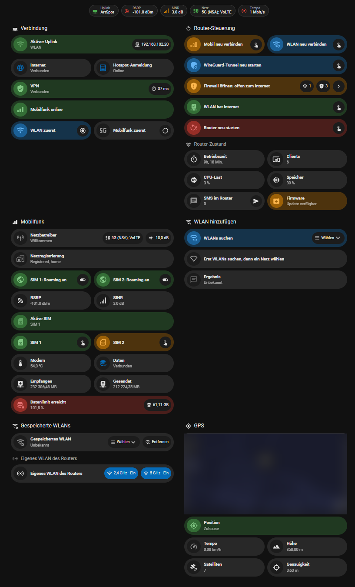
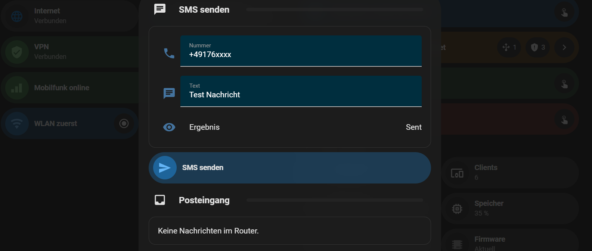
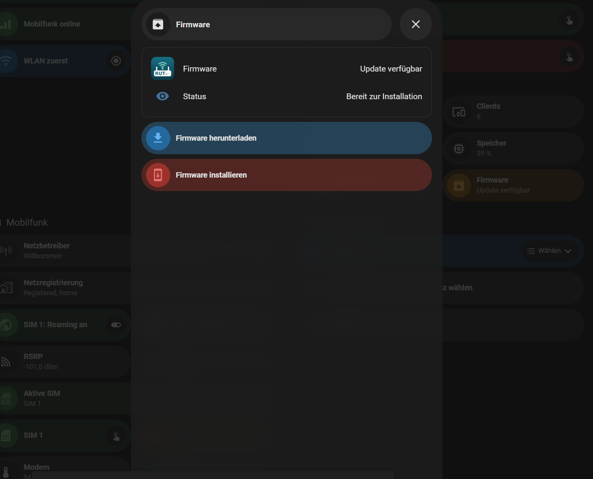

# Dashboard für Teltonika Control

[English](dashboard.md) | **Deutsch**

Ein fertiges Dashboard für deinen Router. Es zeigt den aktiven Uplink, den
Zustand von WLAN und Mobilfunkdaten und bietet dir Buttons für die Aktionen,
die du unterwegs brauchst: WLAN zuerst oder Mobilfunk zuerst, Hotspot-Anmeldung,
Neustart der Mobilfunkverbindung, SIM-Wechsel und das Schalten des
Router-eigenen WLANs.

Das Design nutzt farbige Pills in zwei Spalten mit farbcodierten Badges
oben, im Stil der Frontend-Karten Bubble Card und Mushroom. Die Datei ist
[dashboards/teltonika-control.yaml](../dashboards/teltonika-control.yaml).



Der Screenshot zeigt die deutsche Oberfläche eines RUTC50 in einem Wohnmobil.
Die Karte ist unkenntlich gemacht. Deine Bezeichnungen folgen der Sprache
deines Home Assistant.

<a id="what-you-need"></a>

## Was du brauchst

Voraussetzungen für die Integration:

- Teltonika Control ist installiert und eingerichtet, siehe die
  [Anleitung zum Einstieg](getting-started.de.md).
- Die aktuelle Version der Integration; die Datei passt zum neuesten Release.
  Pills für optionale Funktionen (VPN, WireGuard, Failover, Datenlimit,
  Firewall, SMS, Firmware) blenden sich selbst aus, solange ihre Entitäten
  nicht existieren, und du kannst die löschen, die du nicht willst. Bei einer
  älteren Version löschst du die Pills, deren Entitäten es noch nicht gibt,
  siehe das [Changelog](../CHANGELOG.de.md).
- Home Assistant 2024.8 oder neuer für die Button-Einstellung `perform-action`.

Voraussetzungen nur für dieses Dashboard. Sie werden weder für die
Integration noch für ein anderes deiner Dashboards gebraucht:

- **Bubble Card** (Frontend, HACS) zeichnet die Pills und die Buttons. Das
  Dashboard funktioniert ohne sie nicht. Die Pop-ups für SMS und Firmware
  brauchen Version 3.2.0 oder neuer.
- **Mushroom** (Frontend, HACS) zeichnet die farbigen Badges oben. Es ist
  optional: Lösche den Block `badges:` aus der Datei, wenn du es nicht
  installieren willst.

Installiere sie in HACS unter **Frontend**, starte danach neu oder lade die
Browserseite neu und mach dann mit Schritt 1 weiter.

Die **VPN**-Pill braucht keine zusätzliche Karte. Sie bleibt ausgeblendet, bis
du in den Optionen der Integration einen Host für den VPN-Test einträgst, siehe
[Schritt 12 der Anleitung zum Einstieg](getting-started.de.md#step-12-optional-vpn-check).

<a id="step-1-list-your-entity-ids"></a>

## Schritt 1: Entitäts-IDs auflisten

Entitäts-IDs entstehen aus dem Gerätenamen, dem Entitätsnamen und dem Bereich.
Sie unterscheiden sich zwischen Installationen und zwischen Sprachen, deshalb
enthält die Dashboard-Datei Platzhalter. Hol dir zuerst deine echten IDs:

1. Öffne **Entwicklerwerkzeuge**, **Template**.
2. Füge das folgende Template ein. Es listet jede Entität der Integration auf.

```jinja

{{ e }}  -  {{ state_attr(e, 'friendly_name') }}

```

Lass das Ergebnis offen, du brauchst es im nächsten Schritt. Deaktivierte
Entitäten werden nicht aufgelistet. Das Dashboard nutzt keine davon.

<a id="step-2-adjust-the-placeholders"></a>

## Schritt 2: Platzhalter anpassen

Die Datei verwendet in allen Entitäts-IDs zwei Platzhalter:

| Platzhalter | Ersetzen durch | Beispiel |
|---|---|---|
| `my_router` | der Teil deiner Router-Entitäts-IDs vor dem Entitätsnamen | `rutc50_lan` |
| `my_modem` | dasselbe für die Modem-Entitäten | `internal_modem` |

Für die Entität `sensor.my_router_uplink` zeigt deine Liste zum Beispiel
`sensor.rutc50_lan_uplink`, also wird `my_router` zu `rutc50_lan`. Wenn du den
Router einem Bereich zuordnest, ist der Bereich Teil des Präfixes, zum Beispiel
`it_equipment_rutc50_lan`.

Nutze Suchen und Ersetzen in einem Texteditor an einer Kopie der Datei:

1. Ersetze `my_router` durch das Präfix deines Routers.
2. Ersetze `my_modem` durch das Präfix deines Modems.
3. Ersetze `my_wifi` in den beiden Switch-Entitäten durch den Namen des
   Router-eigenen WLANs, so wie er in deiner Liste steht.
4. Ersetze `homebase` in den beiden WireGuard-Entitäten durch den Namen deiner
   WireGuard-Instanz oder lösche diese Pill, wenn du keine hast.
5. Ersetze `sim_1` in den Entitäten des Datenlimits durch deinen SIM-Slot.
   Lösche die Blöcke, die du nicht brauchst. Sie blenden sich selbst aus,
   solange ihre Entitäten nicht existieren. Die Failover-Pill braucht keine
   Änderung, sie nutzt die Entität, die es auf jedem Router einmal je Art gibt.
   Die **Firewall**-Pill verlinkt auf das
   [Firewall-Dashboard](firewall-dashboard.de.md) und braucht nur das
   Router-Präfix.

Läuft Home Assistant nicht auf Englisch, steht auch die Endung jeder
Entitäts-ID in dieser Sprache (zum Beispiel `uplink_ip_adresse` auf Deutsch).
Vergleiche jede ID in der Datei mit deiner Liste und korrigiere die, die
abweichen. Diese Entitäten nutzt das Dashboard:

| Name in der deutschen Oberfläche | Platzhalter-ID in der Datei |
|---|---|
| Uplink | `sensor.my_router_uplink` |
| Uplink-IP-Adresse | `sensor.my_router_uplink_ip_address` |
| WLAN-Netz | `sensor.my_router_wi_fi_network` |
| WLAN-Signal | `sensor.my_router_wi_fi_signal` |
| WLAN-Band | `sensor.my_router_wi_fi_band` |
| WLAN-Verbindungsgeschwindigkeit | `sensor.my_router_wi_fi_link_speed` |
| Hotspot-Anmeldung | `sensor.my_router_hotspot_login` |
| Internet | `binary_sensor.my_router_internet` |
| VPN erreichbar (optional) | `binary_sensor.my_router_vpn_reachable` |
| VPN-Latenz (optional) | `sensor.my_router_vpn_latency` |
| WireGuard aktiviert (optional, eine je Instanz) | `switch.my_router_wireguard_homebase_enabled` |
| WireGuard neu verbinden (optional) | `button.my_router_reconnect_wireguard_homebase` |
| Betriebszeit | `sensor.my_router_uptime` |
| DHCP-Clients | `sensor.my_router_dhcp_clients` |
| CPU-Last | `sensor.my_router_cpu_load` |
| Speicherauslastung | `sensor.my_router_memory_usage` |
| Uplink-Priorität | `select.my_router_uplink_priority` |
| WLAN neu verbinden | `button.my_router_reconnect_wi_fi` |
| Router neu starten | `button.my_router_reboot_router` |
| Access Point (einer je WLAN-Band) | `switch.my_router_access_point_my_wifi_2_4_ghz` |
| Netzbetreiber | `sensor.my_modem_operator` |
| Netzwerktyp | `sensor.my_modem_network_type` |
| Netzregistrierung | `sensor.my_modem_network_registration` |
| Roaming | `binary_sensor.my_modem_roaming` |
| Daten-Roaming SIM 1 erlauben, SIM 2 | `switch.my_modem_allow_data_roaming_sim_1`, `_sim_2` |
| Band | `sensor.my_modem_band` |
| RSRP, RSRQ, SINR | `sensor.my_modem_rsrp`, `_rsrq`, `_sinr` |
| Temperatur | `sensor.my_modem_temperature` |
| Datenverbrauch heute, Datenverbrauch Monat (optional) | `sensor.my_router_data_used_today`, `sensor.my_router_data_used_this_month` |
| Mobile Daten verbunden | `binary_sensor.my_modem_mobile_data_connected` |
| Keine SIM im aktiven Slot | `binary_sensor.my_modem_no_sim_in_the_active_slot` |
| Datenlimit genutzt, Datenverbrauch, Datenlimit erreicht (optional, je SIM) | `sensor.my_router_data_limit_used_sim_1`, `sensor.my_router_data_used_sim_1`, `binary_sensor.my_router_data_limit_reached_sim_1` |
| Failover Mobilfunk online (optional) | `binary_sensor.my_router_failover_mobile_online` |
| Offene Portweiterleitungen, Firewall-Regeln zum Internet offen (optional) | `sensor.my_router_open_port_forwards`, `sensor.my_router_firewall_rules_open_to_the_internet` |
| SMS-Nachrichten, Firmware (optional) | `sensor.my_router_sms_messages`, `update.my_router_firmware` |
| SMS-Nummer, SMS-Text, SMS senden, SMS-Sendeergebnis (optional, für das Pop-up) | `text.my_router_sms_number`, `text.my_router_sms_text`, `button.my_router_send_sms`, `sensor.my_router_sms_send_result` |
| Firmware-Status, Firmware herunterladen, Firmware installieren (optional, für das Pop-up) | `sensor.my_router_firmware_status`, `button.my_router_download_firmware`, `button.my_router_install_firmware` |
| Mobilfunk neu verbinden | `button.my_modem_restart_mobile_connection` |
| SIM-Slot | `select.my_modem_sim_slot` |
| WLANs suchen | `button.my_router_scan_for_wi_fi_networks` |
| Gefundene WLANs | `select.my_router_found_networks` |
| WLAN-Passwort | `text.my_router_wi_fi_password` |
| Ausgewähltes WLAN hinzufügen | `button.my_router_add_selected_network` |
| Letzte WLAN-Aktion | `sensor.my_router_last_wi_fi_action` |
| Gespeicherte WLANs | `select.my_router_saved_networks` |
| Ausgewähltes WLAN verbinden | `button.my_router_connect_selected_network` |
| Ausgewähltes WLAN entfernen | `button.my_router_remove_selected_network` |
| Position | `device_tracker.my_router_position` |
| GPS-Geschwindigkeit, -Höhe, -Satelliten, -Genauigkeit | `sensor.my_router_gps_speed`, `_gps_altitude`, `_gps_satellites`, `_gps_accuracy` |

Ein Router ohne zweite SIM hat keine Auswahl **SIM-Slot**, ein Router ohne
WLAN hat keine WLAN-Entitäten und ein Router ohne GPS hat keine GPS-Entitäten.
Lösche die Karten für Entitäten, die du nicht hast.

<a id="step-3-create-the-dashboard"></a>

## Schritt 3: Dashboard anlegen

1. Öffne **Einstellungen**, **Dashboards**, **Dashboard hinzufügen**.
2. Wähle **Neues Dashboard von Grund auf**, gib ihm einen Namen wie
   `Teltonika Control` und lege es an.
3. Öffne das neue Dashboard, wähle den Stift (Bearbeiten), dann die drei Punkte
   und **Roh-Konfigurationseditor**.
4. Ersetze den Inhalt durch deine angepasste Datei und speichere.

Zeigt eine Karte „Entität nicht gefunden“, passt die ID in der Datei nicht zu
deiner Liste. Korrigiere diese Entität und speichere erneut.

<a id="what-the-cards-do"></a>

## Was die Karten tun

- **Badges** oben: Uplink, RSRP, SINR, Netzwerktyp und Geschwindigkeit, je nach
  Wert grün, orange oder rot gefärbt. Sie brauchen Mushroom.
- **Verbindung**: Die Pill des aktiven Uplinks ist grün bei WLAN, orange bei
  Mobilfunkdaten und rot bei allem anderen, mit der Uplink-IP als kleiner Pill.
  Die WLAN-Pill zeigt Band, Signal und Geschwindigkeit, wird orange, wenn das
  WLAN kein Internet hat (eine Hotspot-Anmeldeseite), und rot, wenn das WLAN
  weg ist. Die **VPN**-Pill ist grün mit der Latenz oder rot, wenn der Host
  hinter dem Tunnel nicht antwortet. Sie erscheint nur, wenn du in den Optionen
  einen Host für den VPN-Test einträgst, siehe den
  [VPN-Test](../README.de.md#vpn-check). Eine **Failover**-Pill für
  Mobilfunkdaten ist grün, solange der Test des Routers eine Mobilfunk-Schnittstelle
  als online meldet, und rot, wenn keine online ist. Eine WLAN-Pill gibt es
  nicht, weil der Test des Routers für ein funktionierendes WLAN `offline`
  melden kann, siehe [Failover](../README.de.md#failover).
- **WLAN zuerst und Mobilfunk zuerst** sind zwei Buttons ohne Dropdown. Die
  aktive Priorität ist gefärbt, die andere grau, sodass sie auch den aktuellen
  Zustand zeigen. Sie rufen `teltonika_control.set_priority` auf. Bei WLAN
  zuerst geht die Integration zurück auf Mobilfunkdaten, wenn das WLAN nach
  25 Sekunden kein Internet hat.
- **Routersteuerung**: Mobilfunkverbindung neu starten, WLAN neu verbinden und
  den Router neu starten. Der Hotspot-Button ändert sich mit dem Zustand: Er
  startet `teltonika_control.portal_mode`, zeigt, dass er wartet, und meldet,
  wann das WLAN Internet hat, siehe
  [Hotspots mit Anmeldeseite](../README.de.md#hotspots-with-a-login-page). Hat
  der Router eine WireGuard-Instanz, erscheint eine Pill **WireGuard-Tunnel neu
  starten**, solange die Instanz eingeschaltet ist (ersetze `homebase` in ihren
  zwei Entitäts-IDs durch den Namen deiner Instanz oder lösche die Pill).
- **Firewall**: Die Pill **Firewall öffnen** öffnet das separate
  [Firewall-Dashboard](firewall-dashboard.de.md) mit den Portweiterleitungen und
  Verkehrsregeln. Sie verlinkt nur dorthin und ändert nichts, der Pfeil rechts
  daran zeigt das. Sie ist grün, solange nichts zum Internet offen ist. Sobald
  eine Portweiterleitung oder eine Regel an ist, wird sie orange und zeigt zwei
  kleine Zähler, die eingeschalteten Portweiterleitungen und die zum Internet
  offenen Regeln. Sie erscheint nur, solange der Router solche Regeln hat.
- **Router-Zustand**, unter der Pill zum Neustart: Betriebszeit, DHCP-Clients,
  CPU-Last und Speicherauslastung.
- **SMS und Firmware** (optional, jede Pill blendet sich selbst aus, solange der
  Router die Daten nicht anbietet): **SMS im Router** zeigt die Zahl der
  gespeicherten Nachrichten. Ein Tipp darauf oder auf das kleine Sendesymbol
  öffnet das Pop-up **SMS senden** mit den Feldern für Nummer und Text, einem
  Senden-Button, der nach Bestätigung fragt, und dem **Posteingang** mit den
  neuesten Nachrichten. **Firmware** ist orange mit „Update verfügbar“, solange
  der Router ein neueres stabiles Release gefunden hat. Ein Tipp darauf öffnet
  das Pop-up **Firmware** mit dem Update-Zustand, der installierten Version, der
  neuen Version (nur solange der Router eine gefunden hat), dem Status und den
  Buttons **Firmware herunterladen** und **Firmware installieren**, beide mit
  Bestätigung. Die Entität zum Installieren ist standardmäßig deaktiviert, siehe
  [Firmware-Update](../README.de.md#firmware-update).
- **Mobile Daten**: Netzbetreiber, Netzwerktyp, eine Pill **Netzregistrierung**
  (schlicht zuhause, orange beim Roaming), zwei Pills für das Daten-Roaming von
  SIM 1 und SIM 2 (grün bei an, grau bei aus, mit einem Switch rechts; zum
  Ändern tippen, und das Erlauben fragt nach Bestätigung), Signalwerte, die
  aktive SIM mit den Buttons SIM 1 und SIM 2, Modemtemperatur sowie der
  Datenverbrauch heute und in diesem Monat. Unter **Verbindung** erscheint eine
  rote Pill **Keine SIM im aktiven Slot**, solange der aktive Slot leer ist.
  Eine Pill **Datenlimit** (nur wenn am Router ein Limit gesetzt ist) zeigt den
  genutzten Teil des Limits in Prozent, orange ab 80 Prozent und rot, wenn das
  Limit erreicht ist, mit dem verbrauchten Datenvolumen als kleiner Pill.
- **WLAN-Netz hinzufügen**, in drei Schritten:
  1. Drücke **Suchen** (die Pill) und wähle mit **Auswählen** ein Netz. Die
     Liste blendet Netze aus, die im selben Band schon gespeichert sind, und
     zeigt jedes Netz je Band einmal mit seinem besten Signal.
  2. Das gewählte Netz ist hervorgehoben: Seine Pill bekommt einen grünen Rand
     und zeigt den Namen. Vor der Auswahl steht ein grauer Hinweis „Erst
     suchen, dann ein Netz auswählen“.
  3. Drücke an der hervorgehobenen Pill den Button **Passwort** (Schlüssel), um
     das Passwort einzugeben. Ein gesichertes Netz braucht eines mit
     mindestens 8 Zeichen, offene Netze brauchen keins. Drücke dann
     **Hinzufügen**. Zeigt der Schlüssel-Button in deiner Home-Assistant-Version
     kein Eingabefeld, nutze stattdessen die Aktion
     `teltonika_control.join_wifi`, siehe die
     [Anleitung zum Einstieg](getting-started.de.md#add-a-wi-fi-network).

  Die Ergebnis-Pill sagt dir, was passiert ist. Mobilfunkdaten bleiben
  bevorzugt, ein neues Netz kann deine Verbindung also nie von selbst
  unterbrechen.
- **Gespeicherte WLANs**: Wähle ein gespeichertes Netz (einen WLAN-Client oder
  einen Eintrag der Multi-AP-Liste) und drücke **Verbinden**, damit der Router
  es jetzt versucht (ein Multi-AP-Eintrag rückt an den Anfang der Liste), oder
  **Entfernen**. Der letzte Multi-AP-Eintrag lässt sich nicht entfernen. Darunter
  hat das Router-eigene WLAN einen Switch je Band.
- **GPS**: eine Karte mit der Position des Routers sowie Geschwindigkeit, Höhe,
  Satelliten und Genauigkeit, bei Routern mit GPS.

Jede Aktion, die die Verbindung unterbricht, fragt vorher nach Bestätigung.

<a id="pop-ups-sms-and-firmware"></a>

### Pop-ups: SMS und Firmware

Beide Pop-ups öffnen sich über eine Pill. Die Nummer im SMS-Bild ist
unkenntlich gemacht.





Es sind eigenständige Bubble-Card-Pop-ups (Bubble Card 3.2.0 oder neuer, die
Karten darin stehen unter `cards`) am Ende des Abschnitts, und sie brauchen
keinen Platz, bis sie geöffnet werden. Der große Pop-up-Header ist ausgeblendet
(`show_header: false`) und eine **separator**-Karte ist die Überschrift. Schließe
ein Pop-up, indem du außerhalb davon tippst, oder entferne diese Zeile, um den
Header mit dem Schließen-Button zurückzubekommen. Wenn du für die SMS-Felder
lieber eine eigene Seite willst, nutze
[dashboards/teltonika-sms.yaml](../dashboards/teltonika-sms.yaml) und lass die
Pill dorthin navigieren, so wie es die Firewall-Pill tut.

<a id="what-the-small-buttons-on-the-right-mean"></a>

### Was die kleinen Buttons rechts bedeuten

Die Farbe einer Pill zeigt ihren Zustand, aber nicht, dass du sie antippen
kannst. Jede Pill, die etwas tut, hat deshalb rechts einen kleinen Button, und
eine Pill ohne ihn zeigt nur einen Wert:

| Kleiner Button | Bedeutung | Wo |
|---|---|---|
| Tippende Hand (`mdi:gesture-tap`) | Eine einmalige Aktion: zum Ausführen tippen | Mobilfunk neu verbinden, WLAN neu verbinden, WireGuard neu starten, die Pill für die Hotspot-Anmeldung, SIM 1 und SIM 2, Router neu starten |
| Switch, an oder aus | Ein Switch mit zwei Zuständen, so angezeigt, wie er gerade ist | Daten-Roaming von SIM 1 und SIM 2 |
| Gefüllter oder leerer Kreis | Eine Wahl aus zwei: der gefüllte ist aktiv | WLAN zuerst und Mobilfunk zuerst |
| Text „An“ oder „Aus“ | Der Zustand des Router-eigenen WLANs je Band | Router-eigenes WLAN (2,4 GHz und 5 GHz) |

Der kleine Button tut dasselbe wie die Pill, einschließlich der Bestätigung.
Pills für Werte (Uplink, Internet, Signal, Zähler) haben keinen Steuerbutton;
kleine Pills mit einem Wert (IP-Adresse, Latenz, verbrauchte Daten) sind nur
Beschriftungen.

Wenn sie dir nicht gefallen, lösche den Block `sub_button` der Pill.

Sieht eine Pill schlicht aus oder zeigt einen Fehler, ist Bubble Card nicht
installiert oder noch nicht geladen. Lade die Browserseite nach der
Installation neu (Strg+F5).

<a id="what-is-not-included"></a>

## Was nicht enthalten ist

Ein Monatszähler für Router ohne Datenlimit gehört nicht zu diesem Dashboard.
Das Dashboard zeigt das Datenlimit des Routers (siehe **Mobile Daten** oben).
Ohne Limit am Router nutze einen Utility-Meter-Helfer auf den Datenzählern des
Modems, siehe
[Schritt 11 der Anleitung zum Einstieg](getting-started.de.md#step-11-optional-helpers-for-a-monthly-data-counter).

Das Dashboard selbst braucht keine Helfer, Skripte oder YAML-Pakete.

<a id="see-also"></a>

## Siehe auch

- [Anleitung zum Einstieg](getting-started.de.md)
- [Firewall-Dashboard](firewall-dashboard.de.md)
- [README](../README.de.md)
