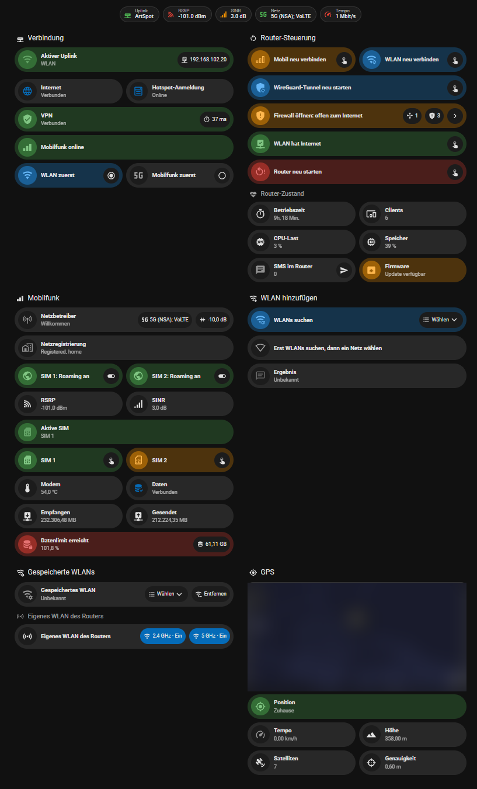

# Dashboard for Teltonika Control

A ready-made dashboard for your router. It shows the active uplink, the
Wi-Fi and mobile data state, and gives you buttons for the actions you need
on the road: Wi-Fi first or mobile first, hotspot login, restarting the
mobile connection, switching the SIM and switching the router's own Wi-Fi.

The design uses coloured pills in two columns, with colour-coded badges at
the top, in the style of the Bubble Card and Mushroom frontend cards. The
file is [dashboards/teltonika-control.yaml](../dashboards/teltonika-control.yaml).



The screenshot shows the German interface of a RUTC50 in a camper. The map is
blurred. Your labels follow your Home Assistant language.

## What you need

Prerequisites for the integration:

- Teltonika Control installed and set up, see the
  [getting started guide](getting-started.md).
- Version 0.5.0 or newer of the integration. It accepts a service target
  (an entity of your router, so no device ID is needed), has the Wi-Fi
  management entities, the WireGuard entities and the router health sensors.
  With an older version, delete the **Restart WireGuard tunnel** pill and the
  **Router health** block from the file. Version 0.6.0 or newer is
  recommended, because it polls the router much more gently.
- Home Assistant 2024.8 or newer for the `perform-action` button setting.

Prerequisites for this dashboard only. They are not needed for the
integration and not for any other dashboard of yours:

- **Bubble Card** (Frontend, HACS) draws the pills and the buttons. The
  dashboard does not work without it.
- **Mushroom** (Frontend, HACS) draws the coloured badges at the top. It is
  optional: delete the `badges:` block from the file if you do not want to
  install it.

Install them in HACS under **Frontend**, restart or reload the browser page
afterwards, and then continue with step 1.

The **VPN** pill needs no extra card. It stays hidden until you set a VPN
check host in the integration options, see
[step 12 of the getting started guide](getting-started.md#step-12-optional-vpn-check).

## Step 1: List your entity IDs

Entity IDs are created from the device name, the entity name and the area.
They differ between installations and between languages, so the dashboard
file contains placeholders. Get your real IDs first:

1. Go to **Developer tools**, **Template**.
2. Paste the template below. It lists every entity of the integration.

```jinja

{{ e }}  -  {{ state_attr(e, 'friendly_name') }}

```

Keep the result open, you need it in the next step. Disabled entities are not
listed. The dashboard does not use any of them.

## Step 2: Adjust the placeholders

The file uses two placeholders in all entity IDs:

| Placeholder | Replace with | Example |
|---|---|---|
| `my_router` | the part of your router entity IDs before the entity name | `rutc50_lan` |
| `my_modem` | the same for the modem entities | `internal_modem` |

For the entity `sensor.my_router_uplink` your list shows, for example,
`sensor.rutc50_lan_uplink`, so `my_router` becomes `rutc50_lan`. If you put
the router into an area, the area is part of the prefix, for example
`it_equipment_rutc50_lan`.

Use find and replace in a text editor on a copy of the file:

1. Replace `my_router` with your router prefix.
2. Replace `my_modem` with your modem prefix.
3. Replace `my_wifi` in the two switch entities with the name of your
   router's own Wi-Fi, as it appears in your list.
4. Replace `homebase` in the two WireGuard entities with the name of your
   WireGuard instance, or delete that pill if you have none.

If Home Assistant runs in another language than English, the ending of each
entity ID is in that language too (for example `uplink_ip_adresse` in
German). Compare each ID in the file with your list and fix the ones that
differ. These are the entities the dashboard uses:

| Name in the English interface | Placeholder ID in the file |
|---|---|
| Uplink | `sensor.my_router_uplink` |
| Uplink IP address | `sensor.my_router_uplink_ip_address` |
| Wi-Fi network | `sensor.my_router_wi_fi_network` |
| Wi-Fi signal | `sensor.my_router_wi_fi_signal` |
| Wi-Fi band | `sensor.my_router_wi_fi_band` |
| Wi-Fi link speed | `sensor.my_router_wi_fi_link_speed` |
| Hotspot login | `sensor.my_router_hotspot_login` |
| Internet | `binary_sensor.my_router_internet` |
| VPN reachable (optional) | `binary_sensor.my_router_vpn_reachable` |
| VPN latency (optional) | `sensor.my_router_vpn_latency` |
| WireGuard enabled (optional, one per instance) | `switch.my_router_wireguard_homebase_enabled` |
| Reconnect WireGuard (optional) | `button.my_router_reconnect_wireguard_homebase` |
| Uptime | `sensor.my_router_uptime` |
| DHCP clients | `sensor.my_router_dhcp_clients` |
| CPU load | `sensor.my_router_cpu_load` |
| Memory usage | `sensor.my_router_memory_usage` |
| Uplink priority | `select.my_router_uplink_priority` |
| Reconnect Wi-Fi | `button.my_router_reconnect_wi_fi` |
| Reboot router | `button.my_router_reboot_router` |
| Access point (one per Wi-Fi band) | `switch.my_router_access_point_my_wifi_2_4_ghz` |
| Operator | `sensor.my_modem_operator` |
| Network type | `sensor.my_modem_network_type` |
| Network registration | `sensor.my_modem_network_registration` |
| Roaming | `binary_sensor.my_modem_roaming` |
| Allow data roaming SIM 1, SIM 2 | `switch.my_modem_allow_data_roaming_sim_1`, `_sim_2` |
| Band | `sensor.my_modem_band` |
| RSRP, RSRQ, SINR | `sensor.my_modem_rsrp`, `_rsrq`, `_sinr` |
| Temperature | `sensor.my_modem_temperature` |
| Data received, Data sent | `sensor.my_modem_data_received`, `_data_sent` |
| Mobile data connected | `binary_sensor.my_modem_mobile_data_connected` |
| Restart mobile connection | `button.my_modem_restart_mobile_connection` |
| SIM slot | `select.my_modem_sim_slot` |
| Scan for Wi-Fi networks | `button.my_router_scan_for_wi_fi_networks` |
| Found networks | `select.my_router_found_networks` |
| Wi-Fi password | `text.my_router_wi_fi_password` |
| Add selected network | `button.my_router_add_selected_network` |
| Last Wi-Fi action | `sensor.my_router_last_wi_fi_action` |
| Saved networks | `select.my_router_saved_networks` |
| Remove selected network | `button.my_router_remove_selected_network` |
| Position | `device_tracker.my_router_position` |
| GPS speed, altitude, satellites, accuracy | `sensor.my_router_gps_speed`, `_gps_altitude`, `_gps_satellites`, `_gps_accuracy` |

A router without a second SIM has no **SIM slot** select, a router without
Wi-Fi has no Wi-Fi entities and a router without GPS has no GPS entities.
Delete the cards for entities you do not have.

## Step 3: Create the dashboard

1. Go to **Settings**, **Dashboards**, **Add dashboard**.
2. Choose **New dashboard from scratch**, give it a name such as
   `Teltonika Control` and create it.
3. Open the new dashboard, select the pencil (edit), then the three dots and
   **Raw configuration editor**.
4. Replace the content with your adjusted file and save.

If a card shows "Entity not found", the ID in the file does not match your
list. Fix that entity and save again.

## What the cards do

- **Badges** at the top: uplink, RSRP, SINR, network type and speed, coloured
  green, orange or red by value. They need Mushroom.
- **Connection**: the active uplink pill is green for Wi-Fi, orange for mobile
  data and red for anything else, with the uplink IP as small pill. The Wi-Fi
  pill shows band, signal and speed, turns orange when the Wi-Fi has no
  internet (a hotspot login page) and red when the Wi-Fi is gone. The **VPN**
  pill is green with the latency or red when the host behind the tunnel does
  not answer. It only appears when you set a VPN check host in the options,
  see the [VPN check](../README.md#vpn-check).
- **Wi-Fi first and Mobile first** are two buttons without a drop-down. The
  active priority is coloured, the other one is grey, so they also show the
  current state. They call `teltonika_control.set_priority`. With Wi-Fi
  first, the integration goes back to mobile data when the Wi-Fi has no
  internet after 25 seconds.
- **Router control**: restart the mobile connection, reconnect the Wi-Fi and
  reboot the router. With a WireGuard instance on the router, a **Restart
  WireGuard tunnel** pill appears while the instance is switched on (replace
  `homebase` in its two entity IDs with the name of your instance, or delete
  the pill). Below the reboot pill, **Router health** shows uptime, DHCP
  clients, CPU load and memory usage. The hotspot button changes with the
  state: it starts
  `teltonika_control.portal_mode`, shows that it waits, and reports when
  the Wi-Fi has internet. See
  [hotspots with a login page](../README.md#hotspots-with-a-login-page).
- **Mobile data**: operator, network type, a **Network registration** pill
  (plain at home, orange while roaming), two pills for the data roaming of SIM
  1 and SIM 2 (green when allowed, grey when denied; tap to change, and
  allowing asks for confirmation), signal values, the active SIM with
  SIM 1 and SIM 2 buttons, modem temperature and the data counters.
- **Add a Wi-Fi network**, in three steps:
  1. Press **Scan** (the pill) and choose a network with **Choose**. The list
     hides networks that are already saved in the same band and shows each
     network once per band with its best signal.
  2. The chosen network is highlighted: its pill gets a green border and
     shows the name. Before you choose, a grey hint says "Scan first, then
     choose a network".
  3. On the highlighted pill, press the **Password** (key) button to enter the
     password. A secured network needs one of at least 8 characters, open
     networks need none. Then press **Add**. If the key button shows no
     input field in your Home Assistant version, use the action
     `teltonika_control.join_wifi` instead, see the
     [getting started guide](getting-started.md#add-a-wi-fi-network).

  The result pill tells you what happened. Mobile data stays preferred, so a
  new network never breaks your connection by itself.
- **Saved Wi-Fi networks**: choose a saved network (a Wi-Fi client or an entry
  of the Multi AP list) and press **Remove**. The last Multi AP entry cannot
  be removed. Below it, the router's own Wi-Fi has a switch per band.
- **GPS**: a map with the router's position plus speed, altitude, satellites
  and accuracy, on routers with GPS.

Every action that interrupts the connection asks for confirmation first.

If a pill looks plain or shows an error, Bubble Card is not installed or not
loaded yet. Reload the browser page (Ctrl+F5) after installing it.

## What is not included

A monthly data limit is not part of this dashboard. Use a Utility Meter
helper on the data counters of the modem if you need one, see
[step 11 of the getting started guide](getting-started.md#step-11-optional-helpers-for-a-monthly-data-counter).

The dashboard itself needs no helpers, scripts or YAML packages.

## See also

- [Getting started guide](getting-started.md)
- [README](../README.md)
