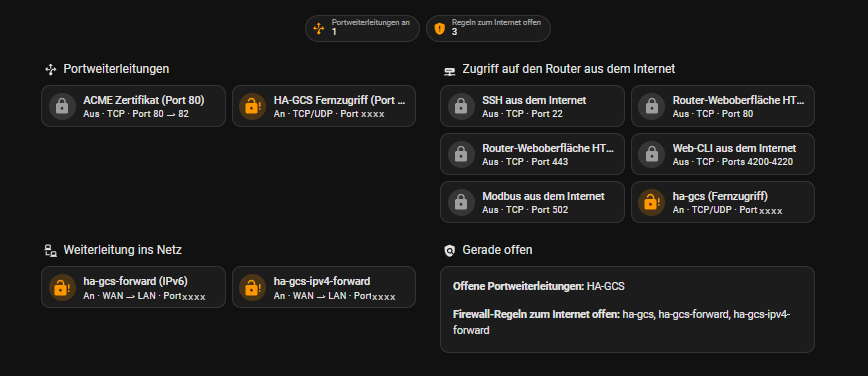

# Firewall-Dashboard

[English](firewall-dashboard.md) | **Deutsch**

Das Haupt-[Dashboard](dashboard.de.md) bleibt absichtlich klein. Die
Portweiterleitungen und Verkehrsregeln des Routers bekommen ein eigenes
Dashboard, das du nur brauchst, wenn dein Router solche Regeln hat und du sie
aus Home Assistant schalten willst. Das Haupt-Dashboard zeigt eine
**Firewall**-Pill, die es öffnet, aber nur, solange der Router
Portweiterleitungen oder Verkehrsregeln hat.



<a id="what-it-shows"></a>

## Was es zeigt

- **Portweiterleitungen**: eine Karte je Regel. Orange, solange die Regel an
  ist, grau, solange sie aus ist, mit Protokoll und Ports. Zum Schalten
  tippen, mit Bestätigung.
- **Zugriff auf den Router aus dem Internet**: die Verkehrsregeln, die das
  Internet an den Router selbst lassen. Bei einem Teltonika-Router sind das die
  Regeln `Enable_SSH_WAN`, `Enable_HTTP_WAN`, `Enable_HTTPS_WAN`,
  `Enable_CLI_WAN` und `Enable_MODBUSD_WAN`, die standardmäßig aus sind, plus
  Regeln, die du selbst angelegt hast.
- **Weiterleitung in dein Netz**: die Verkehrsregeln, die das Internet an
  Geräte hinter dem Router lassen. Sie gehören meist zu einer
  Portweiterleitung.
- **Was gerade an ist**: die Namen von allem, was offen ist, und zwei Badges
  mit den Anzahlen.

Die Karten listen die Regeln deines Routers von selbst auf. Eine Regel, die du
am Router hinzufügst, erscheint nach der nächsten Aktualisierung der
Integration, eine gelöschte Regel verschwindet. Dafür musst du das Dashboard
nicht bearbeiten.

<a id="what-you-need"></a>

## Was du brauchst

- Teltonika Control 0.11.0 oder neuer, mit einem Router-Benutzer, der die
  Firewall lesen und ändern darf (siehe die
  [Berechtigungen](../README.de.md#router-user-and-permissions)).
- Drei Frontend-Karten, installiert über HACS (Frontend) oder den Home
  Assistant Marketplace:
  - **Mushroom** (die Regelkarten und die Badges),
  - **auto-entities** (listet die Switches deines Routers auf),
  - **Bubble Card** für die Pill im Haupt-Dashboard.
- Home Assistant 2024.8 oder neuer.

Die Karten werden nur für dieses Dashboard gebraucht, nicht für die
Integration. Die Switches funktionieren ohne sie in jeder anderen Karte, in
Skripten und in Automatisierungen.

<a id="set-it-up"></a>

## Einrichten

1. Installiere die oben genannten Karten und lade die Browserseite neu
   (Strg+F5).
2. Öffne in Home Assistant **Einstellungen, Dashboards, Dashboard
   hinzufügen**, wähle **Neues Dashboard von Grund auf** und gib ihm den Titel
   **Teltonika Firewall**. Achte darauf, dass die URL auf `teltonika-firewall`
   endet, weil die Pill des Haupt-Dashboards auf `/teltonika-firewall`
   verlinkt.
3. Öffne das neue Dashboard, nutze die drei Punkte, **Dashboard bearbeiten**,
   wieder die drei Punkte, **Roh-Konfigurationseditor**, und füge den Inhalt
   von [dashboards/teltonika-firewall.yaml](../dashboards/teltonika-firewall.yaml)
   ein.
4. Ersetze `my_router` durch den Anfang deiner eigenen Entitäts-IDs. Du findest
   ihn unter **Einstellungen, Geräte & Dienste, Teltonika Control,
   Entitäten**: Für die Entität `sensor.rutc50_lan_open_port_forwards` ist das
   Präfix `rutc50_lan`. Das ist nur für die beiden Zähler nötig. Die
   Regelkarten finden deine Switches von selbst.
5. Läuft Home Assistant nicht auf Englisch, steht auch die Endung der beiden
   Entitäts-IDs der Zähler in dieser Sprache (zum Beispiel
   `offene_portweiterleitungen` auf Deutsch). Nutze die IDs aus deiner
   Entitätenliste.
6. Speichere. Zeigt eine Karte einen Fehler, fehlt eine Frontend-Karte oder sie
   ist noch nicht geladen.

<a id="how-the-cards-find-your-rules"></a>

## Wie die Karten deine Regeln finden

Die Switches der Integration tragen ein Attribut `kind`: `port_forward` oder
`traffic_rule`. Verkehrsregeln haben außerdem eine `group` (`access`, `forward`,
`system` oder `other`), nach der die Karten sie sortieren. Was jede Gruppe ist
und welche deaktiviert angelegt werden, steht in
[README, Firewall](../README.de.md#firewall).

Die eigenen Regeln des Routers (`system`) werden in Home Assistant
**deaktiviert** angelegt, sie erscheinen also nirgends, bis du sie unter
**Einstellungen, Geräte & Dienste, Teltonika Control, Entitäten** aktivierst.
Das Dashboard listet sie ebenfalls nicht auf.

<a id="safety"></a>

## Sicherheit

Eine Regel, die an ist, lässt Verkehr aus dem Internet an den Router oder an
ein Gerät in deinem Netz, und das Ausschalten der Regel, die deinen eigenen
Fernzugriff trägt, sperrt dich aus; die [README](../README.de.md#firewall)
erklärt beides. Für dieses Dashboard gilt:

- Schau dir den Namen an, bevor du bestätigst, und überlege, die Entität deines
  eigenen Fernzugriffs auszublenden, wenn andere das Dashboard nutzen.
- Gib Gästen keinen Zugriff auf dieses Dashboard.
- Das Ein- oder Ausschalten von Regeln kann Verbindungen kurz unterbrechen,
  während der Router seine Firewall neu lädt.

<a id="without-auto-entities"></a>

## Ohne auto-entities

Wenn du die zusätzliche Karte nicht willst, ersetze jeden Block
`custom:auto-entities` durch eine Standardkarte mit den Entitäten deiner
Regeln. Die Entitäts-IDs stammen aus deiner Entitätenliste:

```yaml
- type: entities
  title: Portweiterleitungen
  entities:
    - switch.my_router_port_forward_my_rule
    - switch.my_router_firewall_rule_enable_ssh_wan
```

Du fügst die Zeilen dann selbst hinzu und entfernst sie, wenn sich dein Router
ändert.

<a id="show-it-as-a-pop-up"></a>

## Als Pop-up anzeigen

Bubble Card (3.2.0 oder neuer) kann denselben Inhalt als Pop-up im
Haupt-Dashboard statt auf einer eigenen Seite zeigen. Setze die Karten des
Firewall-Dashboards in ein eigenständiges Pop-up und öffne es über die Pill:

```yaml
- type: custom:bubble-card
  card_type: pop-up
  hash: "#firewall"
  name: Firewall
  icon: mdi:shield-lock
  cards:
    # hier kommen die Karten des Firewall-Dashboards hin
    - type: markdown
      content: Ersetze diese Karte durch die Regelkarten.
```

Ändere dann die **Firewall**-Pill des Haupt-Dashboards auf
`navigation_path: "#firewall"`. Ein eigenes Dashboard lässt sich leichter
aktuell halten, das Pop-up hält alles auf einer Seite.

<a id="automation-warn-when-a-port-stays-open"></a>

## Automatisierung: warnen, wenn ein Port offen bleibt

Die Zähler und ihr Attribut `rules` sind für Automatisierungen gemacht. Diese
benachrichtigt dich, wenn etwas zwei Stunden lang zum Internet offen war, und
nennt es beim Namen:

```yaml
alias: Router-Firewall lange offen
triggers:
  - trigger: numeric_state
    entity_id:
      - sensor.my_router_open_port_forwards
      - sensor.my_router_firewall_rules_open_to_the_internet
    above: 0
    for: "02:00:00"
actions:
  - action: notify.notify
    data:
      title: Router-Firewall
      message: >-
        {{ trigger.to_state.name }} ist seit zwei Stunden zum Internet offen:
        {{ state_attr(trigger.entity_id, 'rules') | join(', ') }}
mode: single
```

Regeln, die du absichtlich öffnest, etwa die Regel für deinen eigenen
Fernzugriff, werden mitgezählt. Ist die immer an, löst die Benachrichtigung
jedes Mal aus. Nutze dann nur den Zähler der Portweiterleitungen oder schließe
die Regel mit einer Bedingung auf ihren Namen aus.

<a id="see-also"></a>

## Siehe auch

- [Dashboard-Anleitung](dashboard.de.md)
- [README, Firewall](../README.de.md#firewall)
