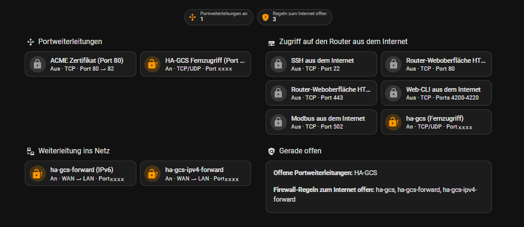

# Firewall dashboard

The main [dashboard](dashboard.md) stays small on purpose. The port forwards
and traffic rules of the router get their own dashboard, which you only need
when your router has such rules and you want to switch them from Home
Assistant. The main dashboard shows a **Firewall** pill that opens it, but only
while the router has port forwards or traffic rules.



## What it shows

- **Port forwards**: one card per rule. Orange while the rule is on, grey while
  it is off, with protocol and ports. Tap to switch, with confirmation.
- **Access to the router from the internet**: the traffic rules that let the
  internet reach the router itself. On a Teltonika router these are the
  `Enable_SSH_WAN`, `Enable_HTTP_WAN`, `Enable_HTTPS_WAN`, `Enable_CLI_WAN` and
  `Enable_MODBUSD_WAN` rules, which are off by default, plus rules you made
  yourself.
- **Forwarding to your network**: the traffic rules that let the internet reach
  devices behind the router. They usually belong to a port forward.
- **What is on right now**: the names of everything that is open, and two
  badges with the counts.

The cards list the rules of your router by themselves. A rule you add on the
router appears after the next update of the integration, a rule you delete
disappears. You do not edit the dashboard for that.

## What you need

- Teltonika Control 0.11.0 or newer, with the router user allowed to read and
  change the firewall (see the [permissions](../README.md#router-user-and-permissions)).
- Three frontend cards, installed through HACS (Frontend) or the Home
  Assistant Marketplace:
  - **Mushroom** (the rule cards and the badges),
  - **auto-entities** (lists the switches of your router),
  - **Bubble Card** for the pill on the main dashboard.
- Home Assistant 2024.8 or newer.

The cards are needed for this dashboard only, not for the integration. The
switches work without them in any other card, in scripts and in automations.

## Set it up

1. Install the cards named above and reload the browser page (Ctrl+F5).
2. In Home Assistant, go to **Settings, Dashboards, Add dashboard**, choose
   **New dashboard from scratch** and give it the title **Teltonika Firewall**.
   Make sure the URL ends with `teltonika-firewall`, because the pill of the
   main dashboard links to `/teltonika-firewall`.
3. Open the new dashboard, use the three dots, **Edit dashboard**, the three
   dots again, **Raw configuration editor**, and paste the content of
   [dashboards/teltonika-firewall.yaml](../dashboards/teltonika-firewall.yaml).
4. Replace `my_router` with the beginning of your own entity IDs. You find it in
   **Settings, Devices & services, Teltonika Control, Entities**: for the entity
   `sensor.rutc50_lan_open_port_forwards` the prefix is `rutc50_lan`. This is
   only needed for the two counters. The rule cards find your switches by
   themselves.
5. If Home Assistant runs in another language than English, the ending of the
   two counter entity IDs is in that language too (for example
   `offene_portweiterleitungen` in German). Use the IDs from your entity list.
6. Save. If a card shows an error, a frontend card is missing or not loaded yet.

## How the cards find your rules

The switches of the integration carry an attribute `kind`: `port_forward` or
`traffic_rule`. Traffic rules also have a `group` (`access`, `forward`, `system`
or `other`), which the cards use to sort them. What each group is, and which
ones are created disabled, is in [README, Firewall](../README.md#firewall).

The router's own rules (`system`) are created **disabled** in Home Assistant, so
they do not show up anywhere until you enable them under **Settings, Devices &
services, Teltonika Control, Entities**. The dashboard does not list them
either.

## Safety

A rule that is on lets traffic from the internet reach the router or a device
in your network, and switching off the rule that carries your own remote access
locks you out; the [README](../README.md#firewall) explains both. For this
dashboard:

- Look at the name before you confirm, and think about hiding the entity of
  your own remote access if others use the dashboard.
- Do not give guests access to this dashboard.
- Switching rules on or off can briefly interrupt connections while the router
  reloads its firewall.

## Without auto-entities

If you do not want the extra card, replace each `custom:auto-entities` block by
a core card with the entities of your rules. The entity IDs come from your
entity list:

```yaml
- type: entities
  title: Port forwards
  entities:
    - switch.my_router_port_forward_my_rule
    - switch.my_router_firewall_rule_enable_ssh_wan
```

You then add and remove the lines yourself when your router changes.

## Show it as a pop-up

Bubble Card (3.2.0 or newer) can show the same content as a pop-up on the main
dashboard instead of a separate page. Put the cards of the firewall dashboard
into a standalone pop-up and open it from the pill:

```yaml
- type: custom:bubble-card
  card_type: pop-up
  hash: "#firewall"
  name: Firewall
  icon: mdi:shield-lock
  cards:
    # the cards of the firewall dashboard go here
    - type: markdown
      content: Replace this card with the rule cards.
```

Then change the **Firewall** pill of the main dashboard to
`navigation_path: "#firewall"`. A separate dashboard is easier to keep up to
date, the pop-up keeps everything on one page.

## Automation: warn when a port stays open

The counters and their `rules` attribute are made for automations. This
notifies you when something has been open to the internet for two hours, and
names it:

```yaml
alias: Router firewall open for a long time
triggers:
  - trigger: numeric_state
    entity_id:
      - sensor.my_router_open_port_forwards
      - sensor.my_router_firewall_rules_open_to_the_internet
    above: 0
    for: "02:00:00"
actions:
  - action: notify.notify
    data:
      title: Router firewall
      message: >-
        {{ trigger.to_state.name }} has been open to the internet for two hours:
        {{ state_attr(trigger.entity_id, 'rules') | join(', ') }}
mode: single
```

Rules you open on purpose, such as the rule for your own remote access, are
counted too. If that is always on, the notification fires every time, so use
the counter of port forwards only, or exclude the rule with a condition on its
name.

## See also

- [Dashboard guide](dashboard.md)
- [README, Firewall](../README.md#firewall)
